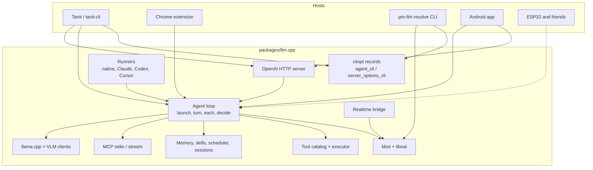
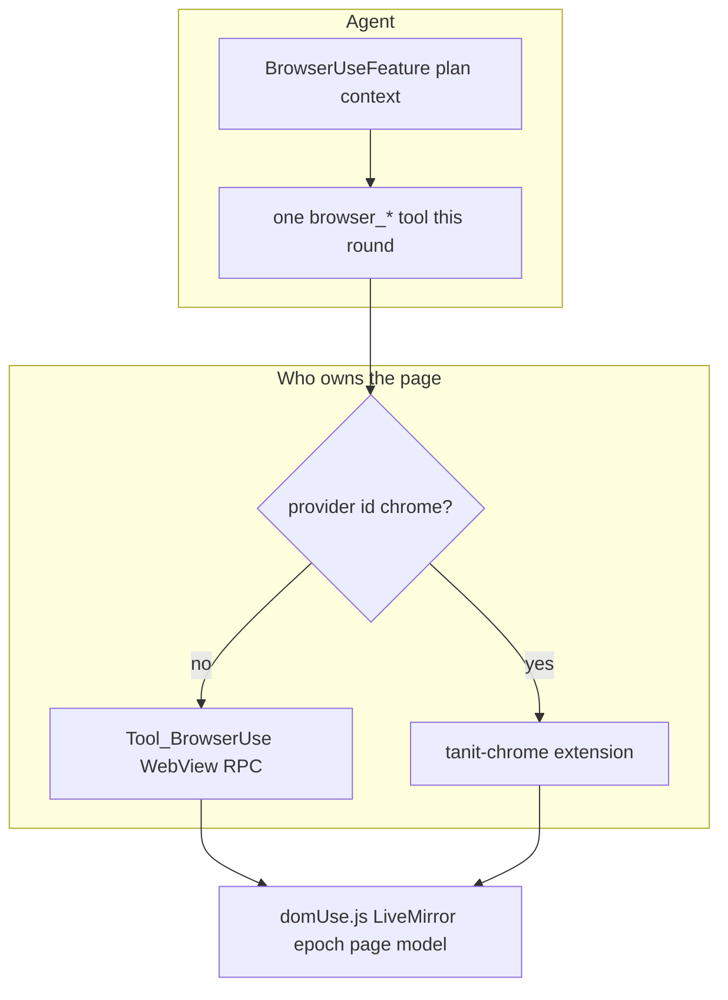
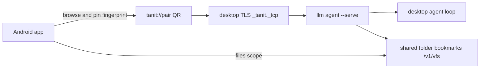
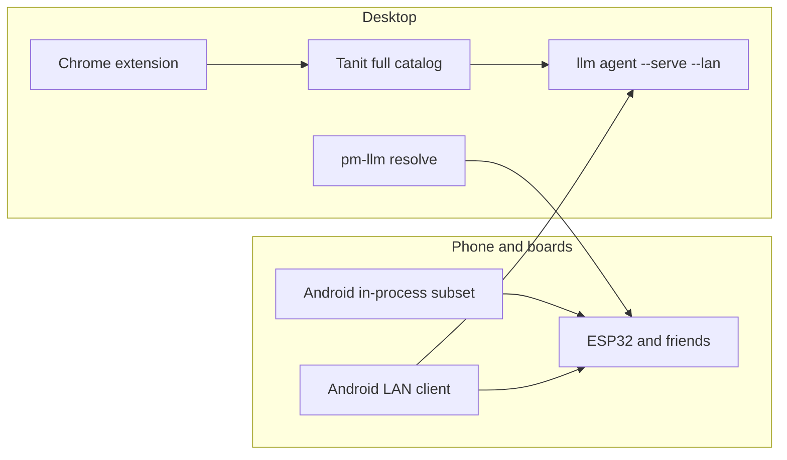

# llm.cpp

PolyMech agent layer. Status **2/3, experimental**: the loop, the harness, llama.cpp, realtime, and the tool catalog already run. The package is still being pulled out of Tanit, so a few host facts stay wired in.

Sources live under `src/`. Include root for `"llm/..."`, `"kbot.h"`, and `<liboai.h>` is `packages/llm.cpp/src`.

## What works

| Surface | Where | State |
|---|---|---|
| Agent loop, planner, memory, skills | `src/llm/agent*.cpp` | Runs inside Tanit and `tanit-cli` |
| Tool catalog and path-tool dispatch | `tool_catalog.cpp`, `path_tool_catalog.cpp`, `path_tool_executor.cpp`, `src/llm/tools/` | Catalog is shared. Desktop tools stay on the host lists |
| llama.cpp client | `llama_agent_client.cpp`, `llama_vlm_client.cpp` | Talks to the sibling `lib/llm` tree. This package links it and does not absorb it |
| Realtime voice | `realtime_voice_agent.cpp`, `realtime_agent_bridge.cpp`, `src/kbot/llm_client_realtime.cpp` | Speech session behind `FEATURE_REALTIME` |
| Harness | `tests/orchestrator/` | Dry loopback is the default. Live decide, context, and learn run against the configured provider. `iterator` live needs a chat router key |
| OpenAI HTTP server | `agent_openai_server.cpp` | `GET /health`, `GET /v1/models`, `POST /v1/chat/completions`, `POST /v1/llm/each`, `POST /v1/llm/decide`. Loopback suites pass on `tanit-cli` |
| Browser use | `tools/browser_use/`, `agent_feature_BrowserUse.cpp` | Centre WebView tabs. Same `browser_*` tools as the Chrome extension |
| App use | `tools/computer_use/Tool_ComputerUse.cpp` | Windows UI Automation: inspect, screenshot, click, type, hotkey |
| Chrome extension | `tanit-chrome` plus host provider `chrome` | Injects the same `domUse.js`. Wins over the in-app WebView when that provider is registered |
| Android on the LAN | phone client of `llm agent --serve --lan` | Pair over TLS, then chat, files, tools, and optional video run on the desktop |
| Standalone CLI | `cli/main.cpp` → `pm-llm` | Opens the same encrypted `pm://config/settings.json` as Tanit. `settings`, `agent`, and `serve` resolve and print JSON |

## Modules



A turn goes through one path:

```mermaid
sequenceDiagram
  participant Host as Host CLI or HTTP
  participant Opt as AgentServerOptions / AgentCliOptions
  participant Launch as resolve_agent_launch
  participant Loop as agent turn
  participant Tools as tool catalog
  participant Model as kbot / llama.cpp / runner

  Host->>Opt: fill flags and settings
  Opt->>Launch: preset, router, model, key
  Launch->>Loop: resolved provider
  Loop->>Model: prompt plus tool schemas
  Model-->>Loop: text or tool calls
  Loop->>Tools: dispatch
  Tools-->>Loop: tool results
  Loop-->>Host: final text and usage
```

### Client

`kbot` is one static library (`CMakeLists.txt` in this directory). It compiles the kbot wrapper and the liboai components: chat, completions, responses, embeddings, images, audio, and the realtime WebSocket client. The target name stays `kbot` because Tanit, the chat plugin, and Android already link it.

### Agent

| Piece | Files |
|---|---|
| Loop and factory | `agent.cpp`, `agent_factory.cpp`, `agent_launch.cpp`, `agent_turn_options.cpp`, `agent_commons.cpp`, `agent_context.cpp` |
| Decisions and iteration | `agent_decide.cpp`, `decisions.cpp`, `agent_each.cpp` |
| Loopback | `loopback_agent_client.cpp` |
| External runners | `agent_runner.cpp`, `agent_runner_claude_code.cpp`, `agent_runner_codex.cpp`, `agent_runner_cursor.cpp` |
| Memory and skills | `agent_memory.cpp`, `agent_memory_recall.cpp`, `agent_memory_artifacts.cpp`, `agent_skills.cpp`, `skills/skillshub.cpp`, `agent_scheduler.cpp`, `chat_session_store.cpp` |
| MCP | `mcp_config.cpp`, `mcp_stdio_client.cpp`, `mcp_stream_client.cpp`, `mcp_tools_cache.cpp`, `tools/mcp/` |
| CLI records | `agent_cli.hpp`, `agent_cli_launch.hpp`, `server_options_cli.hpp` |

`pm-llm` and Tanit fill the same option records. Tanit maps `PmImageCliState` in `src/cli/pm_image_cmd_llm_agent_server.cpp` and calls `run_llm_agent_openai_server`.

### Tools

`tool_catalog.cpp` publishes the schemas. `path_tool_executor.cpp` is the switchboard and still includes every tool header.

| Group | Directory | Notes |
|---|---|---|
| Files | `tools/fs`, `tools/commons` | Read, write, search, compose |
| Memory | `tools/memory` | Session memory tools. Android has its own TU |
| Pictures, audio, video | `tools/pictures`, `tools/audio`, `tools/video` | Host pipelines |
| Browser | `tools/browser_use` | `browser_read`, `browser_find`, `browser_scope`, `browser_click`, `browser_type`, `browser_select`, `browser_batch`, `browser_navigate` |
| App use | `tools/computer_use` | `app_inspect_dump`, `app_inspect_find`, `app_screenshot`, `app_click`, `app_drag`, `app_type`, `app_hotkey`, `app_open`, `app_close`, `app_batch` |
| Network | `tools/network` | SSH, MQTT, Modbus |
| Service | `tools/service` | CMS. `ServiceTools_Android.cpp` is the phone TU |
| Sequencer | `tools/sequencer` | xblox |
| Inquire, info, commands | `tools/inquire`, `tools/info`, `tools/command_creation` | CLI and desktop catalogs |
| Run | `tools/run` | Process launch |

### Local models and voice

`llama_agent_client.cpp` and `llama_vlm_client.cpp` call the sibling llama.cpp tree under `lib/llm`. Hugging Face download and discovery live in `src/llm/huggingface/`.

Realtime is `realtime_session_config.cpp`, `realtime_agent_bridge.cpp`, and `realtime_voice_agent.cpp`, with the socket client in `src/kbot/llm_client_realtime.cpp`. Mic and speaker stay in the host audio stack.

## Browser, apps, and the phone

Two page hosts share one runtime. The centre WebView and the Chrome extension both inject `domUse.js` and expose the same `browser_*` tools. One browser tool runs per round. A registered host provider named `chrome` takes the call. With no such provider, the call stays on the open centre tab.



| | In-app browser | Chrome extension | Desktop apps |
|---|---|---|---|
| Start | Centre browser tab in Tanit | Side panel, `tanit-chrome-host`, loopback agent | Foreground window via UI Automation |
| Tools | `browser_*` | Same names, thin catalog | `app_inspect_*`, `app_screenshot`, `app_click`, `app_type`, `app_hotkey`, `app_batch` |
| Page or window | `ExecuteScript` on the dock tab | `chrome.scripting.executeScript` | `app_inspect_dump`, then act on that session |
| Where the code sits | `tools/browser_use/`, `agent_feature_BrowserUse.cpp` | Extension plus HTTP `POST /api/agent-tools/call` | `tools/computer_use/Tool_ComputerUse.cpp` |

App use is Windows-only. The model dumps the tree, then clicks and types against that snapshot. Browser refs (`eN`, epoch) and app sessions are separate. Notes: `docs/browser-use.md`, `docs/browser-use-next.md`.

Android has two ways onto the same agent. Cloud chat runs the NDK subset in-process. LAN chat leaves the loop on the desktop.



`llm agent --serve --lan` keeps cleartext HTTP on loopback and adds a TLS port (default `--port + 1`). Discovery is `_tanit._tcp` with the certificate fingerprint and no secret. `--pair` prints a one-time `tanit://pair` URI. The phone checks the fingerprint, then exchanges the secret for a device token.

Scopes are `chat`, `files`, `tools`, and `video`. Chat covers completions. Tools run on the desktop daemon, including each, decide, and path tools. Files are shared bookmarks under `/v1/vfs`, address `vfs://desktop/<name>/<path>`. Video is the remote desktop stream and is off unless the ticket asks for it. The phone posts its own logcat to `POST /v1/logs`. It does not publish its own mounts yet. Full route list: `docs/llm-server.md`.

## Layout

```
packages/llm.cpp/
  CMakeLists.txt          kbot static library
  cli/main.cpp            pm-llm
  src/kbot/               wrapper and realtime client
  src/liboai/             OpenAI HTTP components
  src/llm/                agent, tools, MCP, llama, serve
  tests/orchestrator/     agent and dry-run harnesses
  docs/                   per-topic notes
```

Agent translation units compile on the Tanit host lists (`pm-media`, `pm-llm-host`, Android, security). That split keeps the chat-plugin export cap intact. `server_options_cli.cpp` is the piece `pm-llm` links today. `agent_openai_server.cpp` compiles with Tanit because the routes still call the loop, video, LAN, and IPC.

## Harness

Canonical files are `tests/orchestrator/`. Tanit `tests/orchestrator/test-agent*.mjs` re-enters those files. Shared helpers that stay in Tanit: `test-commons.js`, `reports.js`, `test-report-accumulate.mjs`.

```
node packages/llm.cpp/tests/orchestrator/test-agent-decide.mjs
node packages/llm.cpp/tests/orchestrator/test-agent-iterator.mjs
node packages/llm.cpp/tests/orchestrator/test-agent-context-decide.mjs
node packages/llm.cpp/tests/orchestrator/test-agent-learn-decide.mjs
node tests/orchestrator/test-llm-server.mjs --mode loopback --only chat,each,decide
node tests/orchestrator/test-llm-server-tools.mjs --mode loopback
```

Add `--mode live` for a real provider call. Decide, context, and learn do that today. Iterator live skips until the chat profile has a router key.

`PM_LLM_EXE` points a harness at `pm-llm`. That binary resolves flags and exits. It does not run a turn and it does not bind `--serve`.

## Hosts



Android already compiles an explicit subset (`cmake/android-agent.cmake`), including `ServiceTools_Android.cpp` and the Android memory tools, and leaves browser use and app use on the desktop. On the LAN the phone is a client of that desktop server: the turn, the browser, and the app tools stay on the machine that can see the windows. ESP32 and the other small boards follow the phone's LAN shape, or a still smaller in-process tool list when the board itself should run the loop.

## Next

1. **Consolidate.** Move `AgentTool` out of the host `constants.hpp`. Install the Tanit provider row and brand identity from the host. Turn `path_tool_executor.cpp` into a registry so browser, computer use, pictures, audio, video, service, sequencer, and search stay host registrations. Then the host source lists can become this package's library without collapsing the chat-plugin split.
2. **Android.** Keep the in-process subset free of Win32 includes. Keep the LAN client on the desktop server for browser use, app use, and shared folders.
3. **ESP32 and friends.** Same pairing and option records as the phone when the board is a client. A local loop only for the tools that fit the board.

Deeper notes live in `docs/`: `llm-agents.md`, `llm-tools.md`, `browser-use.md`, `browser-use-next.md`, `llm-server.md`, `llama.md`, `realtime.md`, `mcp.md`, `agent-memory-next.md`.
