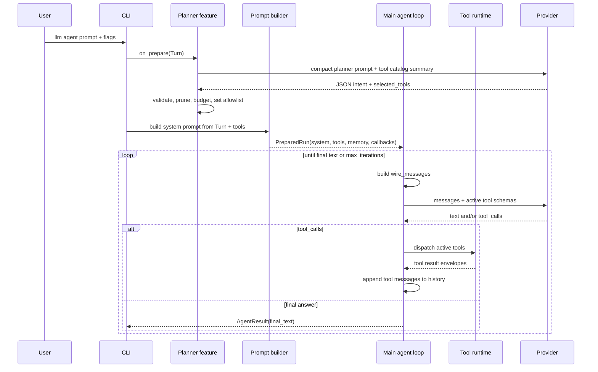
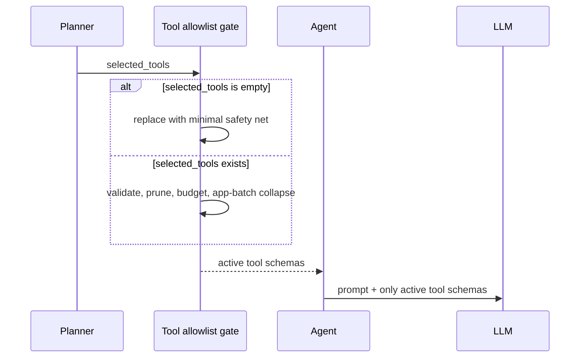
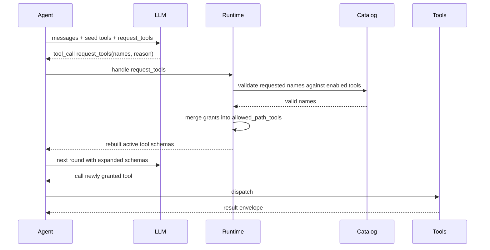
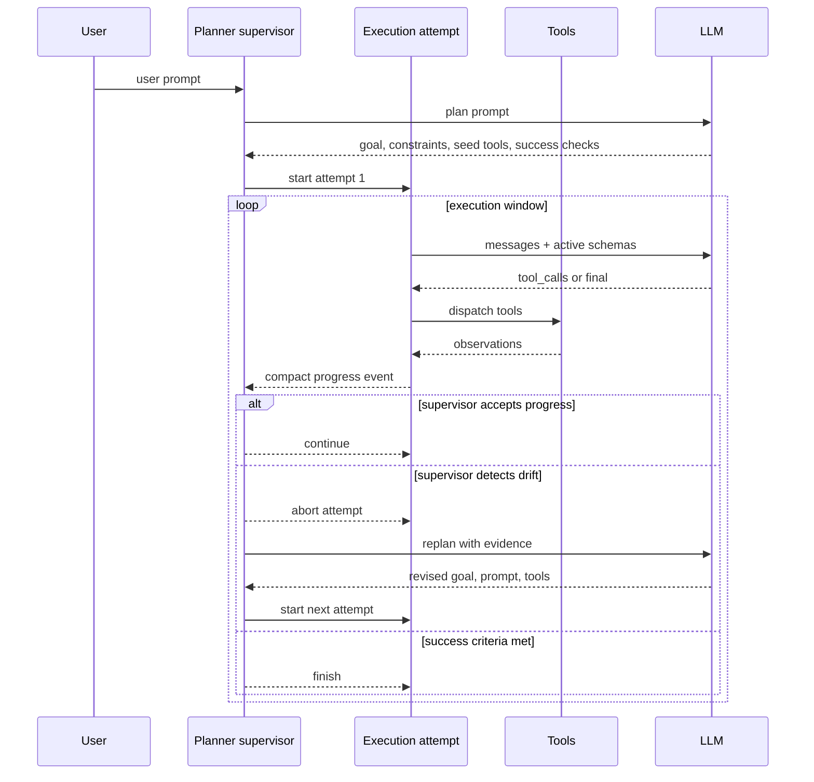

# Agent Loop Design

PixlWiz currently uses an orchestrator and executioner split:

- The **planner** is a cheap routing pass. It classifies the turn, picks an initial path-tool allowlist, and writes planner metadata onto the `Turn`.
- The **main agent** is the executioner. It receives the system prompt, the current tool schemas, conversation messages, and then loops through LLM calls and tool dispatch until it returns final text or hits `max_iterations`.
- The **runtime** enforces tool availability. If the executioner calls an unavailable tool, the tool result explains that it must call `request_tools` first.
- The **transcript** remains full fidelity. Optional context reduction only affects the wire copy sent to the model for a given LLM call.

This design is fast for one-shot work because the planner runs once and the executioner does not wait for a controller between every action. The tradeoff is that the planner cannot currently stop a bad execution loop and launch a cleaner one with a better goal, prompt, and tool set.

## Current Boundary



Current hard boundary:

- The planner has one shot before the main loop starts.
- The planner can shrink the tool catalog by setting `allowed_path_tools`.
- The main agent owns the execution loop after `PreparedRun` is built.
- `max_iterations` is the only coarse stop once execution begins.
- There is no planner-side "abort and retry execution" checkpoint.

## Tool Selection Today

The planner's selected tool names are not trusted blindly. The runtime validates them against the enabled catalog, removes invalid names, applies app-tool collapse rules, and enforces the planner budget.

If the planner selects no tools, the runtime now pins a minimal safety net instead of falling back to the full catalog:

- `info_lookup`
- `memory_read`
- `memory_write`

That keeps pure chat turns cheap while still giving the executioner a small recovery surface.



## Progressive Tool Acquisition

The executioner can now ask for more path tools during the same turn through the `request_tools` meta-tool. This is a local expansion mechanism, not a full replan.



Important limits:

- It only adds valid enabled tool schemas.
- It does not change the user goal or the planner's interpretation.
- It does not compact bad history that already accumulated.
- It does not let the planner interrupt or replace the executioner.

`request_tools` is useful when the planner underselected one tool. It is not enough when the whole execution strategy is wrong.

## Observations From `case-app-use`

The `case-app-use` smoke run exposed two agent-loop issues:

- A low `max_iterations` cap can kill a valid app task before it reaches final text. Raising the cap to `100` let the executioner finish with `DONE`.
- The executioner can keep acting against the wrong target window. In the observed run, `app_inspect_dump` saw Cursor as the foreground app, not Paint. The loop kept consuming tokens and eventually failed the harness verifier even though the final text was `DONE`.

The compression result is a separate tool-level issue. `app_inspect_dump` returns a JSON envelope with a large `markdown` field. The current pre-API reducer preserves too much of that structured envelope, so prompt tokens still grow. Tool-level compaction or target-scoped app inspection should handle that later.

The agent-loop lesson is different: long app tasks need a controller that can notice "execution is going sideways" before the executioner burns many rounds.

## Target Boundary: Planner As Supervisor

Goal: keep the fast seed-planner path, but add explicit supervision checkpoints where the planner can abort the current execution attempt and launch a new one with better instructions and a better tool seed.



The supervisor should not sit between every tool call by default. That would make simple turns slower and more expensive. It should wake at bounded checkpoints:

- after planner seed selection,
- after a failed tool call,
- after N execution iterations,
- after high-cost observations such as large app dumps,
- when the executioner reports final text,
- when verifier/self-check data conflicts with the stated goal.

## Replan Contract

A replan should create a new execution attempt, not mutate a broken one in place.

Suggested planner output:

```json
{
  "decision": "start | continue | abort_replan | finish | fail",
  "goal": "short execution goal",
  "success_checks": ["observable condition"],
  "selected_tools": ["app_open", "app_inspect_dump", "app_batch"],
  "execution_prompt": "specific instructions for the next attempt",
  "abort_reason": "why the previous attempt should stop",
  "evidence": ["compact observation from prior attempt"]
}
```

Runtime responsibilities:

- Preserve full history in logs.
- Send only compact attempt summaries back to the supervisor.
- Let the supervisor choose a fresh `selected_tools` set for the next attempt.
- Let the supervisor rewrite the execution prompt with stronger target constraints.
- Keep `request_tools` available inside an attempt for small underselection fixes.
- Treat supervisor abort as a normal controlled outcome, not as a model/tool error.

## Design Rule

Use `request_tools` for **local tool underselection**.

Use supervisor replan for **strategy drift**:

- wrong target app or window,
- repeated failed tool arguments,
- large observations without progress,
- final text that conflicts with verifier/self-check evidence,
- tool sequence that is valid but not converging on the goal.

This keeps the common path cheap while giving long-running tasks a real recovery loop.
