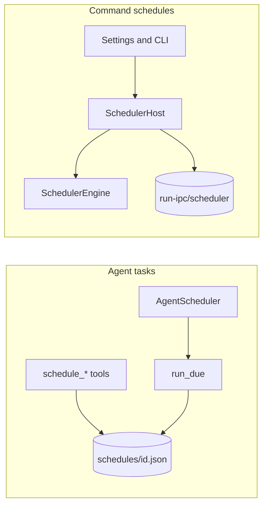
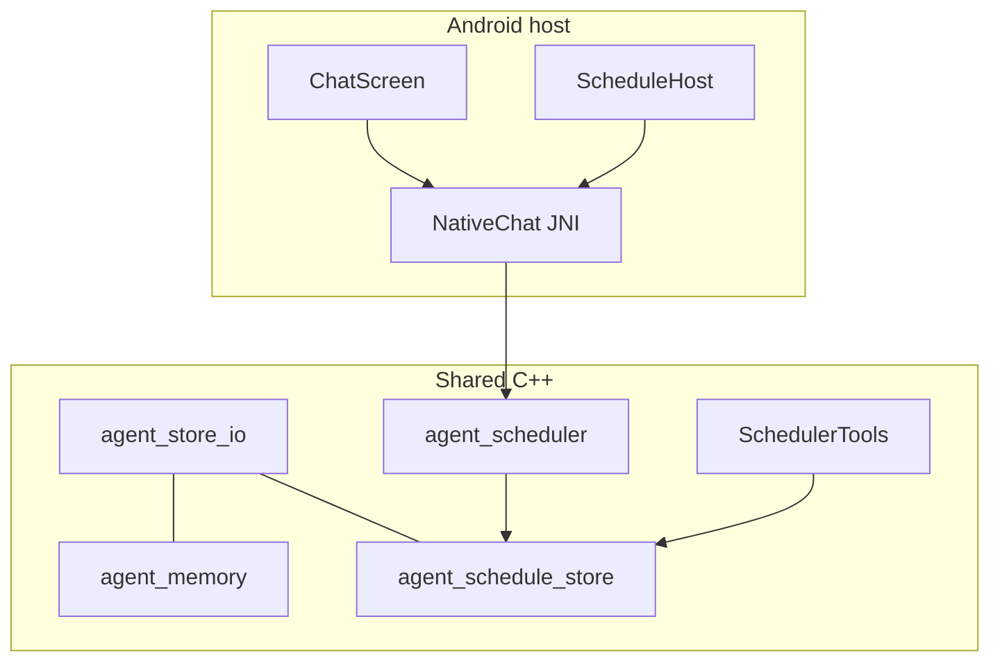
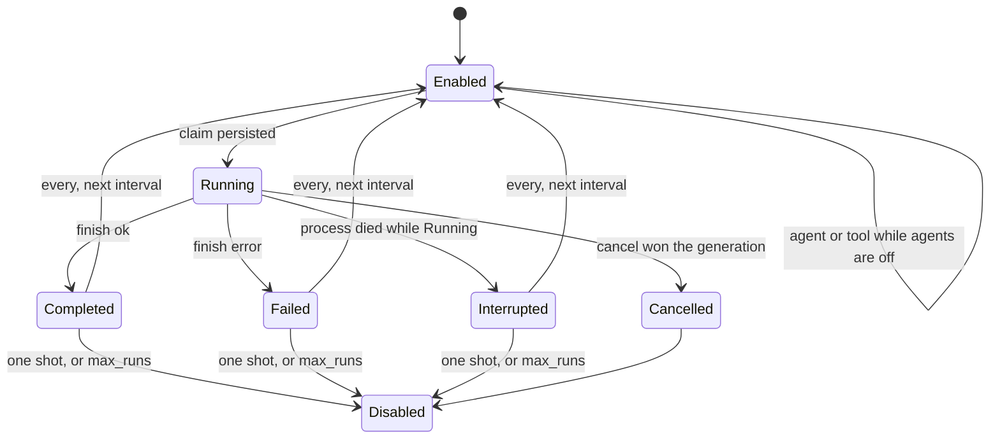
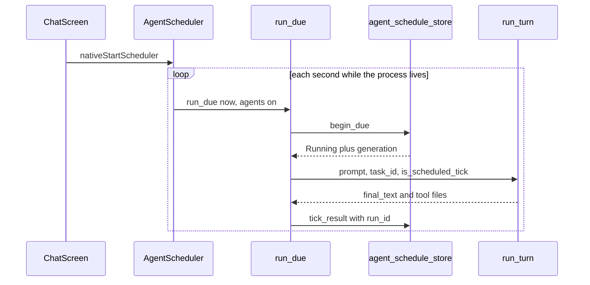
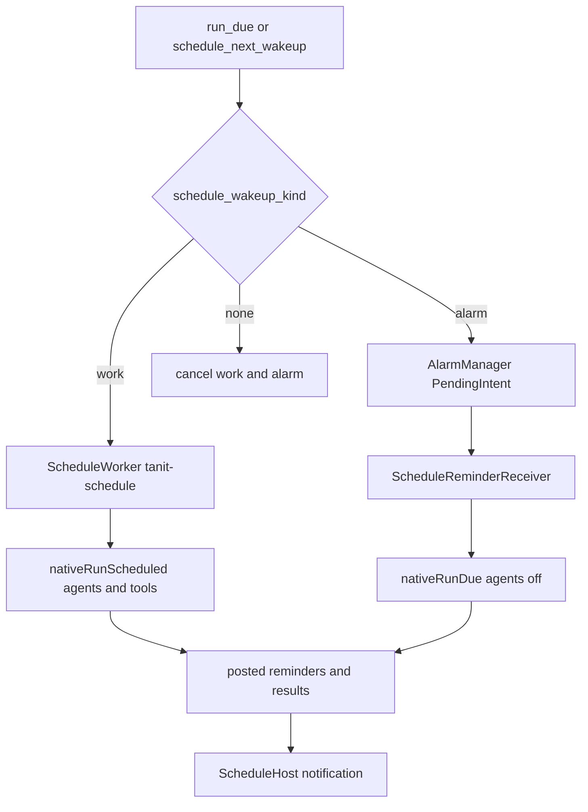
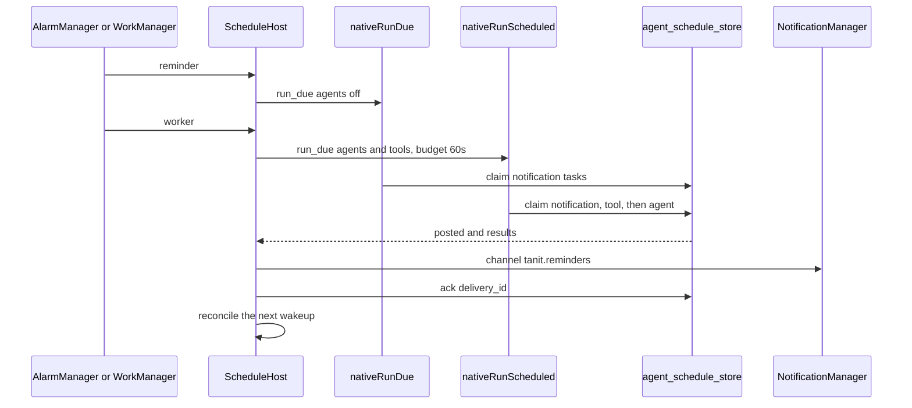
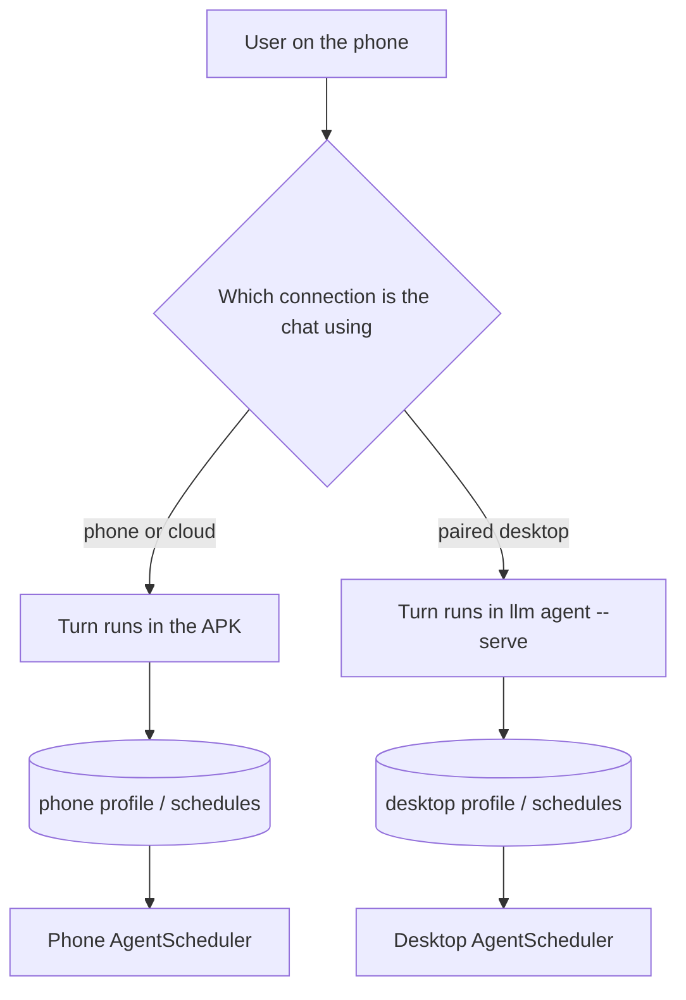
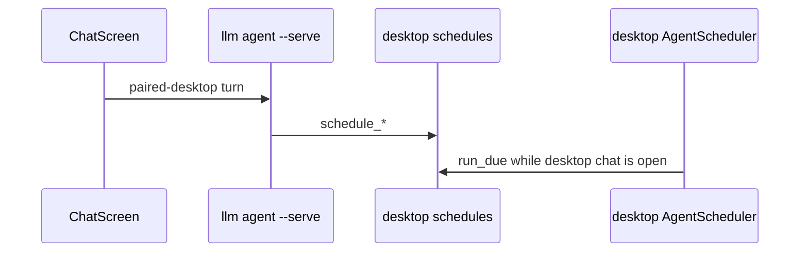

# Schedulers

Tanit has two schedulers. They do not share a store, an id, or an executor.

| | Agent tasks | Command schedules |
|---|---|---|
| Owner | `media::llm::agent` in `packages/llm.cpp` | `pm::tasks` in `src/tasks` |
| Entry | `AgentScheduler`, `run_due` | `SchedulerHost`, `SchedulerEngine` |
| Flag | `FEATURE_SCHEDULER_TOOL` | `FEATURE_SCHEDULER` |
| Store | `<profile>/schedules/<id>.json` | the command document plus `<config>/run-ipc/scheduler/state.json` |
| Created by | `schedule_in`, `schedule_at`, `schedule_every` | Settings, `schedulerClient.ts`, the CLI |
| Fires | one executor chosen by the task | a command, a CLI plan, or an XBlox plan |
| Timing | next run is completion plus the interval; a gap runs once | next run is the planned slot; missed slots collapse |
| Phone | linked. Chat starts `global_scheduler()` | not linked. `scheduler_host.cpp` is outside the NDK graph |

Desktop turns both flags on. The phone sets both to `1` in `cmake/android-chat-features.cmake`. Only `FEATURE_SCHEDULER_TOOL` changes the APK. `FEATURE_SCHEDULER=1` on the phone does not compile `SchedulerHost`.

This note is the agent store and the Android host that caches its next reminder. The command engine stays a desktop process with its own leader claim (`scheduler_claim.cpp`, fresh for 2 seconds). A phone XBlox run, when one exists, calls the phone sequence runner. It does not go through `SchedulerHost`.

## Who owns what

| Piece | Owns | Does not own |
|---|---|---|
| `agent_store_io` | atomic JSON, paths, the profile-change hook, timestamps | either store's records |
| `agent_memory` | sessions, journals, snapshots, session memory | schedule files |
| `agent_schedule_store` | `ScheduledTask` create, claim, finish, cancel, reminder ack | the poll thread |
| `agent_scheduler` | `Life` of the one-second loop, `run_due`, the next wakeup | Android alarms and notifications |
| `SchedulerTools` | the five `schedule_*` tools | time, once the file is written |
| JNI `NativeChat` | profile pin, one C++ call, a JSON envelope | recurrence math |
| `ScheduleHost` | one WorkManager job, one reminder alarm, the notification channel | the task file |
| `ScheduledTasks` | the chat projection: rows, cancel, transcript upsert | the next due time |

`schedule_store_dir()` is the parent of the session directory plus `/schedules`. Sessions stay under `<profile>/sessions/<id>.json` with a `.journal.jsonl`. The UI copy of a chat is `<profile>/sessions/<id>.transcript.json`. Scheduler files are ordinary JSON. Session files keep the secure-storage path.

A real profile-path change calls `global_scheduler().stop()` and drops both caches. The same path is a no-op, so pinning the directory from JNI does not stop the loop. Security builds do not link `agent_scheduler.cpp`. The hook stays empty and only the caches drop.

Kotlin does not write `schedules/*.json` and does not parse a recurrence.

## Task file

One file per task: `<profile>/schedules/<id>.json`. The id is a slug of the title plus a counter (`bring-list-1`). Create skips an id that is already loaded.

Missing fields keep old files valid.

| Missing field | Means |
|---|---|
| `execution` | `agent` |
| `delivery` | `inbox` |
| `policy` | `best_effort` |

`execution` is what runs. `delivery` is where the result goes. `policy` is how precise the reminder clock is.

| Execution | Runs | Model | OS wakeup |
|---|---|---|---|
| `agent` | `run_turn` with the task prompt | yes | `work` |
| `notification` | title and prompt as a reminder | no | work or alarm |
| `tool` | one frozen call, `write_file` or `https` `http_request` | no | `work` |

`time_sensitive` is valid only for `notification`. Anything else is rejected at create.

| Delivery | Where the result goes |
|---|---|
| `inbox` | task file, and a transcript row once a `run_id` exists |
| `notification` | the Android reminder channel. An agent or tool result is also written into that task's conversation |
| `silent` | task file only |

A notification task forces delivery `notification`. An agent or a tool keeps the requested delivery: `inbox`, `notification`, or `silent`. Sound stays off. Missing delivery is `inbox`.

Writers of a task file:

- `schedule_in`, `schedule_at`, `schedule_every`, `schedule_cancel`, from a live turn
- `nativeScheduleCancel`, the same disable as `schedule_cancel`
- `run_due`, for the claim, the terminal status, and the next due time

Cancel disables the task, bumps `generation`, and keeps pending reminder deliveries. The file stays. `schedule_list` is the summary. It is not the transcript.

## Claim lifecycle

`run_due` is the only pass over due tasks. The one-second loop calls it. A wakeup calls it once and returns. A wakeup must not call `AgentScheduler::start()`. `start()` is the infinite poll.

The loop's own life is separate: `Stopped`, `Running`, `Stopping`. `stop()` from the worker only sets the flag and returns. A second external `stop()` waits until the thread has left `Stopping`. `stop()` does not abort process-global speech or shell. The in-flight turn sees `Turn::cancel_check`. An HTTP read already in flight keeps going.

Claim order:

1. Skip a task that is disabled, has no `next_run_at`, or is not yet due.
2. A `Running` claim whose id is still in the in-process live set belongs to the other caller. Leave it.
3. A `Running` claim with no live owner was left by a dead process. Persist `interrupted`, arm the next time, and do not run the executor.
4. An `agent` or a `tool` while `run_agents` is false returns `Blocked` and writes nothing. The due time stays. A later open of chat can still run it.
5. Persist `Running`, the occurrence id `taskId|planned-time`, and, for a tool, the idempotency key. Then release the lock and run.
6. Finish in one write that matches `generation`. A cancel that landed during the run keeps `enabled` false. The runner's copy is not written back.

A one-shot disables after the attempt, success or failure. `every` sets `next_run_at` to the finish time plus `interval_seconds`. `max_runs` counts attempts, including failures. A gap runs once. Missed repeats are not filled in.

`consecutive_failures` and `last_error` are stored. They do not by themselves stop a repeat.

The occurrence id is also the reminder `delivery_id`. Ack removes one delivery. The list holds 32 and drops the oldest. `handoff_pending` is true exactly when that list is not empty.

## Agent ticks

Chat calls `nativeStartScheduler`. That pins the profile, configures `global_scheduler()` with the live chat provider, and `start()`s the loop. Boot, process start, the worker, and the reminder receiver do not call it.

Each tick builds a `Turn` from the task: the prompt, `task_id`, `folder_hint`, the task's `memory_state`, and the recent events. `cancel_check` follows `stop_requested_`. The provider is read again from chat settings for that tick.

The task id is the schedule id, not the open chat session. Memory writes during the tick go to the schedule file when the current id is that task. They do not open a chat session under the same id.

When the turn finishes, the event is `tick_result`:

- `run_id` is the occurrence id from the claim
- `final_text` and `error` are the turn result
- `files` lists `{path, tool}` taken from tool-result `output_path`

A path that appears only in the reply text is not a file. The card is the registered path.

While chat is open it polls the task list about every two seconds. `ScheduledTasks.applyTicks` upserts by `run_id`:

- the reply is a transcript row whose id is the `run_id`
- each registered file is a tool card whose id is `run_id` plus the path
- a `run_id` already stored in some session transcript is left there

Leaving chat does not stop the loop. The thread keeps running until the process is gone. Android may freeze it in the background. After the process is killed, the files remain. The worker can run the overdue agent or tool without opening chat. Opening chat starts the poll as well.

A notification task never takes this path. Its event type is `notification`, and the transcript upsert ignores it.

## Frozen tool

`execution=tool` stores `tool.name` and `tool.arguments` at create. The arguments are not rebuilt from the prompt. The allowlist is `write_file` and `http_request`. `file_delete`, `run`, and `image_from_camera` are rejected at create. `time_sensitive` is rejected too.

`http_request` requires an `https` URL. Loopback, private, and link-local hosts are refused before any socket. Redirects are not followed. Retries are 0. The `Idempotency-Key` header is the occurrence id. A status of 0 is stored as an unknown outcome and the call is not repeated for that occurrence. A one-shot task disables after the attempt.

On claim, `idempotency_key` is set to the occurrence id and persisted before the call. A later `run_due` that finds that claim `Running` and not live marks it `interrupted` and does not call the tool again. The key stays.

`run_due` with agents off does not claim a tool task. The reminder receiver uses that entry. The worker does not: an enabled tool with a next time asks for `work`.

## What the OS is asked to wake

After a store write, and again at process start, C++ returns the next wake times. `schedule_wakeup_kind` looks at enabled tasks that have a next time.

| Task | Kind |
|---|---|
| notification, `best_effort` | `work` |
| notification, `time_sensitive` | `alarm` |
| agent or tool | `work` |
| disabled, or `blocked` | `none` |

`wakeup.work` and `wakeup.alarm` are independent. No reminder due cancels both. There is one unique work item and one reminder `PendingIntent`, not a job per task.

WorkManager is one-shot and deferrable. A delay under 15 minutes is not a 5-second promise on WorkManager alone. On Android, `ScheduleHost` also arms an AlarmManager catch-up for any work wakeup sooner than 15 minutes, so a 5-minute `schedule_every` does not sit in the ~30-minute JobScheduler batch window. Sub-minute `schedule_every` stays valid in the store. It fires from the in-process loop while the process is alive, and from that catch-up alarm when the process is gone. The 15-minute floor is not applied at create.

Exact alarms use `setExactAndAllowWhileIdle` when `canScheduleExactAlarms()` is true, and `setAndAllowWhileIdle` otherwise. The manifest has `SCHEDULE_EXACT_ALARM`. It does not have `USE_EXACT_ALARM`. The user grants exact alarms from the Schedule screen. There is no deny callback.

## Android host

`ScheduleHost` applies the wakeup C++ already chose. `appliedKey` remembers the last envelope so a repeat reconcile is a no-op. `forgetApplied()` clears that memory. The profile the wakeup was armed for is stored on the work input and on the reminder intent. An empty profile falls back to `files/tanit-profile`.

| Class | When it runs | What it calls |
|---|---|---|
| `TanitApp` | process start | `armFromStore` on the app profile |
| `ScheduleBootReceiver` | `BOOT_COMPLETED`, `MY_PACKAGE_REPLACED` | `armFromStore` |
| `ScheduleWorker` | the unique work `tanit-schedule` | `nativeRunScheduled` |
| `ScheduleReminderReceiver` | `com.polymech.pmimage.schedule.REMINDER` | `nativeRunDue` |
| `ChatScreen` | chat opens | `nativeStartScheduler`, then the poll |
| `ScheduleActivity` | the list the user opened | cancel, then reconcile |

`armFromStore` forgets the in-memory key and reconciles. It does not start the poll. A real boot broadcast is protected. The instrumentation test calls the receiver in-process. A reboot of a device is still a manual check.

`nativeRunDue` is `run_due(now, false, {})`. The reminder receiver uses it. Agent tasks and tool tasks stay unclaimed on that path. `nativeRunScheduled` is the worker. It uses the same provider and `run_tick` as chat, does not call `start()`, and passes agents and tools on, with a deadline. The report's `posted` array is reminders. `results` is agent and tool output. Both can post on `tanit.reminders`. An agent result is also a chat session, one per task, with its own id. The title is the first line, later runs append by occurrence id, and the notification opens that chat. A reply there is an ordinary turn. The next scheduled run still uses the task prompt.

`schedule_every` accepts `time` as `HH:MM` plus an IANA `timezone` and stores `schedule.kind = daily`. On Android the next instant comes from `java.time.ZoneId`. A spring gap moves forward. Without that hook the same clock is read as UTC. The command engine's UTC daily is unchanged. WorkManager still does not promise 09:00 to the second. An exact alarm stays a user-facing reminder.

The channel id is `tanit.reminders`. It is created the first time a post is allowed. The notification id is the `delivery_id` hash. Post acks `delivery_id`, then the occurrence id, then the task id. If notifications are disallowed, post returns without acking, and the task stays armed.

The Schedule screen can ask for `POST_NOTIFICATIONS` and can open the exact-alarm settings page. Tests assume those grants are already done. A denial is not stored as `blocked`.

Force-stop leaves reminders quiet until the user opens the app. Opening reconciles. It starts the poll only when chat itself opens.

## Chat projection

`ScheduledTasks.snapshot` reads `nativeScheduleList`. Enabled rows feed the composer. `ticks` include disabled tasks so the last reply is still visible. Cancel calls `nativeScheduleCancel` and then reconcile.

The transcript file keeps the entry id. Reopening the session upserts the same `run_id` instead of adding a second bubble. A run already saved in another session is not copied across.

## Create tools

| Tool | When | Required |
|---|---|---|
| `schedule_in` | "in 30 seconds" | `title`, `prompt`, `delay_seconds` ≥ 1 |
| `schedule_at` | an explicit UTC time | `title`, `prompt`, `run_at` |
| `schedule_every` | "every 30 seconds" | `title`, `prompt`, `interval_seconds` ≥ 5 |
| `schedule_cancel` | stop one task | `task_id` |
| `schedule_list` | what is armed | none |

Optional on create: `execution` (`agent`, `notification`, `tool`), `precision` (`best_effort`, `time_sensitive`), `sound` (notification only), `tool` and `arguments` (the frozen call), `initial_state`, `folder_hint`, and for `every` also `start_at` and `max_runs`.

Create returns `{ "task_id" }`. A failed save returns an empty id and the tool says the task could not be saved. The in-memory store is left unchanged.

## Phone chat and the desktop runner

`schedule_*` writes the profile of the process that is running the turn. The task has no host field. The phone store and the desktop store are two directories, and each poll reads only its own.

Phone or cloud chat runs inside the APK. The android prompt tells the model that tools act on this phone. `schedule_in`, `schedule_at`, and `schedule_every` save a phone task. The phone poll, started when chat opens, is what fires an agent or a frozen tool. A notification task is the one that becomes a `tanit.reminders` post. That file never appears on the desktop, and the desktop poll never claims it.

Paired-desktop chat keeps the phone as the screen. `LanChatBackend` sends the turn to `llm agent --serve`, and the desktop agent is the one that calls tools. A `schedule_*` call in that turn writes the desktop profile. The desktop chat panel starts `AgentScheduler` when its window is created, and that poll is what runs the task. `llm agent --serve` itself does not start the poll. `llm agent --scheduler` is a separate process that can run the same files. The phone still starts its own poll for the phone profile. It does not see the desktop task, and the phone Schedule screen does not list it.

The desktop prompt is the one in front of the model for a LAN turn. Its connection line says tools act on this computer, and the opening line includes scheduled work among desktop abilities. The planner maps "at a time / after a delay / on an interval" to `schedule_*`. Nothing in that prompt says the person is on a phone, or that this save will run here rather than buzz the phone. The tool text is the same binary on both hosts, and it still talks about the app being open and about an Android exact alarm. So the desktop agent can store a desktop task, and it can also describe that task as a phone reminder.

A tick on the desktop is posted into the desktop chat. It is not written into the phone transcript and it does not post `tanit.reminders`. A tick on the phone stays on the phone. Saying "on my computer" in a phone-local chat does not move the file. The routing rules for apps, the screen, and the browser do not apply to the schedule store. The host is whichever process is already executing the turn.

The desktop command scheduler is a third clock. Settings and the CLI write it. `schedule_*` does not. A desktop agent task and a desktop command do not share an id.

## What a person thinks they scheduled

A reminder that fires on the phone while the app can wake is in place. A phone agent and a frozen HTTPS call can wake through the worker too. The person still asked for an outcome: do this, on that machine, at that clock time, and tell me when it is done. WorkManager is not that clock.

| They said | What happens | What they still do not get |
|---|---|---|
| Remind me, with a sound, in 30 minutes | A phone reminder, through work or an alarm | A clear line about permission and about how late it may be |
| Send me the stock note every morning | A daily clock, a worker wakeup, its own chat, and a notification that opens it | A time more exact than WorkManager |
| Call this API tomorrow at 14:30 | One frozen HTTPS call, woken without chat, with the outcome recorded | An exact 14:30, a secret store, or a retry after an unknown POST |
| Remind me on my phone, while chat is the desktop | The file is written on the desktop | A choice of machine, and a phone notification |
| What is scheduled? | Each device lists its own store | One list, with status, across the phone and the desktop |
| Cancel that repeat | Later runs are disabled | A clear answer if a run that already started was stopped |

Create returns the task id plus where it will run, the next time, where the result shows up, and the limit. The phone schedule list and the row above the composer show the same words. A reminder with notifications off adds one line: the reminder stays saved and will not alert.

## Where, when, and how you hear about it

These three stay ahead of more scheduler machinery. The two stores and the command clock stay separate. The screen is what should look like one list.

1. **Say it when the task is saved.** Host, next run, where the result goes, and the limit that matters: the desktop has to be open, a phone agent can fire late, notifications are off, an exact alarm is not granted. Edit, pause, and cancel can wait. The sentence cannot.
2. **Show why it is not an ordinary waiting task.** Notifications off, exact alarm not granted, the other device is not running, the network is down, the time was missed, the run failed, the run was interrupted. A denied notification stays armed and posts nothing. That has to be visible. It is not stored on the task today.
3. **Let an agent finish and still notify the phone.** On the phone this is in place: delivery is separate from execution, and a worker can post the result. A desktop run still cannot reach the phone. That needs a delivery channel, not a local `NotificationManager`.
4. **Daily at a clock time in the person's timezone.** `schedule_every` with `time` and `timezone` stores a daily task. Android resolves it with `ZoneId`, including the spring gap. The command engine's UTC daily stays where it is. The wake is still WorkManager, not an exact alarm.
5. **Run now, pause, skip the next one, edit, cancel.** Cancel today disables later runs and keeps the task conversation. It does not say whether the run already in progress stopped. The list should also open the last result, the error, and the files, without a search through chat.
6. **A background agent, and an HTTPS call, that wake without chat.** The worker does this with the same turn as chat. It does not start the one-second poll. The agent result shows up as a chat session. A private or loopback URL is refused. An unknown HTTP outcome is not posted again. Force-stop still stays quiet until the person opens the app. A turn already inside HTTP is not cut off mid-call.
7. **One list over the phone store, the desktop agent store, and the command clock.** Read-only is enough. Do not merge the files or the executors. Ids should stay stable across devices. A slug minted on one machine is not that.

A schedule does not gain permissions because an agent created it. A repeat that writes files, calls an API, or drives the desktop stays inside the same consent the person already gave for that action.

The phone Schedule screen can list, cancel, and ask for the two grants. It cannot create a task. A reminder does not open the transcript. A background result is written into that task's conversation immediately. A file card still comes only from a path the tool registered. Stopping the poll does not cut off speech, a shell, or an HTTP read that has already started. The turn can notice the stop between steps.
