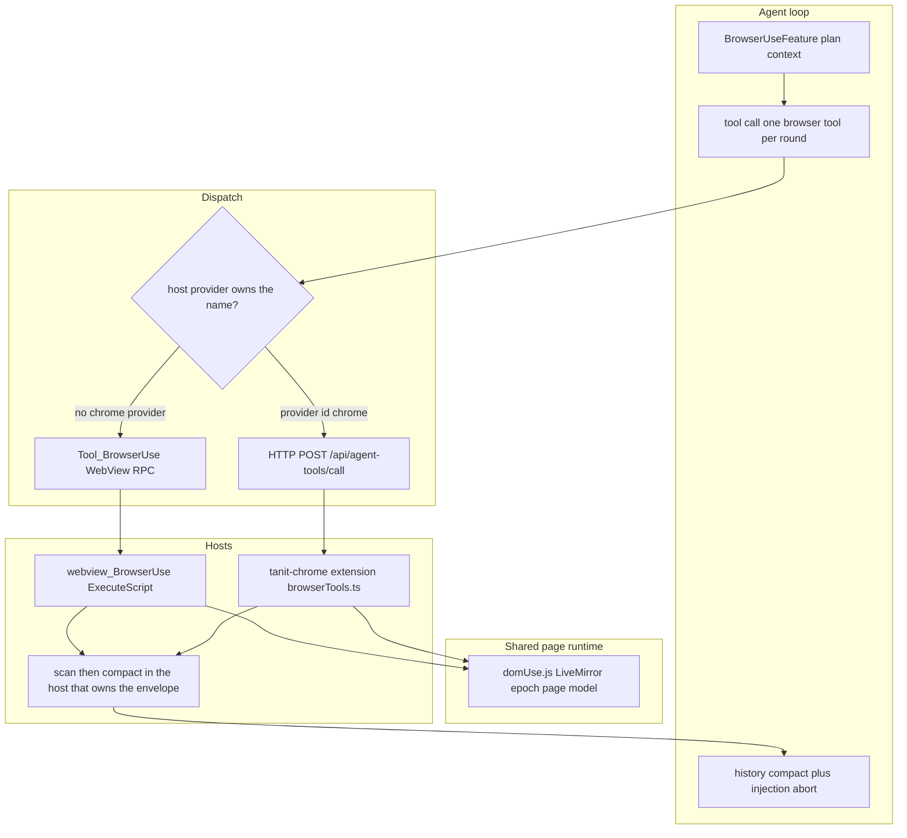
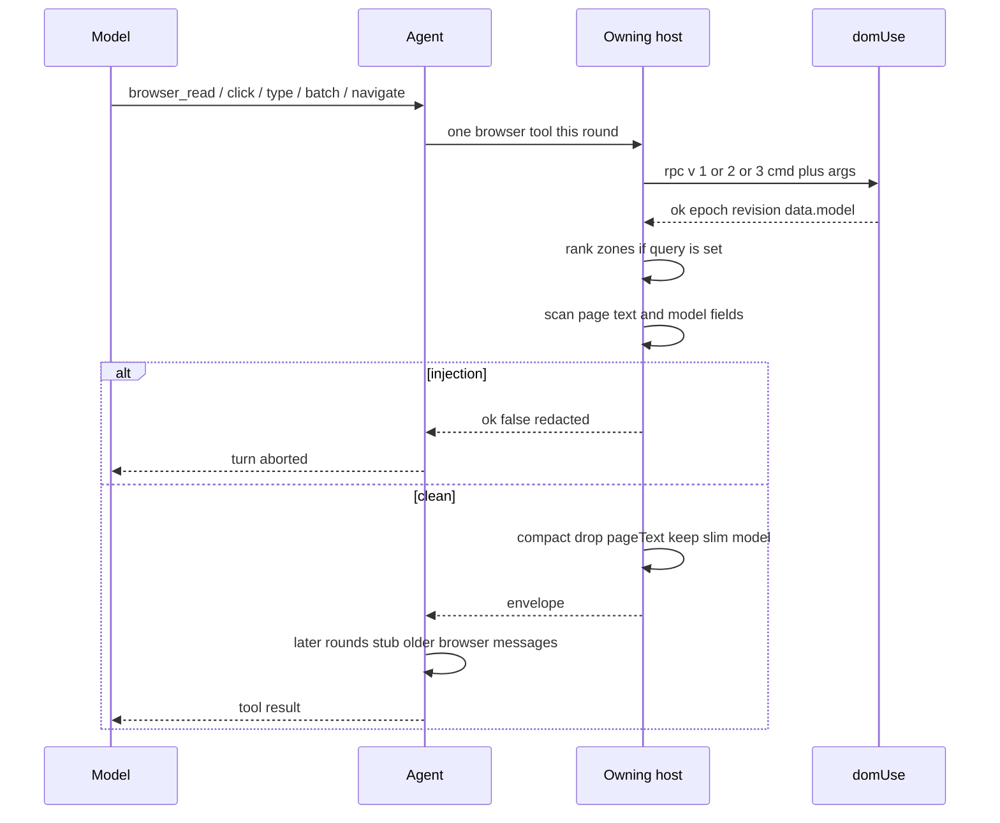

# Browser-use — current stack

Two surfaces, one page runtime. The in-app centre WebView and the Chrome extension both inject `domUse.js` and speak the same `browser_*` tools. They do not run at the same time for one tool call: a registered host provider named `chrome` wins, otherwise the call stays on the WebView.

The older centre-WebView notes (tools, tabs, page-model versions) stay in [`browser-use.md`](browser-use.md). This file is the two-path flow and what is still open.

## Stack

| Layer | In-app | Chrome |
|-------|--------|--------|
| Who starts it | Centre browser tab in Tanit | Side panel → `tanit-chrome-host` → loopback agent |
| Tool schema | Rich defs in `Tool_BrowserUse.cpp` (`query`, scope, epoch) | Thin catalog, `additionalProperties: true` |
| Transport | `rpc_for_tab` → `ExecuteScript` | Extension `browserUse` → `chrome.scripting.executeScript` |
| Page script | `dist/shared/inspect/domUse.js` | Same script, bundled as `domUse.js` |
| Tab identity | Dock id string, current centre tab | Chrome tab id; module-level `turnTabId` |
| Context the model sees first | Tab list, url, epoch, scope, page-model strategy | Snapshot: focused http(s) tab, up to 20 tabs |
| After the call | Scan, optional BM25 `query`, compact, then agent history compact | Same scan and compact inside `tanit-chrome-host`, then the agent compacts history again |

`browser_use::enabled()` is compile-time. It is true in a full assistant build even when no WebView tab is open. The Chrome fallback inside `path_tool_executor` therefore does not run there. Chrome is reached only when `dispatch_host_tool` finds the `chrome` provider first.

## Call flow

Shared page result (`domUse` `ok()`): `{ ok, epoch, revision, url, title, data }`. A read puts `items`, `pageText`, `zoneHints`, and `model` under `data`. A click/type/select puts `{ ref, action, model }` under `data`. A batch puts `steps` and `model` under `data`; the Chrome host hoists those onto the envelope so the shared compactor sees them.

Compaction keeps the latest read's refs and a slim model (at most 8 zones, ranked or blocking first, `liveRef`, events, a short `collectionItems` list). `pageText` is omitted after the scan. `browser_navigate` is scanned and not rebuilt, so the tab list survives. `tabId` is copied back onto Chrome results.

## What is already one runtime

- Element refs (`eN`), epoch, revision, session scope, zone hints, batch, and the page model are all in `apps/shared/inspect/domUse.ts` plus `pageModel/`.
- Both hosts call that script. The model IR does not need a second port.
- Prompt-injection scan and history slim are the C++ functions in `browser_use_inject.cpp` and `browser_use_compact.cpp`. The WebView tool calls them in `Tool_BrowserUse.cpp`. The Chrome tool server calls them in `finish_chrome_browser_result`.
- The agent still aborts the turn when the envelope is stamped, and it still blocks a following `run` that looks like exfil or download-and-execute. That applies to both surfaces, because it keys off the tool name.

## Gaps

| Gap | Why it matters |
|-----|----------------|
| Chrome catalog has no real schema | The model is not told about `query`, `scope`, or epoch. Ranking only happens if it happens to pass `query`. |
| Protocol `v` is split | In-app tools send `v: 2`, the plan-phase status call sends `v: 1`, Chrome sends `v: 3`. `domUse` accepts all three. |
| Arg rename tables are copied | `make_request` in C++ and `ARG_KEYS` in `browserTools.ts` must stay in lockstep. |
| `turnTabId` is one global in the extension | A focus change mid-turn moves the next call. The in-app path binds a dock id. |
| Epoch is optional and defaults to the live page | A click can land after the document has already changed. |
| No origin allowlist | Chrome only rejects non-http(s). The in-app navigator follows the URL the model emits, including a CMS-relative path. |
| Open action space | The model may invent a CSS selector, any typed string, and any URL. There is no closed choice of uniquely named controls, and no `DONE` / `BLOCKED` / `WAIT`. |
| Chrome context is a tab list, not a page model | Plan-phase `model.rankedZones` is injected for the WebView status RPC only. |
| JS always emits `model` | `FEATURE_BROWSER_PAGE_MODEL=OFF` only stops the C++ side from ranking and keeping it. |
| `tanit-chrome-host` must be reconfigured | The scan/compact sources are on that target in CMake. A stale host binary still returns the raw page. |

## Next

1. Rebuild `tanit-chrome-host` after CMake picks up the new sources, then confirm a Chrome `browser_read` comes back without `pageText` and with a slim `model`.
2. Give the Chrome catalog the same arguments as the in-app tools, including `query`, so zone ranking is not an accident.
3. One protocol version and one arg-rename table shared by both hosts.
4. Bind the Chrome turn to the snapshot tab until the model passes `tab=`. Re-read before click/type when epoch or revision moved.
5. Per-task origin list on both navigators.
6. Closed loop on top of `browser_read`: one choice per unique role and name, type only when the caller already supplied the string, stop when the same action changes nothing. That is a `choice` decision over the model, not a new page runtime.
