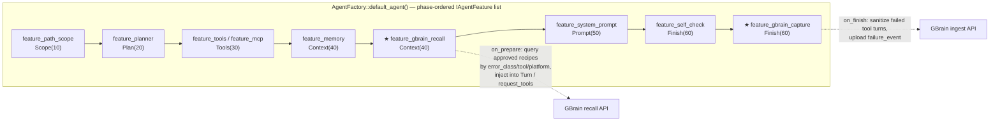
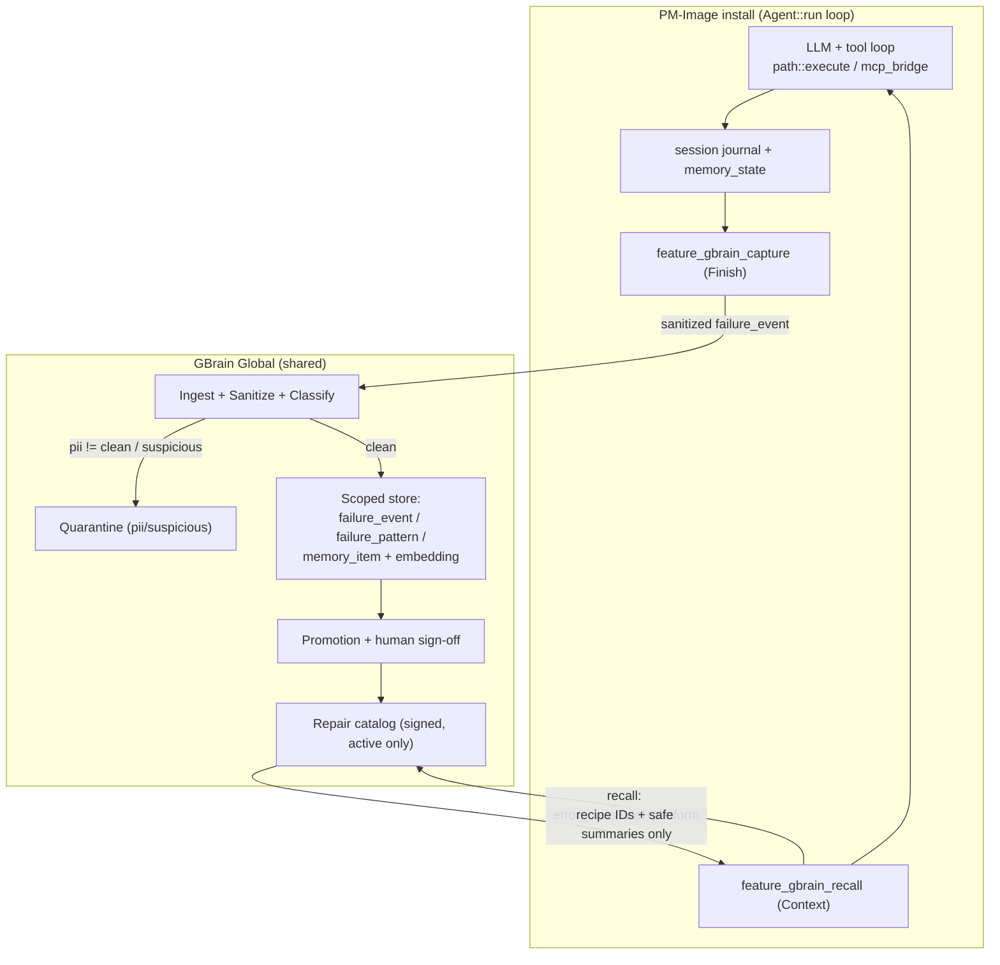
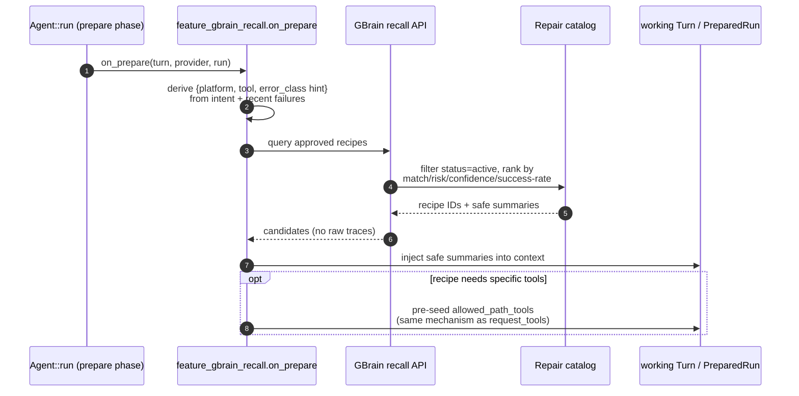
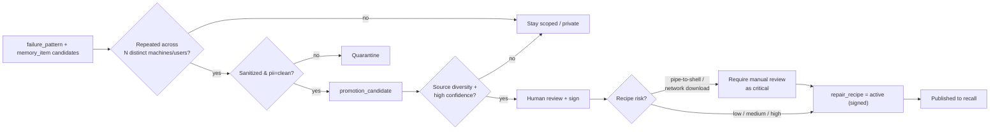
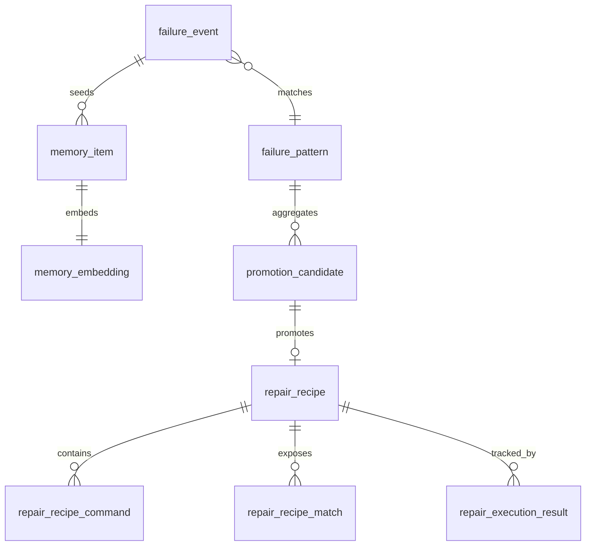

# GBrain Global — Shared Failure-Memory & Repair-Catalog

> **Status:** Design phase. This document specifies a shared failure-memory + repair-catalog
> system and **how it bolts onto the existing agent infrastructure** (`agent_factory.cpp`,
> `agent_feature.hpp`, `agent_memory.cpp`). No implementation is included here.

## 1. Overview

Today each PM-Image install has **local, file-based structured memory**: per-session
`memory_state` (JSON merge-patch), an `events` ring buffer, and an append-only tool
`.journal.jsonl` — all under `session_store_dir()`. Nothing is shared between installs, so the
same PowerShell/tool failure gets rediscovered on every machine.

**GBrain Global** is the shared/server counterpart of that local memory. Hundreds of installs
upload **sanitized** tool failures; the server classifies, dedupes, embeds, and promotes repeated
safe patterns into **signed/approved repair recipes**. Installs then recall **only approved
recipes** — never raw traces, never arbitrary LLM text.

The client side is **two new agent features** (one capture, one recall) that plug into the
existing feature pipeline. The server side owns the shared schema (kept deliberately light here).

### 1.1 Design Goals

1. Reuse the existing structured-memory + tool-journal plumbing as the **failure source**.
2. Capture/recall via the **feature pipeline** — no changes to `Agent::run()`'s core loop.
3. Promote repeated safe patterns into shared/global memory.
4. Semantic retrieval via embeddings.
5. Expose signed/approved repair recipes only.
6. Never let a client read raw traces from other users.
7. Recall returns approved recipe candidates, not arbitrary LLM text.

## 2. Alignment With Current Infrastructure

This is the core of the design: GBrain extends what already exists rather than replacing it.

### 2.1 Concept Mapping (local → shared)

| Local (today, `agent_memory.cpp`) | Shared (GBrain Global) | Notes |
| --- | --- | --- |
| `session.events[]` ring buffer | `failure_event` (sanitized) | Only failing tool turns are uploaded. |
| `.journal.jsonl` line `{tool, ok:false, error, …}` | `failure_event` source record | The journal is already the durable per-tool ground truth. |
| `memory_state` (merge-patch JSON) | `memory_item` (durable claim) | Same "structured durable memory" idea, server-scoped. |
| `sanitize_session_id()` | tenant/user/session scoping | Local sanitizes the *id*; server scopes the *data*. |
| Snapshots (P12) | `promotion_candidate` → signed recipe | Local snapshots are private; promotion makes patterns shared. |
| `request_tools` grant | recipe-driven tool grant (future) | A recall hit can pre-seed the tools a known repair needs. |

### 2.2 Where It Hooks Into the Feature Pipeline

`AgentFactory::default_agent()` already assembles a phase-ordered feature list. GBrain adds two
features and changes nothing in the loop engine.



- **`feature_gbrain_recall`** — `phase() = Context(40)`, runs in `on_prepare`. Looks at the
  turn intent / recent failures and queries the server for approved recipes; injects safe
  summaries into the working `Turn` (and may pre-grant the tools a recipe needs via the existing
  `request_tools` allowlist mechanism). Sits after `feature_memory` so it sees recalled local
  state first.
- **`feature_gbrain_capture`** — `phase() = Finish(60)`, runs in `on_finish`. Walks the run
  `Result`/transcript for failed tool envelopes (`ok == false`), sanitizes them, and uploads
  `failure_event`s. Mirrors how `feature_memory` already persists at end-of-run; reuses the same
  journal data the loop writes via `session_append_journal()`.

### 2.3 The Failure Source Already Exists

Every tool call in `Agent::run()` produces an envelope and a journal line. The capture feature
consumes exactly this — no new instrumentation in the loop:

```671:675:src/llm/agent_memory.cpp
void session_append_journal(const std::string& session_id, const nlohmann::json& entry) {
    if (session_id.empty()) return;
    std::lock_guard<std::mutex> lk(journal_mutex());
    const fs::path path = session_journal_path_unlocked(session_id);
    std::error_code ec;
```

A failing serial/parallel tool dispatch already journals `{tool, tool_call_id, ok:false, error,
duration_ms}`. GBrain capture reads that, classifies `error_class`, sanitizes, and uploads.

## 3. Architecture



### 3.1 Trust Boundaries

- **Untrusted input:** tool `stderr`/`stdout` (hostile). Sanitization happens client-side in the
  capture feature *and* server-side at ingest.
- **Quarantine gate:** anything with `pii_status != clean` or suspicious command text never
  reaches the shared store.
- **Egress gate:** recall returns only signed/approved, `active` recipes — never raw traces,
  never free LLM text.

## 4. Capture Flow (`feature_gbrain_capture`, Finish phase)

```mermaid
sequenceDiagram
    autonumber
    participant Loop as Agent::run loop
    participant Jnl as session journal / Result
    participant Cap as feature_gbrain_capture.on_finish
    participant API as GBrain ingest API
    participant Srv as Server (sanitize/classify)

    Loop->>Jnl: tool envelope {ok:false, error, exit_code}
    Note over Loop,Jnl: already written by session_append_journal()
    Loop->>Cap: on_finish(turn, result, run)
    Cap->>Jnl: scan failed tool turns
    Cap->>Cap: client-side redact + drop if pii risky
    Cap->>API: upload failure_event (hashes + sanitized text)
    API->>Srv: re-sanitize, classify error_class,<br/>compute normalized_signature
    alt pii != clean OR suspicious
        Srv-->>API: quarantined (held)
    else clean
        Srv-->>API: stored + pattern counters upserted
    end
    API-->>Cap: ack (no recipe payload here)
```

Capture is **best-effort and non-blocking**, exactly like the existing disk-persist path
(`persist_session_locked` swallows I/O failure). A failed upload never breaks the turn.

## 5. Recall Flow (`feature_gbrain_recall`, Context phase)



Recall runs at `Context(40)`, after `feature_memory`, so local recalled state is already in the
`Turn` and global recall can complement (not fight) it.

## 6. Promotion Flow (server-side, async)



Promotion requires **sanitation, dedupe, source diversity, and review/high confidence**. Block
pipe-to-shell / network-download recipes unless manually reviewed as `critical`.

## 7. Server Data Model (reference — kept light)

> Deliberately not exhaustive here; the DB/migration slice is a separate doc. This is enough to
> anchor the client integration above.

**Core tables:** `failure_event`, `failure_pattern`, `memory_item`, `memory_embedding`,
`repair_recipe`, `repair_recipe_command`, `repair_recipe_match`, `repair_execution_result`,
plus ingest plumbing (`ingest_quarantine`, `sanitizer_rule`, `promotion_candidate`,
`app_instance`, `machine_fingerprint`).

**Controlled vocabularies:**

| Domain | Values |
| --- | --- |
| `visibility` | `private`, `project`, `global` |
| `status` | `raw`, `sanitized`, `classified`, `candidate`, `active`, `rejected`, `deprecated` |
| `risk_level` | `low`, `medium`, `high`, `critical` |
| `pii_status` | `unknown`, `clean`, `risky`, `blocked` |
| `error_class` | `command_not_found`, `access_denied`, `path_not_found`, `execution_policy`, `missing_module`, `dependency_failure`, `network_failure`, `dns_failure`, `timeout`, `unknown` |



Key points (no column-level detail): store **hashes** for raw command/stderr (raw text not
required); `failure_pattern` dedupes by `normalized_signature`; `memory_embedding` is
`vector(384)` (MiniLM-style); `repair_recipe` is declarative + signed; `repair_recipe_command`
is allowlisted with `risk`/`requires_admin`/`requires_user_confirm`/rollback and **no arbitrary
script blobs**.

## 8. Security Model

- `stderr`/`stdout` are **hostile input** — do not execute retrieved text.
- Clients only ever receive signed/approved `active` recipes.
- Users insert/read only their **own** failure data; global raw traces are never client-readable.
- Global promotion requires sanitation, dedupe, source diversity, and review/high confidence.
- Block pipe-to-shell / network-download recipes unless manually reviewed as `critical`.

## 9. Open Questions (design phase)

- **Recall trigger:** proactive every turn vs. only after a tool failure within the run?
- **Capture scope:** upload on `ok == false` only, or also "succeeded after retry" repair signals
  (which feed `repair_execution_result`)?
- **Sanitization split:** how much redaction client-side (capture feature) vs. server-side ingest?
- **Tool pre-seeding:** should a recall hit auto-grant tools, or only *suggest* them and let the
  model call `request_tools`?
- **Transport/identity:** how `app_instance` / `machine_fingerprint` are established and authed
  (out of scope for the agent-side features, but blocks the ingest contract).

## 10. Deliverables (next phase, not now)

- [ ] `feature_gbrain_recall` (Context/40) + `feature_gbrain_capture` (Finish/60) — interfaces only.
- [ ] Ingest + recall API contract (request/response shapes; recipe = IDs + safe summaries).
- [ ] Client-side sanitizer reusing existing redaction helpers.
- [ ] Server DB/migration slice (separate doc).
