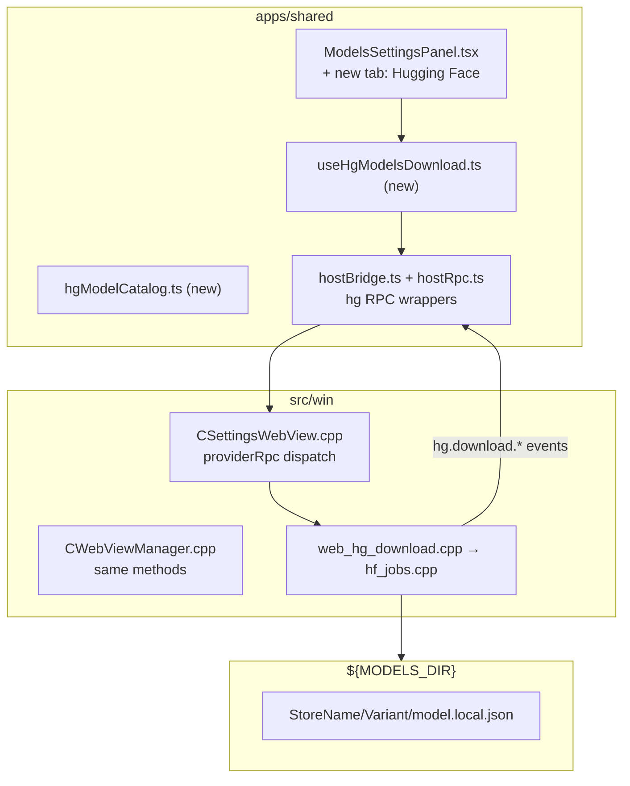

# HG CLI + C++ backend

Hugging Face GGUF discovery, enriched metadata, **Xet-backed download**, and `model.local.json` sidecars. Default output: `${MODELS_DIR}` (`%APPDATA%\PolyMech\tanit\models`).

See [hg-local-meta.md](hg-local-meta.md) for full sidecar schema.

---

## Discovery

```powershell
tanit-cli.exe hg search qwen --limit 20
tanit-cli.exe hg org sentence-transformers --limit 10
tanit-cli.exe hg meta "https://huggingface.co/sentence-transformers/all-MiniLM-L6-v2"
```

## GGUF inspect (bits, GB, VRAM estimate, mmproj)

```powershell
tanit-cli.exe hg variants qwen2.5-7b-instruct
tanit-cli.exe hg probe qwen2.5-7b-instruct -v Q4_K_M
tanit-cli.exe hg meta "https://huggingface.co/Qwen/Qwen2.5-Coder-14B-Instruct-GGUF"
```

## Authentication (`HF_TOKEN`)

Token resolution order (CLI, jobs, and WebView2 RPC when `token` is omitted):

1. `--token` / RPC `token` field
2. User variable **`HF_TOKEN`** in `settings.json` → `variables` subtree (same store as `${USER:HF_TOKEN}` / `${HF_TOKEN}` in commands)
3. Environment variable `HF_TOKEN`

```powershell
# via env (CI / one-off)
$env:HF_TOKEN = "hf_…"
tanit-cli.exe hg download qwen2.5-7b-instruct -v Q4_K_M

# via settings (persistent) — add to %APPDATA%\PolyMech\tanit\settings.json:
# "variables": { "HF_TOKEN": "hf_…" }
tanit-cli.exe hg probe qwen2.5-7b-instruct -v IQ2_M   # no --token needed
```

Public repos: probe/variants/meta work without a token. **Download** needs a token for Xet CAS (`xet-read-token` API). Gated repos need a token for all API calls.

---

## Download (Xet storage)

Large GGUF files on Hugging Face are served via **Xet CAS**, not legacy LFS `resolve/main` curl. Plain redirect + `Authorization: Bearer` → **HTTP 403**.

The C++ backend implements the [Xet download protocol](https://huggingface.co/docs/xet/en/download-protocol) natively (no Python / `hf_xet`):

```
tree API (xetHash) → xet-read-token → CAS reconstruction → presigned range GET
→ xorb chunk parse → LZ4 / ByteGrouping4 decompress → write .gguf
```

| Module | Role |
| --- | --- |
| `hf_xet_download.cpp` | CAS reconstruction loop, progress/cancel |
| `hf_xet_xorb.cpp` | Chunk header parse, LZ4 frame + bg4 decompress |
| `hf_hub_client.cpp` | `xet-read-token`, tree `xetHash` merge, binary GET |
| `hf_download.cpp` | Xet path when `xetHash` present; legacy `stream_download_url` fallback |

Build: vendored **lz4** (`pm_lz4`) linked into `pm-media` when `FEATURE_COMMAND_HG=ON`.

**Limits (today):** no Xet resume (full re-download on retry); large terms buffered in memory per reconstruction slice.

```powershell
tanit-cli.exe hg download qwen2.5-7b-instruct -v IQ2_M
tanit-cli.exe hg download qwen2.5-7b-instruct -v Q4_K_M --overwrite
```

**Smoke-tested (2026-07-13):** `bartowski/Qwen2.5-7B-Instruct-GGUF` / `IQ2_M` — 2.78 GB, exit 0, sidecar + manifest written.

---

## Download + sidecar (`model.local.json`)

```powershell
# default: ${MODELS_DIR}
tanit-cli.exe hg download qwen2.5-7b-instruct -v Q4_K_M

# rebuild manifests without re-downloading
tanit-cli.exe hg download qwen2.5-7b-instruct -v Q4_K_M --remanifest-only

# rebuild sidecar for an existing variant folder
tanit-cli.exe hg sidecar "%APPDATA%\PolyMech\tanit\models\Qwen2.5-7B-Instruct\Q4_K_M"
```

Output layout:

```
${MODELS_DIR}/<StoreName>/<Variant>/
  <upstream>.gguf
  tanit-manifest.json
  model.local.json
```

---

## llama-server notes (from sidecar)

Tanit chat today uses **in-process** `TextChatModel` (`llama_agent_client`). The sidecar `llama_server` block specs the **alternate** path aligned with Unsloth Studio — for a future `LlamaServerBackend` / `chat.router = "llama-server"` switch.

### What the sidecar writes (`llama_server`)

| Field | Meaning |
| --- | --- |
| `backend` | `"llama-server"` |
| `suggestedArgs` | Spawn hints (see below) |
| `needsMmproj` | `true` when repo has vision |
| `mmprojArg` | Recommended mmproj basename (may not be local yet) |
| `openAiBasePath` | `"/v1"` |
| `managedDenylist` | `["-m", "--mmproj", "--port", "--host"]` — app-owned, not user pass-through |
| `chatTemplateKwargs` | Present when GGUF header has `tokenizer.chat_template` |

**`suggestedArgs` (C++ defaults from `hf_sidecar.cpp`):**

| Arg | Value | Notes |
| --- | --- | --- |
| `-c` | `gguf.contextLength` if &gt; 0, else `8192` | Post-download header read; not `0` |
| `-ngl` | `-1` | Full GPU offload when VRAM allows |
| `--flash-attn` | `"on"` | |
| `--no-context-shift` | `true` | |
| `--threads` | `-1` | |
| `--jinja` | `true` | Chat template via Jinja |
| `--fit` | `"on"` | Added when `vram.totalBytesEst` &gt; 12 GB |

### Proposed spawn contract

```
llama-server
  -m <files.weights[0]>          # managed — denylist
  --port <ephemeral>             # managed
  --host 127.0.0.1               # managed
  -c <from sidecar suggestedArgs>
  -ngl -1                        # or --fit on per VRAM policy
  --flash-attn on
  --no-context-shift
  --threads -1
  --jinja
  [--mmproj <files.mmproj>]      # when needsMmproj && mmproj local
```

**Binary:** ship `tanit-llama-server.exe` next to the app (`FEATURE_LLAMA_SERVER`; produced by `packages/llama/build-cuda.ps1`, copied from `prebuilt/bin/llama-server.exe`). Override via `LLAMA_SERVER_PATH`. Source: `packages/llama/tools/server/`.

**VRAM policy at load (proposed):**

1. Read sidecar `vram` + live GPU free memory
2. If `total_bytes_est > 0.95 * free_vram` → `--fit on`, cap `-c`
3. Vision without local mmproj → fail with “download mmproj” (list in `vision.mmprojFiles`)

**Process ownership (not wired yet):**

| Piece | Owner today / planned |
| --- | --- |
| Download + sidecar | `hg` CLI + settings RPC ✓ |
| Server spawn/kill | Future `LlamaServerBackend` in `src/llm/` |
| Chat API | HTTP client → `127.0.0.1:<port>/v1/chat/completions` |
| Router switch | `settings.json` → `chat.router = "llama-server"` (future) |

**Open decisions:** single global server vs per-model instance; log tee under `%APPDATA%/…/logs/llama-server/`; migration vs complement in-process router.

Full schema: [hg-local-meta.md](hg-local-meta.md).

---

## Handoff: Settings UI integration (HG tab)

**Goal:** Add a **third tab** (or sub-panel) in Settings → Models for Hugging Face GGUF chat models: discovery, quant/spec match, download with progress, installed sidecars. Keep the existing **VFS tab** (embeddings/Kompress) unchanged — this is a **parallel branch** until `local_model_catalog` migrates to `model.local.json`.

**Audience:** Next agent implementing TypeScript + minimal C++ RPC gaps.

---

### Current state (what is already done)

| Layer | Status |
| --- | --- |
| C++ `hg` lib | Download (Xet + legacy), probe, sidecar, VRAM/bits enrichment — see [hg-local-meta.md](hg-local-meta.md) |
| Xet download | Pure C++ (`hf_xet_*` + lz4); smoke-tested on bartowski Qwen2.5 7B IQ2_M |
| `HF_TOKEN` | `--token` → `variables.HF_TOKEN` → `HF_TOKEN` env (`resolve_hf_token`) |
| Default output | `${MODELS_DIR}` via `media::settings::get_models_dir()` (same as VFS downloader) |
| Native RPC (settings) | Wired in `CSettingsWebView.cpp` (~3484) |
| Native RPC (general) | Wired in `CWebViewManager.cpp` (~1379) |
| `CWebView.cpp` | **No HG handlers** — not on the RPC path; use `CSettingsWebView` / `CWebViewManager` only |
| TypeScript | **No `hg*` types or hooks yet** — only VFS in `hostBridge.ts` / `hostRpc.ts` / `useModelsDownload.ts` |
| Settings UI | `ModelsSettingsPanel.tsx` — VFS only (`installed` / `remote` tabs) |
| llama-server router | **Not wired** — sidecar hints only; in-process `TextChatModel` remains default |

Build flag: `FEATURE_COMMAND_HG` (default ON). HG RPC blocks sit behind `FEATURE_BROWSER` in `CSettingsWebView.cpp` (same gate as VFS).

---

### Architecture (mirror VFS pattern)



**Do not** fold HG into `useModelsDownload.ts` — keep hooks separate; share only `modelsDir`, progress UI primitives, and `PathLink`.

---

### Native RPC reference (already implemented)

Dispatch: `{ kind: "providerRpc", rpcId, method, ...payload }` → reply `{ kind: "hostProviderRpc", id, ok, data?, error? }`.

| Method | C++ handler | Request fields | Response `data` (key fields) |
| --- | --- | --- | --- |
| `hgOrgList` | `handle_org_list` | `orgOrUrl`, `limit?`, `token?` | `{ org, count, models[] }` |
| `hgMetaGet` | `handle_meta_get` | `aliasOrRepo` / `repoId` / `model`, `token?` | `{ entry, summary, repo, modelInfo }` |
| `hgVariantsList` | `handle_variants_list` | same | `{ repoId, storeName, repo, summary, variants[] }` |
| `hgProbe` | `handle_probe` | + `variant?` | `{ entry, variantLabels, repo, summary, variants[], modelInfo }` |
| `hgDownloadStart` | `handle_start` | `aliasOrRepo`, `variant`, `localDir?`, `overwrite?`, `remanifestOnly?`, `token?` | `{ taskId, repoId, localRoot, modelsDir }` |
| `hgDownloadCancel` | `handle_cancel` | `taskId` | `{ taskId, cancelRequested }` |
| `hgDownloadPause` | `handle_pause` | `taskId`, `paused?` | `{ taskId, paused }` |
| `hgDownloadTasksGet` | `handle_tasks_get` | — | `{ tasks[] }` |

**Variant object** (enriched): `label`, `displayLabel`, `bits`, `totalBytes`, `sizeGb`, `sharded`, `files[]`, `vram.{ totalGbEst, kvCacheBytesEst, heuristic }`.

**Repo object:** `hasVision`, `mmprojFiles[]`, `recommendedMmproj?`.

**Progress events** (host push, subscribe like VFS):

| Event | Payload |
| --- | --- |
| `hg.download.progress` | `taskId`, `repoId`, `variant`, `currentFile`, `fileIndex`, `fileCount`, `bytesDone`, `bytesTotal`, `bytesPerSec`, `paused` |
| `hg.download.complete` | `taskId`, `localRoot`, `modelsDir`, `files[]`, `manifest`, `sidecar`, `sidecarFile` |
| `hg.download.failed` | `taskId`, `error` |
| `hg.download.cancelled` | `taskId` |

`from_id` for settings downloads is `"settings"` — events target the settings webview.

---

### Files to touch (integration checklist)

#### TypeScript (primary work)

| File | Action |
| --- | --- |
| [`apps/shared/web/hostBridge.ts`](../../apps/shared/web/hostBridge.ts) | Add `HgDownload*` / `HgVariant*` types, `callHg*`, `onHgDownloadEvent` (mirror `onVfsDownloadEvent`, prefix `hg.download.`) |
| [`apps/shared/settings/hostRpc.ts`](../../apps/shared/settings/hostRpc.ts) | Extend `SettingsRpcClient` with `hgDownloadStart`, `hgDownloadCancel`, `hgDownloadPause`, `hgVariantsList`, `hgMetaGet`, `hgProbe`, `hgOrgList`, `onHgDownloadEvent` |
| `apps/shared/settings/hgModelCatalog.ts` | **New** — builtin aliases (`qwen2.5-7b-instruct`, …), HF URL parser hints, types for sidecar summary |
| `apps/shared/settings/useHgModelsDownload.ts` | **New** — state machine parallel to `useModelsDownload.ts` |
| [`apps/shared/components/settings/ModelsSettingsPanel.tsx`](../../apps/shared/components/settings/ModelsSettingsPanel.tsx) | Add tab `huggingface`; wire new hook; reuse row/progress components |
| [`apps/shared/i18n/en.ts`](../../apps/shared/i18n/en.ts) + `types.ts` | Labels: tab name, org search, bits/GB/VRAM, vision/mmproj warning, catalog vs URL |
| [`apps/settings/src/main.tsx`](../../apps/settings/src/main.tsx) | Pass extended `settingsRpc` — no change if `hostRpc` exports HG methods |

#### C++ (only if gaps block UI)

| File | Likely gap |
| --- | --- |
| [`CSettingsWebView.cpp`](../../src/win/ui_next/CSettingsWebView.cpp) | Add `hgCatalogList` RPC (wrap `catalog_entries()`) if TS should not hardcode aliases |
| same + [`CWebViewManager.cpp`](../../src/win/web/CWebViewManager.cpp) | Add `settingsHgLocalStatus` — scan `${MODELS_DIR}/**/model.local.json` for **Installed** tab |
| [`web_hg_download.cpp`](../../src/win/web/web_hg_download.cpp) | Thin handlers for new RPCs |
| [`CWebView.cpp`](../../src/win/web/CWebView.cpp) | **Skip** unless a non-settings webview needs HG (not required for Settings tab) |

---

### Proposed UI: new tab **Hugging Face**

Extend `ModelsTab` type: `"installed" | "remote" | "huggingface"`.

**Sub-flows inside the HF tab:**

1. **Catalog** — cards for builtin aliases (`hf_catalog.cpp`); show `defaultVariant`, description; button → variants drawer.
2. **Discover** — input accepts org slug, `org/repo`, or full `https://huggingface.co/...` URL:
   - org only → `hgOrgList` → model picker list
   - repo URL / `org/repo` → `hgMetaGet` + `hgVariantsList`
3. **Quant picker** — table from `summary.variants` or `variants[]`:
   - columns: `displayLabel`, `bits`, `sizeGb`, `vram.totalGbEst`, sharded badge
   - highlight row matching user VRAM (read from future acceleration RPC or conservative default e.g. 8 GB)
   - vision repos: banner if `repo.hasVision` + mmproj not local
4. **Download** — `hgDownloadStart({ aliasOrRepo, variant, overwrite })`; progress bar from `hg.download.progress`
5. **Installed (HF)** — until `settingsHgLocalStatus` exists: optional client scan is **not** possible; implement C++ RPC that returns sidecar paths under `modelsDir`

**Spec match (VRAM):**

- Use `variant.vram.totalGbEst` from probe (heuristic pre-download; refined in sidecar post-download).
- Compare to free VRAM when Settings → Acceleration lands; until then show static tiers: green &lt; 6 GB, amber 6–12 GB, red &gt; 12 GB est.
- Do **not** block download on red — warn only (matches Studio `--fit on` path).

**Entry point parsing (TS):** port rules from [`hf_ref.cpp`](../../src/llm/huggingface/hf_ref.cpp) — URL → repo, single segment → org, `a/b` → repo. Reuse same strings as CLI.

---

### Hook sketch (`useHgModelsDownload.ts`)

Mirror [`useModelsDownload.ts`](../../apps/shared/settings/useModelsDownload.ts):

```ts
export type HgModelState = {
  id: string;              // repoId or alias
  repoId: string;
  storeName: string;
  variant: string;
  bits?: number;
  sizeGb?: number;
  vramGbEst?: number;
  hasVision?: boolean;
  phase: "idle" | "probing" | "downloading" | "completed" | "failed" | "cancelled";
  taskId?: string;
  localRoot?: string;      // variant dir
  sidecar?: Record<string, unknown>;
  progressPct: number | null;
  error?: string;
};
```

Core methods: `probeRepo(ref)`, `listOrg(org)`, `downloadVariant(ref, variant, overwrite)`, `cancel(taskId)`, `pause(taskId, paused)`, `refreshTasks()`.

On mount: `hgDownloadTasksGet()` + subscribe `onHgDownloadEvent` to resume in-flight downloads after panel reload.

---

### What stays on the old path (do not migrate yet)

| Concern | Old path | HG path |
| --- | --- | --- |
| Embeddings (BGE, MiniLM) | VFS `settingsModelsRemoteList` | — |
| Chat router model list | `discover_llama_text_models()` | Future: read `model.local.json` |
| Manifest | flat files + `model.json` | `model.local.json` + `tanit-manifest.json` |
| Settings tabs | `installed` / `remote` (VFS) | new `huggingface` tab |

---

### Suggested implementation order

1. `hostBridge.ts` + `hostRpc.ts` — HG RPC + event listener
2. Smoke in browser devtools: `settingsRpc.rpc("hgVariantsList", { aliasOrRepo: "qwen2.5-7b-instruct" })`
3. `useHgModelsDownload.ts` — probe + download + progress
4. `ModelsSettingsPanel.tsx` — third tab, minimal catalog + URL discover
5. C++ `settingsHgLocalStatus` — installed sidecar list
6. C++ `hgCatalogList` — optional; avoids duplicating catalog in TS
7. i18n + VRAM tier styling + vision/mmproj callout

---

### Testing checklist

```powershell
# CLI sanity (native backend)
tanit-cli.exe hg variants qwen2.5-7b-instruct
tanit-cli.exe hg probe qwen2.5-7b-instruct -v IQ2_M
tanit-cli.exe hg download qwen2.5-7b-instruct -v IQ2_M   # needs HF_TOKEN (settings or env)

# Xet smoke: progress should pass old ~1 KB stall; full file ~2.78 GB for IQ2_M
dir "%TEMP%\hg-xet-smoke\Qwen2.5-7B-Instruct\IQ2_M"

# After UI download
dir "%APPDATA%\PolyMech\tanit\models\<StoreName>\<Variant>\model.local.json"
```

- [x] CLI Xet download completes (bartowski Qwen2.5 7B Instruct IQ2_M)
- [x] `model.local.json` + `tanit-manifest.json` written post-download
- [x] `HF_TOKEN` from env (settings variable path same code path)
- [ ] `hgOrgList` from settings webview returns models
- [ ] `hgVariantsList` shows `bits`, `sizeGb`, no shard-noise labels (`00002`)
- [ ] Download progress events update bar
- [ ] Complete event includes `sidecar` JSON
- [ ] Cancel / pause work mid-download
- [ ] VFS tab regression: BGE/MiniLM still download via `vfsDownloadStart`
- [ ] `modelsDir` in HF tab matches VFS tab (`PathLink` same path)
- [ ] llama-server spawn from sidecar `suggestedArgs` (future backend)

---

### Related docs

- [hg-local-meta.md](hg-local-meta.md) — sidecar schema, VRAM projection, llama-server migration
- [hg-models.md](hg-models.md) — Python tanit + layout conventions

### C++ module map

| Module | Role |
| --- | --- |
| `hf_ref.cpp` | Alias / org / URL parsing |
| `hf_hub_client.cpp` | HF API, tree, `xet-read-token`, `resolve_hf_token` |
| `hf_gguf.cpp` | Variant label matching |
| `hf_catalog.cpp` | Builtin aliases, `MODELS_DIR` |
| `hf_download.cpp` | Orchestration: Xet vs legacy download, manifest, sidecar |
| `hf_xet_download.cpp` / `hf_xet_xorb.cpp` | Xet CAS reconstruction |
| `hf_stream_download.cpp` | Legacy `resolve/main` curl downloader |
| `hf_meta.cpp` / `hf_quant.cpp` / `hf_vram.cpp` / `hf_mmproj.cpp` | Enriched probe metadata |
| `hf_gguf_header.cpp` | Fast GGUF KV header read (feeds sidecar + VRAM) |
| `hf_sidecar.cpp` | `model.local.json`, **llama-server hints** |
| `hf_jobs.cpp` / `web_hg_download.cpp` | Async WebView2 jobs + RPC |


