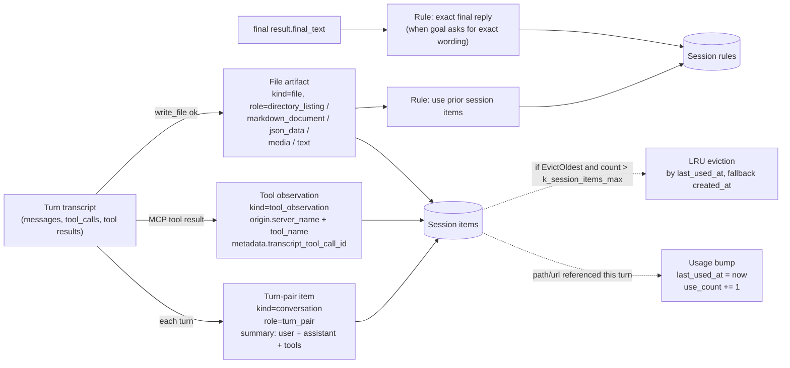
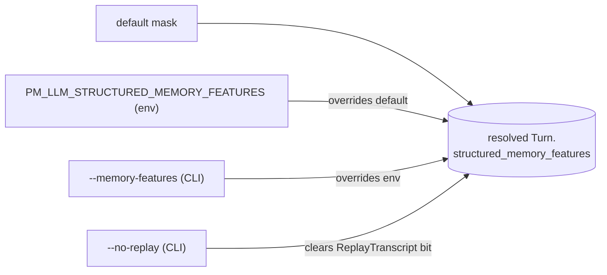

# LLM agent memory — overview

Short tour of how `tanit llm agent` remembers things across turns. The same
plumbing serves the CLI, the in-app web chat, and the scheduler — they all run
on top of `media::llm::agent::run_turn` and the structured-memory module under
`src/llm/`.

**Related:** [llm/llm-next.md](llm/llm-next.md) (provider selection),
[llm/llm-tools.md](llm/llm-tools.md) (tool surface),
[llm-agent-planner.md](llm-agent-planner.md) (planner routing). Implementation:
`src/llm/agent.hpp`, `src/llm/agent.cpp`, `src/llm/agent_feature.cpp`,
`src/llm/agent_context.cpp`, `src/llm/agent_memory.cpp`,
`src/llm/agent_memory_artifacts.cpp`, `src/llm/llm_constants.hpp`,
`src/cli/pm_image_cmd_llm_agent.cpp`, `src/win/ui_next/ChatWebPanel.cpp`.

---

## 1. Mental model

A **session** holds three things, persisted to a JSON file under
`stemp/agent-memory/sessions/<session-id>.json`. The chat UI binds each
chat-web session entry in `settings.json` to one of these files via an
`agent_task_id` field, so reopening a chat in a later app run rehydrates the
same items, rules, and turn-pairs it built up before.

- **Items** — durable, referenceable nouns (files written, web pages, datasets,
  MCP observations, conversation turn-pairs). Each item carries `kind`, `role`,
  `origin`, `locator`, `summary`, `created_at`, `last_used_at`, `use_count`.
- **Instructions** (a.k.a. rules) — scoped behavioral guidance the agent
  synthesises (`rule_use_prior_session_items`, `rule_exact_final_reply`, …).
  Rules remember *verbs*; items remember *nouns*.
- **Events** — a ring-buffer of raw turn records (legacy conversation history).
  Still written for debugging, but only **replayed** into the prompt when the
  `ReplayTranscript` feature bit is set (off by default since structured memory
  carries the conversational context now).

> Key distinction: an **artifact** is a durable referenceable thing; an
> **observation** is a tool-result event. MCP calls always create an
> observation. Only sometimes they get promoted to a file/web/data artifact.

```mermaid
classDiagram
  class Session {
    +items: map<id, Item>
    +instructions: map<id, Rule>
    +events: ring<TurnRecord>
  }
  class Item {
    +id, kind, role
    +origin{type, tool_name, server_name}
    +locator{path|url|blob_ref}
    +summary, content_type, schema_hint
    +created_at, last_used_at, use_count
    +metadata
  }
  class Rule {
    +id, text, action, trigger
    +scope: session|goal|tool
    +priority: hard|soft
    +active, source_turn_id, created_at
  }
  Session "1" --> "*" Item
  Session "1" --> "*" Rule
```

---

## 2. Multi-turn lifecycle

Each call to `tanit-cli llm agent --prompt "…" --session-id S` (or each
chat-UI send on session `S`) is **one turn**: planner → main agent → tools →
final reply → memory persistence → exit. The session id is the seam that
carries memory across processes.

```mermaid
sequenceDiagram
  autonumber
  actor U as User
  participant CLI as tanit-cli<br/>llm agent
  participant Plan as Planner LLM
  participant Ctx  as build_system_prompt
  participant Main as Main agent LLM
  participant Tool as Tools<br/>(file_*, mcp_*, image_*)
  participant Mem  as agent_memory_artifacts<br/>+ agent_memory store
  participant Disk as sessions/&lt;id&gt;.json

  U->>CLI: prompt P (turn N)
  CLI->>Mem: session_load(S)
  Mem->>Disk: read items + rules + events
  Mem-->>CLI: memory_state
  CLI->>Plan: tool catalog, P, session items+rules
  Plan-->>CLI: focused tool list + goal hints

  CLI->>Ctx: items + rules + (events if ReplayTranscript)
  Ctx-->>CLI: system prompt

  loop tool-loop
    CLI->>Main: system + P + tool schemas
    Main-->>CLI: text and/or tool_calls
    alt tool call
      CLI->>Tool: invoke(args)
      Tool-->>CLI: result
    end
  end

  CLI->>Mem: on_finish(turn, transcript, result)
  Note over Mem: session_persist_artifacts_from_result<br/>(see §3)
  Mem->>Disk: write merged memory_state + event
  CLI-->>U: final reply
  CLI->>CLI: MemoryUpdate event (logged)
```

Notes:

- The planner gets a compact `## Session items` + `## Relevant rules` block
  appended to its user message (`append_planner_session_memory`,
  gated by `InjectInPlanner`).
- The main agent's system prompt prepends the same blocks
  (`append_session_items`, `append_relevant_session_rules`, in
  `agent_context.cpp`), newest-first and budgeted by
  `k_session_items_inject_chars` / `k_session_rules_inject_chars`.
- The legacy `## Conversation History` block from `turn.recent_events` is
  only injected when `ReplayTranscript` is set.

---

## 3. Memory sinks — what becomes an item or a rule

After each successful turn, `MemoryFeature::on_finish` calls
`session_persist_artifacts_from_result(session_id, user_prompt, result,
features)`. That function inspects the transcript and produces a single
merge-patch that the session store applies atomically.



Each sink is **independently gateable** by a bit in
`pm::llm::StructuredMemoryFeature` (see §4). Items use stable ids derived from
the locator/tool, so the same path written again replaces — doesn't duplicate —
its prior entry.

Item-creation defaults:

- All newly-created items start with `last_used_at = created_at` and
  `use_count = 1`.
- The bump pass scans every existing item's `locator.{path,url}` for a substring
  match against this turn's tool-call argument dumps + `final_text` (with
  backslash/slash normalisation so JSON-escaped Windows paths still match).
  Hits bump `last_used_at` and `use_count`.
- Eviction sorts by `last_used_at` (fallback `created_at`), so items that keep
  getting cited survive over noisy one-shot observations.

---

## 4. Feature flags

`Turn::structured_memory_features` is a `uint32` bitmask of
`pm::llm::StructuredMemoryFeature`. Default
(`k_default_structured_memory_features`) enables everything **except**
`ReplayTranscript`.

| Bit | Flag | What it gates |
|---:|------|---------------|
| 0  | `CaptureWriteArtifacts`  | Promote successful `write_file` to a file item / artifact |
| 1  | `CaptureMcpObservations` | Record MCP tool results as `tool_observation` items |
| 2  | `SynthesizeRules`        | Emit scoped instruction rules |
| 3  | `DedupOnWrite`           | Collapse duplicate items by stable id / locator |
| 4  | `TruncateSummaries`      | Clamp item summaries to `k_session_item_summary_chars` |
| 5  | `EvictOldest`            | LRU eviction once `k_session_items_max` is exceeded |
| 6  | `InjectItems`            | Render `## Session items` into the main system prompt |
| 7  | `InjectRules`            | Render `## Relevant session rules` into the main system prompt |
| 8  | `InjectInPlanner`        | Append items + rules block to the planner user message |
| 9  | `EmitMemoryUpdate`       | Fire an `Event::MemoryUpdate` after persisting |
| 10 | `CaptureTurnPairs`       | Record a `conversation / turn_pair` item per turn |
| 11 | `ReplayTranscript`       | Inject the legacy `## Conversation History` block from `recent_events` |

Size budgets live alongside the enum in `src/llm/llm_constants.hpp`
(`k_session_items_max = 50`, `k_session_rules_max = 20`,
`k_session_item_summary_chars = 400`, `k_session_items_inject_chars = 4000`,
`k_session_rules_inject_chars = 1500`, `k_memory_update_log_chars = 8000`).

---

## 5. Operator controls



CLI flags on `tanit-cli llm agent` (registered in
`pm_image_cmd_llm_agent.cpp`):

| Flag | Effect |
|------|--------|
| `--multi-turn` / `--single-turn` | Toggle whether session memory hydrates / persists at all |
| `--session-id <id>` | Continuity across CLI invocations |
| `--memory-features <spec>` | Override the structured-memory mask. Spec is one of: decimal/`0xHEX`; comma-separated flag names with optional `+`/`-` deltas; special tokens `all`, `default`, `none`. Examples: `0x7FF`, `CaptureWriteArtifacts,InjectItems`, `default,-ReplayTranscript`, `none,+InjectItems,+InjectRules` |
| `--no-replay` | Clear the `ReplayTranscript` bit on top of whatever mask resolved |

`PM_LLM_STRUCTURED_MEMORY_FEATURES` is the same grammar as `--memory-features`
and slots in between the default and the CLI options (the CLI flag wins). The
env var is honoured by **every** Turn entry point — CLI (`llm agent`), the
in-app chat (`ChatWebPanel`), and library embedders that call the shared
`apply_structured_memory_features_env(...)` helper — so flipping bits
applies uniformly regardless of where the agent was launched. The chat UI has
no separate `--memory-features` flag (users don't reconfigure memory bits
per-message); use the env var or rebuild with a different default mask.

---

## 6. Planner and memory handoff

The planner does not own memory, but it sees enough memory to choose the right
tool schemas. On each turn, `append_planner_session_memory` appends a compact
block containing:

- newest-first session items, especially prior turn-pairs and file artifacts;
- relevant hard/soft session rules;
- the current folder context.

The main agent then receives a richer system prompt from `agent_context.cpp`
with the same item/rule concepts. A common success path is:

1. User gives a terse follow-up such as `now as markdown report.md` or
   `and the video?`.
2. Planner sees session memory and selects the tool families needed for the
   action, for example `write_file`, `run`, or `info_lookup`.
3. Main agent uses the remembered item/rule to act without asking the user to
   repeat context.

Important distinction:

- The planner chooses **built-in path tools only** (`run`, `write_file`,
  `info_lookup`, `file_read`, etc.).
- CLI command ids, custom command ids, and MCP tool ids are not valid
  `selected_tools`. They are data the main agent discovers or invokes through
  selected tools.

Current custom-command behavior depends on this handoff. For a round like
`is the mic recording?` followed by `and the video?`, the turn-pair item says
the previous action was a status check. The planner should select `run` plus
`info_lookup`; the main agent should preserve the action (`status`) and swap
the subject to video instead of treating `video` as a missing media file.

See [llm-agent-planner.md](llm-agent-planner.md) for the detailed routing
rules and known debts around prompt-based policy.

---

## 7. Test harness and regression cases

`tests/orchestrator/test-agent.mjs` is the main live harness for structured
memory and planner routing. It writes summaries to `stemp/<case>/summary.md`
and per-round communication bundles to `stemp/agent-memory`.

Useful cases:

| Case | What it protects |
|------|------------------|
| `case-chat` | Pure conversational facts carried by turn-pair items |
| `case-dir` | Generated file path carried forward into a Markdown output |
| `case-mixed` | Chat facts plus file artifacts in the same session |
| `case-followup` | Terse file-output follow-ups and same-stem artifacts (`report.md` + `report.txt`) |
| `case-commands` | Custom command routing, status follow-ups, audio/video command execution |
| `case-agent-cli` | Nested `tanit-cli llm agent` dispatch, quiet child agents, parallel child execution |

Recent bugs these cases exposed:

- Planner selected useful tools but the main agent still asked for
  clarification on `and the video?`; fixed by making custom-command status
  follow-ups explicit in the main system context.
- `audio record --duration 5` was silently ignored because the real flag was
  `--duration-ms`; fixed with a seconds alias so common phrasing does not turn
  into an unbounded recording.
- Nested child-agent output was polluted by settings load logs; fixed by
  demoting that cache probe to `debug`.
- Parallel child-agent tests exposed PowerShell `Start-Process -ArgumentList`
  quoting issues. The harness now validates split argument-list forms as well
  as flat command strings.

---

## 8. Current debts

Structured memory works, but some behavior is still encoded as prose policy:

- Terse custom-command follow-up handling lives in prompt text rather than a
  typed intent/action resolver.
- Nested child-agent launch rules are duplicated between planner context,
  main-agent context, compact info output, and tests.
- The test harness understands concrete shell shapes such as PowerShell
  `Start-Process`; long term, child-agent launch should produce structured
  metadata that tests can validate directly.
- Some leaf CLI commands still tolerate unknown extras. Aliases such as
  `audio record --duration` are pragmatic, but stricter unknown-option handling
  would prevent silent no-op flags.

---

## 9. Code map

| File | Role |
|------|------|
| `src/llm/llm_constants.hpp` | `StructuredMemoryFeature` enum, default mask, size caps |
| `src/llm/agent.hpp` | `Turn`, `Result`, `Event`, `Event::MemoryUpdate` |
| `src/llm/agent_memory.cpp` | Session store (load / merge-patch / persist / event ring) |
| `src/llm/agent_memory_artifacts.cpp` | Turn → memory: artifact / observation / turn-pair inference, dedup, truncate, bump, LRU evict; feature-mask parser |
| `src/llm/agent_context.cpp` | System-prompt assembly: items, rules, optional conversation history |
| `src/llm/agent_feature.cpp` | `MemoryFeature::on_finish` glue + planner items/rules block |
| `src/cli/pm_image_cmd_llm_agent.cpp` | CLI entry, flag → mask resolution, MemoryUpdate logging |
| `src/win/ui_next/ChatWebPanel.cpp` | Web-chat path, same memory hooks; binds chat-web session → agent task id in `settings.json` so memory survives app restart |
| `tests/orchestrator/test-agent.mjs` | Multi-round case harness (`case-chat`, `case-mixed`, `case-dir`, `case-followup`) |

---

## 10. Inspecting a session

```bash
# Default location (case test harness, override with --cwd elsewhere):
ls stemp/agent-memory/sessions/

# Items + counts:
node -e "const j=JSON.parse(require('fs').readFileSync(process.argv[1],'utf8'));
  for(const[id,v]of Object.entries(j.memory_state?.items||{}))
    console.log(id, 'use=', v.use_count, 'last_used=', v.last_used_at, 'kind=', v.kind);
  " stemp/agent-memory/sessions/<your-session>.json

# Per-round MemoryUpdate digest (test harness only):
cat stemp/agent-memory/case-mixed-round-04-communication.json | jq .communication.memory_updates
```

The `MemoryUpdate` event payload includes `item_count`, `artifact_count`,
`instruction_count`, `bumped_items`, `evicted_items`, `evicted_rules`,
`features`, and the merged `patch` (auto-truncated to id digests when the patch
JSON exceeds `k_memory_update_log_chars`).
