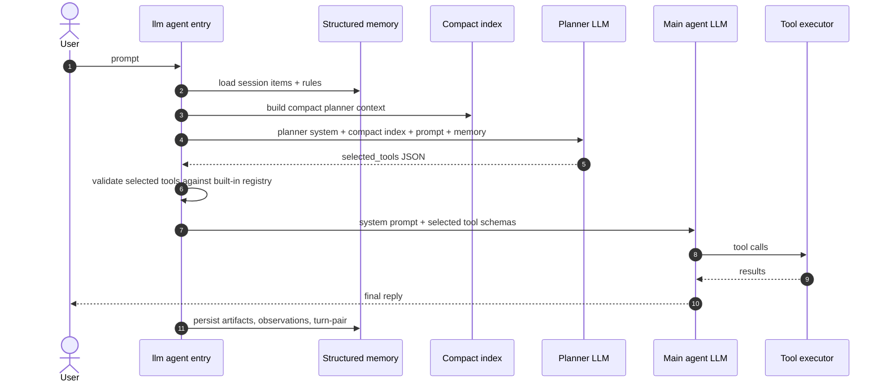

# LLM agent planner

Detailed guide to the PM-Image planner pass used by `tanit-cli llm agent`
and the in-app chat agent.

The planner is a small LLM call that runs before the main agent. It does not
answer the user. Its job is to choose which built-in path-tool schemas should
be expanded for the main agent turn.

Related docs:

- [llm-agent-memory-overview.md](llm-agent-memory-overview.md)
- [llm/llm-tools.md](llm/llm-tools.md)
- [llm/llm-next.md](llm/llm-next.md)

Implementation and fixtures:

- `src/llm/agent_feature.cpp`
- `src/llm/agent_context.cpp`
- `src/llm/llm_info_compact.cpp`
- `src/llm/path_tool_catalog.cpp`
- `src/cli/pm_image_cmd_llm_agent.cpp`
- `stemp/prompts/planner.md`
- `tests/orchestrator/test-agent.mjs`

---

## 1. Purpose

Without a planner, every agent turn would either register the whole tool
catalog or rely on a tiny generic tool summary. Both are bad:

- registering too many schemas increases latency, token use, and model
  confusion;
- registering too few schemas makes the main agent ask for clarification or
  hallucinate command syntax.

The planner solves that by turning the user goal plus compact context into a
small list of built-in tools, for example:

```json
{"selected_tools":["file_glob","write_file"],"reason":"create a directory listing file","fallback":false}
```

The selected tool names are then used to expand full schemas for the main
agent turn.

---

## 2. Lifecycle



The planner output is advisory but constrained:

- invalid tool names are dropped;
- CLI command ids such as `custom.mic-status` are not path tools and cannot be
  registered directly;
- MCP tool ids are merged separately when MCP policy enables them;
- if the planner fails, the agent falls back to a conservative tool set.

---

## 3. Inputs

The planner receives:

- a planner system prompt, normally from the compiled default or
  `--planner-prompt @path`;
- a compact PM-Image index from `llm_info_compact.cpp`;
- the user goal;
- folder context;
- structured-memory items and rules when `InjectInPlanner` is enabled.

The compact index usually includes:

- built-in command names;
- visible custom command ids;
- active preset information;
- enabled path-tool summaries;
- MCP availability summary.

It intentionally does **not** include every full schema. Full schemas are only
expanded after the planner chooses a small set.

---

## 4. Output contract

The planner must return strict JSON:

```json
{
  "selected_tools": ["run", "info_lookup"],
  "reason": "short explanation",
  "fallback": false
}
```

Rules:

- `selected_tools` contains built-in path tools only.
- Do not include `custom.*`, `tanit-cli` subcommands, or `mcp_*` names.
- Use the smallest useful set.
- Include `run` for execution intent.
- Include `write_file` when the user names a file that must be created or
  changed.
- Include `info_lookup` when the main agent needs exact PM-Image command,
  custom command, tool, MCP, or schema details.

The planner should not solve the task. It should not invent shell commands,
file contents, or final answers.

---

## 5. Routing Rules

### Files and Artifacts

Use file tools when the user asks to inspect, transform, or create files:

| User intent | Planner tools |
|-------------|---------------|
| Find files by name/pattern | `file_glob` |
| Read a known text file | `file_read` |
| Search contents | `file_search` |
| Write or update content | `write_file` |
| Copy/rename an existing artifact without changing content | `run` |

If the prompt names a target file, such as `dir.json`, `report.md`, or
`notes.txt`, the planner must select a writing path. `info_lookup` alone is
invalid because it cannot create files.

### Image and Video Tools

Only select image tools for raster images. Do not select image tools for SVG,
DXF, JSON, Markdown, source code, or plain text.

Common mapping:

- `image_understand` for visual questions about existing images;
- `image_resize` for resize/re-encode tasks;
- `image_transform` for editing existing images;
- `image_create` for text-to-image generation;
- `create_video` for AI video generation.

### Shell and Local Commands

Select `run` when the user asks to execute anything:

- build, test, npm, git, CMake, scripts;
- `tanit-cli` or `tanit-cli.exe`;
- custom commands;
- child agents;
- OS commands needed for copy/rename/inspection.

Do not select `info_lookup` alone for execution. It can discover syntax but
cannot run it.

### Lookup

Select `info_lookup` when command shape is unknown or the user asks about
PM-Image capabilities, tools, MCP, or exact syntax.

Use `info_lookup` together with `run` for custom command execution because
the compact index may show the ids but not all details the main agent needs.

### Command Creation

Select `create_command` when the user asks to **create or register a new ribbon button, context-menu entry, or CLI workflow**:

| User intent | Planner tools |
|-------------|---------------|
| Add a new ribbon button for an image operation | `create_command` |
| Register a context-menu shortcut for a CLI verb | `create_command` |
| Wrap an existing CLI command as a named preset | `create_command` |
| Create a GIMP / external-tool pipeline button | `create_command` |

Rules:

- `create_command` is only available when `FEATURE_TOOLS_COMMAND_CREATION` is compiled in; it appears in `info_lookup` results when enabled.
- Select `info_lookup` first if the exact CLI syntax for the underlying command is unknown.
- Do **not** select `run` to write commands.json by hand; `create_command` handles ID generation, safe storage, and schema validation.
- `create_command` plus `info_lookup` together covers "create a command that uses X to do Y" patterns where the syntax needs to be looked up before the entry is built.

---

## 6. Structured Memory Interaction

Memory changes both planner choice and main-agent behavior.

Examples:

- `now as dir.json` after a prior directory listing should select a writing
  path and use the newest relevant session item.
- `also as report.txt` after `report.md` should create a distinct artifact,
  not overwrite the `.md` item.
- `and the video?` after `is the mic recording?` should preserve the action
  (`status`) and swap the subject to video.

The planner sees a compact memory block. The main agent sees memory in the
system prompt. This means a planner can correctly choose `run`, but the main
agent can still fail to use it if the main system context does not explain the
follow-up pattern. `case-commands` protects this handoff.

---

## 7. Custom Commands

Custom commands are PM-Image local capabilities registered under `custom.*`.
They are invoked through the CLI, not registered as path tools.

Planner rule:

```text
custom-command intent -> selected_tools includes run and usually info_lookup
```

Main-agent execution shape:

```powershell
tanit-cli custom.mic-status
tanit-cli custom.video-status
tanit-cli custom.mic-start
tanit-cli custom.mic-stop
```

Common failures:

- selecting `custom.video-status` directly in `selected_tools`;
- selecting `info_lookup` alone for an execution request;
- hallucinating ids such as `custom.video.is-recording`;
- treating terse `and the video?` as a request for a missing video file.

The shipped planner prompt explicitly forbids custom ids in `selected_tools`
and requires `run` plus `info_lookup` for custom-command intents.

---

## 8. Child Agents

Child agents are spawned by shelling to `tanit-cli.exe llm agent`. The
planner should select `run`, and usually no `info_lookup` if the prompt already
contains the command shape.

Preferred command:

```powershell
tanit-cli.exe --log-level error llm agent --preset superfast --single-turn --prompt "..."
```

Guidelines:

- `--log-level` is a top-level option and must appear before `llm agent`.
- `--preset superfast` is the default for narrow child work.
- `--single-turn` prevents unnecessary memory/session work.
- Child prompts should be narrow and output-focused.
- Parent should scrape stdout, not stderr logs.

Current known debt: this is prompt guidance, not a typed launch abstraction.
Long term, child dispatch should be represented by an `AgentLaunchSpec` or
builder that handles preset, logging, quoting, output files, and parallel
execution.

---

## 9. Parallel Dispatch

Multiple separate `run` tool calls are serialized by the agent loop. If the
user asks for parallel agents or concurrent local commands, the main agent
must compose one shell command that starts all jobs and waits for them.

PowerShell pattern:

```powershell
$outA = "child_a_output.txt"
$outB = "child_b_output.txt"

$a = Start-Process "tanit-cli.exe" -ArgumentList "--log-level", "error", "llm", "agent", "--preset", "superfast", "--single-turn", "--prompt", '"What is 1+1? Reply with only the number."' -PassThru -RedirectStandardOutput $outA
$b = Start-Process "tanit-cli.exe" -ArgumentList "--log-level", "error", "llm", "agent", "--preset", "superfast", "--single-turn", "--prompt", '"What is 2+2? Reply with only the number."' -PassThru -RedirectStandardOutput $outB

Wait-Process -Id $a.Id, $b.Id
Get-Content $outA
Get-Content $outB
```

Important quoting details:

- In `Start-Process -ArgumentList`, pass each CLI token as a separate item.
- Do not pass `"--log-level error"` as one item.
- Prompt text with spaces should be wrapped in embedded quotes, for example
  `'\"What is 1+1? Reply with only the number.\"'`.

Bash pattern:

```bash
tanit-cli.exe --log-level error llm agent --preset superfast --single-turn --prompt "..." > /tmp/a.txt & pid_a=$!
tanit-cli.exe --log-level error llm agent --preset superfast --single-turn --prompt "..." > /tmp/b.txt & pid_b=$!
wait "$pid_a" "$pid_b"
printf 'childA='; cat /tmp/a.txt
printf 'childB='; cat /tmp/b.txt
```

Do not wrap each backgrounded command in a subshell like `(cmd &) ; wait`.
The parent shell cannot wait on jobs started inside those subshells, so it can
read empty files and trigger retry loops.

---

## 10. CLI Syntax and Unknown Options

Planner quality depends on command surfaces being easy to discover and hard to
misuse.

Recent example:

- The model emitted `audio record --duration 5`.
- The real option was `--duration-ms 5000`.
- Because the command allowed extras, `--duration 5` was ignored and the
  recording became unbounded until the run tool timed out.
- The CLI now accepts `--duration <seconds>` as a friendly alias.

The deeper debt is unknown-option tolerance on leaf commands. Aliases are good
UX, but silent extras are dangerous for agent execution. Prefer strict parsing
or explicit aliases for common natural-language forms.

---

## 11. Logging and Quiet Children

Nested agent runs should keep stderr clean. Otherwise the parent has to parse
around settings logs, HTTP logs, and debug lines.

Current mitigations:

- child commands use `--log-level error` or `--log-level off`;
- settings load cache probes are `debug`, not `info`;
- verbose LLM HTTP logs should stay at `trace`;
- run-tool logs include wall time and short stdout/stderr previews for
  diagnostics.

Longer term, quiet child-agent execution should be a first-class launch mode
instead of a collection of prompt instructions and log-level conventions.

---

## 12. Tests

Use the stemp cases to validate planner and memory behavior:

```powershell
node tests/orchestrator/test-agent.mjs --case=case-dir
node tests/orchestrator/test-agent.mjs --case=case-chat
node tests/orchestrator/test-agent.mjs --case=case-mixed
node tests/orchestrator/test-agent.mjs --case=case-followup
node tests/orchestrator/test-agent.mjs --case=case-commands
node tests/orchestrator/test-agent.mjs --case=case-agent-cli
```

Important cases:

- `case-commands` protects custom-command status routing, terse follow-ups,
  and audio/video command execution.
- `case-agent-cli` protects nested child-agent command shape, quiet logging,
  and parallel child dispatch.
- `case-followup` protects structured-memory follow-ups for generated files.

The harness records:

- per-case summaries in `stemp/<case>/summary.md`;
- per-round communication bundles in `stemp/agent-memory/*-communication.json`;
- full agent logs in `stemp/agent-memory/*-agent.json`.

---

## 13. Code Map

| File | Role |
|------|------|
| `stemp/prompts/planner.md` | Live editable planner prompt used by the test harness |
| `src/llm/agent_feature.cpp` | Runs planner, parses/validates selected tools, appends memory to planner input |
| `src/llm/agent_context.cpp` | Builds the main-agent system prompt after planner selection |
| `src/llm/llm_info_compact.cpp` | Builds compact planner context: commands, presets, tools, MCP |
| `src/llm/path_tool_catalog.cpp` | Path-tool registry and compact descriptions |
| `src/llm/tools/run/RunTool.cpp` | Shell execution, nested-agent normalization, timing/log previews |
| `src/cli/pm_image_cmd_llm_agent.cpp` | CLI flags for planner, presets, memory, logs, agent run loop |
| `tests/orchestrator/test-agent.mjs` | Live planner/memory regression harness |

---

## 14. Known Debts

The current planner path works, but the hard parts are still too prose-heavy:

- Child-agent dispatch should be a typed launch spec/builder rather than
  instructions scattered through planner prompt, main-agent context, compact
  info, and tests.
- Custom-command follow-ups should eventually be resolved by a small
  intent/action layer, not only by prompt examples.
- Test assertions should prefer structured execution metadata over shell-shape
  regexes.
- Leaf CLI commands should reject unknown flags unless they intentionally
  allow passthrough.
- Planner and main-agent guidance must be kept in sync; otherwise the planner
  can select the right tools while the main agent still ignores them.
