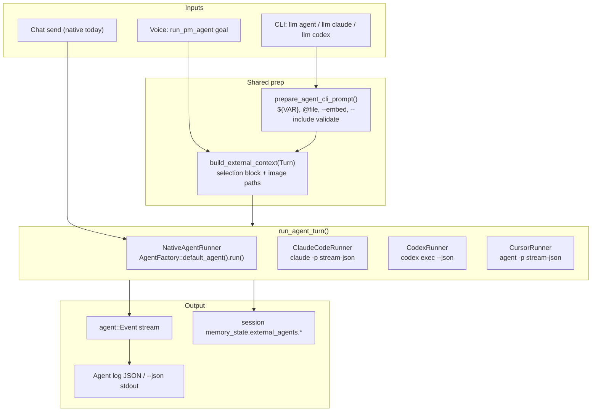
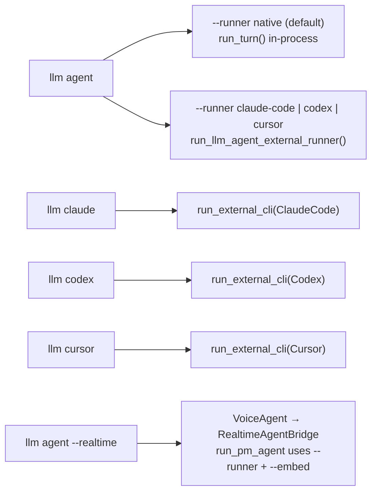
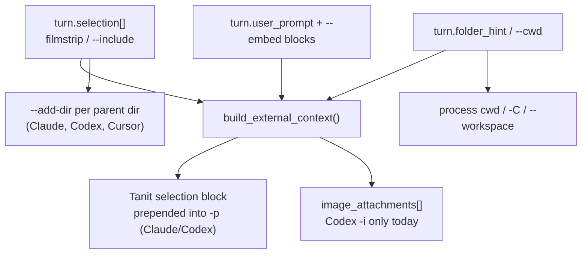

# LLM agents — native factory + external runners

Design for PM-Image / Tanit chat agents: the **native in-process loop** (`AgentFactory`) and **external CLI runners** (Codex, Claude Code, Cursor). Users switch runners from chat presets, CLI flags, or (optionally) by delegating to an external agent from a native turn via tool/MCP.

**Compile-time gates** (CMakePresets `cacheVariables`, default OFF except `dev` enables Codex):

| Flag | CLI subcommand | External binary |
|------|----------------|-----------------|
| `FEATURE_AGENT_CODEX` | `llm codex` | `codex exec --json` |
| `FEATURE_AGENT_CLAUDE` | `llm claude` | `claude -p --output-format stream-json` |
| `FEATURE_AGENT_CURSOR` | `llm cursor` | `agent -p --output-format stream-json` |

**Implementation status (2026-07-18):**

| Component | Status |
|-----------|--------|
| `run_agent_turn()` dispatch | landed |
| `agent_runner_context` (selection → prompt + `--add-dir`) | landed |
| `agent_runner_session` (Tanit session ↔ external session id) | landed (Claude resume) |
| Shared CLI prep (`--include`, `--embed`, `${VAR}`) | landed (`pm_image_cmd_llm_agent_prompt.*`) |
| Codex runner + `llm codex` CLI | landed |
| Claude runner + `llm claude` CLI | landed (stream-json NDJSON parser) |
| Claude `claude_defaults.json` (key/value flags + `${VAR}`) | landed (`agent_runner_claude_defaults.*`) |
| Claude MCP via `--mcp-config` + `strict-mcp-config` | landed (plain `mcp.json` or secure doc export) |
| Claude agent run log (`ExternalStream`, shared `agent.json`) | landed (`agent_runner_log.*`; voice + typed chat) |
| Claude cancel (voice / `stop_pm_agent` → kill process) | landed (`turn.cancel_signal` / `cancel_check`) |
| `llm agent --runner claude-code\|codex\|cursor` | landed |
| Realtime `run_pm_agent` → external runner | landed (`AgentLaunchSpec.runner`, `--embed` suffix) |
| Cursor runner + `llm cursor` CLI | implemented (needs `agent login` smoke test) |
| Chat UI preset `runner` + send path | not started (UI still calls native `run_turn()`) |
| Path tool `run_external_agent` | not started |

Related docs:

- [backup/llm-agent-factory.md](../backup/llm-agent-factory.md) — native feature stack
- [agent-launch-status.md](agent-launch-status.md) — launch resolver status
- [llm-streaming.md](llm-streaming.md) — UI streaming contract
- [mcp.md](mcp.md) — MCP wiring

Primary implementation (today):

| Layer | Files |
|-------|--------|
| Turn / events / `run_turn` | `src/llm/agent.hpp`, `src/llm/agent.cpp` |
| Feature composition | `src/llm/agent_factory.{hpp,cpp}`, `src/llm/agent_feature.cpp` |
| Launch resolution | `src/llm/agent_launch.{hpp,cpp}` |
| **External runners** | `src/llm/agent_runner.{hpp,cpp}`, `agent_runner_context.*`, `agent_runner_codex.*`, `agent_runner_claude_code.*`, `agent_runner_claude_defaults.*`, `agent_runner_log.*`, `agent_runner_cursor.*` |
| Session map | `src/llm/agent_runner_session.{hpp,cpp}` |
| CLI prompt prep | `src/cli/pm_image_cmd_llm_agent_prompt.{hpp,cpp}` |
| CLI (native + `--runner`) | `src/cli/pm_image_cmd_llm_agent.cpp` |
| CLI (external subcommands) | `src/cli/pm_image_cmd_llm_external_agent.cpp` |
| Realtime delegation | `src/llm/realtime_agent_bridge.cpp`, `realtime_voice_agent.cpp` |
| Chat UI | `src/win/ui_next/ChatWebPanel_Agent.cpp` (native only today) |
| Process spawn | `src/core/process_runner.{hpp,cpp}` |

---

## 1. Problem

We need more than one “brain” for chat:

| Runner | Role |
|--------|------|
| **Native** (`AgentFactory`) | kbot + path tools + MCP + structured memory; full Tanit integration |
| **Claude Code** (`claude -p`) | Anthropic agent loop, Edit/Bash/skills, subscription OAuth |
| **Codex** (`codex exec`) | OpenAI Codex CLI, sandbox + patch workflow, ChatGPT login |
| **Cursor** (`agent -p`) | Cursor Agent CLI (`agent` on PATH), stream-json, `--workspace` / `--trust` |

All four must:

- accept the same **user intent** (`Turn`: prompt, selection, folder),
- emit the same **`agent::Event` stream** so `ChatWebPanel` / `pmChat` need minimal branching,
- be **selectable without re-architecting** the chat UI or CLI,
- optionally be reachable as a **delegation target** (path tool or MCP) from a native turn.

---

## 2. Architecture overview

Every surface builds a **`Turn`** (prompt, selection, folder) and an **`AgentRunnerKind`**, then calls **`run_agent_turn()`**. Native and external runners share the same **`Event` → pmChat** contract; only the backend differs.



### 2.1 CLI entry points



All external paths accept **`--include`** (→ `turn.selection`) and **`--embed`** (file contents appended to prompt). Variable grammar matches native agent (`${CURRENT_SELECTION}`, `@path`, `file:path`).

### 2.2 Context pipeline



### 2.3 Session continuity

Tanit **`--session-id`** / multi-turn stores external CLI session ids under structured memory:

```json
{
  "external_agents": {
    "claude-code": { "session_id": "…" }
  }
}
```

`external_session_lookup()` / `external_session_store()` in `agent_runner_session.cpp` wire Claude **`--resume`** across CLI invocations sharing the same Tanit session id.

### 2.4 Public surface (landed)

```cpp
namespace media::llm::agent {

enum class AgentRunnerKind { Native, Codex, ClaudeCode, Cursor };

struct AgentRunnerOptions {
    AgentRunnerKind kind = AgentRunnerKind::Native;
    std::string model;
    std::string sandbox;              // Codex: read-only | workspace-write | …
    std::string approval;             // Codex/Cursor approval mapping
    std::string mode;                 // Cursor: plan | ask
    bool ephemeral = false;
    bool trust_workspace = false;
    bool skip_git_repo_check = true;
    int  timeout_ms = 600000;
    std::string resume_id;            // external session / thread id
    std::string executable_override;
};

POLYMECH_API Result run_agent_turn(
    const Turn& turn,
    const ProviderSettings& provider,   // Native: full provider; External: mostly ignored
    const AgentRunnerOptions& runner,
    EventCallback on_event = nullptr);

} // namespace
```

**File layout:**

```
src/llm/agent_runner.hpp
src/llm/agent_runner.cpp                    // dispatch by kind
src/llm/agent_runner_context.{hpp,cpp}      // build_external_context, spawn helpers
src/llm/agent_runner_session.{hpp,cpp}     // Tanit ↔ external session ids
src/llm/agent_runner_codex.{hpp,cpp}        // FEATURE_AGENT_CODEX
src/llm/agent_runner_claude_code.{hpp,cpp}  // FEATURE_AGENT_CLAUDE
src/llm/agent_runner_claude_defaults.{hpp,cpp}
src/llm/agent_runner_log.{hpp,cpp}
src/llm/agent_runner_cursor.{hpp,cpp}       // FEATURE_AGENT_CURSOR
src/cli/pm_image_cmd_llm_agent_prompt.{hpp,cpp}
src/cli/pm_image_cmd_llm_external_agent.cpp
```

Native **`run_turn()`** remains the compatibility entry for chat UI; external CLI uses **`run_agent_turn()`** directly.

### 2.5 Launch spec extension (partial)

`AgentLaunchSpec` and each chat preset carry a **`runner`** string. Preset schema is live in settings API; chat send wiring is still TODO.

```json
{
  "id": "default",
  "name": "Default",
  "runner": "native",
  "is_default": true,
  "chat": { "router": "openrouter", "model": "…" },
  "tools": { "mcp_tools_enabled": true },
  "skills": { "enabled": true }
}
```

| Field | Values | Default |
|-------|--------|---------|
| `runner` | `native`, `codex`, `claude-code`, `cursor` | `native` |
| `external.model` | CLI model string | preset / `--model` |
| `external.permission_profile` | see §4 | safe default per runner |
| `external.ephemeral` | bool | `false` |

Resolution order (today): explicit **`--runner`** → env **`PM_LLM_AGENT_RUNNER`** → preset (when UI lands) → native.

Chat send JSON (planned): `"runner": "claude-code"` alongside `preset`, `context_paths`, `folder`.

---

## 3. Context bridge (selection, cwd, embed, memory)

External CLIs have no Tanit-native `--include`. We map native **`Turn`** fields through shared helpers:

| `Turn` field | Native | Claude Code | Codex | Cursor |
|--------------|--------|-------------|-------|--------|
| `folder_hint` | system prompt + path scope | process **cwd** | `-C` / `--cd` | `--workspace` / cwd |
| `selection[]` | system prompt block | **`build_external_context`** block in `-p` + **`--add-dir`** per parent | same + **`-i`** for image paths | **`--add-dir`** + prompt block |
| `user_prompt` | user message | `-p` (includes selection preamble) | argv prompt | `-p` |
| `--embed` paths | appended in `prepare_agent_cli_prompt()` | same (via shared prep) | same | same |
| `task_id` / memory | `session_load/save` | `memory_state.external_agents.claude-code.session_id` | (resume TODO) | (resume TODO) |
| MCP | in-process | **`claude_defaults.json`** → `--mcp-config ${TEMP_DIR}/claude-mcp-config.json` + `strict-mcp-config` | `codex mcp` config (optional) | `--approve-mcps` |

Shared helper — `agent_runner_context.hpp`:

```cpp
struct ExternalContextBundle {
    std::string append_system;   // merged into user_prompt for Claude/Codex spawn
    std::string user_prompt;
    std::filesystem::path working_root;
    std::vector<std::filesystem::path> image_attachments;  // Codex -i
};
ExternalContextBundle build_external_context(const Turn& turn);
```

CLI prep — `pm_image_cmd_llm_agent_prompt.hpp`:

```cpp
bool prepare_agent_cli_prompt(const AgentPromptPrepareParams& params, std::string& err);
// Resolves ${VAR}, @file prompts, --embed file inlining, --include path validation
```

**Dual memory:** Tanit structured memory and external session files (`~/.claude`, `$CODEX_HOME`) stay separate. External ids are stored in Tanit session sidecar:

```json
{
  "external_agents": {
    "claude-code": { "session_id": "uuid-from-claude-ndjson" }
  }
}
```

---

## 4. External CLI mapping

### 4.1 Claude Code (`claude` v2.1.x)

Tanit spawns **`claude.exe`** directly (not `claude.ps1`) to avoid PowerShell stdin issues on Windows.

#### Spawn order

`build_claude_argv()` assembles flags in this order:

1. **`claude_defaults.json`** — user/project defaults (see §4.1.1)
2. **Tanit runtime flags** — always appended after defaults (later argv wins if duplicated):
   - `-p` + prompt (includes selection preamble from `build_external_context`)
   - `--output-format stream-json --verbose --include-partial-messages`
   - `--permission-mode` when `AgentRunnerOptions.approval` maps (see below)
   - `--allowedTools` for enabled Tanit MCP (`ToolSearch`, `mcp__tanit__*`, plus catalog names). `acceptEdits` does not auto-approve MCP; without this, `speak` / `info_lookup` return "requested permissions ... haven't granted".
   - `--disallowedTools` for disabled / non-selected catalog tools
   - `--model`, `--resume` when set on the turn/options
   - `--add-dir` per selection parent directory

Cancel: `proc.on_cancel_check` polls `turn.cancel_check`, `turn.cancel_signal`, then global CLI cancel — required for voice/realtime where the worker thread does not see global cancel alone.

#### CLI mapping

| Concern | Flags |
|---------|--------|
| Headless | `-p` / `--print` |
| Stream UI | `--output-format stream-json --verbose --include-partial-messages` |
| Multi-turn | `--resume` / `--session-id` (Tanit session map); `--input-format stream-json` for stdin client mode (TODO) |
| Cwd | process **cwd** = `turn.folder_hint`; extra roots via `--add-dir` |
| Context | selection block prepended into `-p`; optional `--append-system-prompt` via defaults |
| Model | `--model`, `--effort` (defaults or `--model` CLI flag) |
| Tools / consent | `--permission-mode`; Tanit always injects `--allowedTools` / `--disallowedTools` for the enabled MCP catalog (`acceptEdits` does not cover MCP) |
| MCP | `--mcp-config`, `--strict-mcp-config` via `claude_defaults.json` |
| Auth | OAuth (`/login`) or `--bare` + `ANTHROPIC_API_KEY` / `--settings` |
| Structured output | `--output-format json` + `--json-schema` |

**Approval mapping (`AgentRunnerOptions.approval` → Claude):**

| `approval` | Claude `--permission-mode` |
|------------|----------------------------|
| `never` / unset | `acceptEdits` (auto-approve workspace file writes) |
| `on-request` | `default` |
| `bypass` | `bypassPermissions` |

For locked profiles in presets/CLI, prefer setting flags in **`claude_defaults.json`** (`permission-mode`, `allowed-tools`, …) rather than `--dangerously-skip-permissions` in UI.

#### §4.1.1 `claude_defaults.json`

Shipped template: `dist/roaming/claude_defaults.json` → copied to `<config_dir>/claude_defaults.json` on first run.

**Load order (merge, later wins on same key):**

1. `<config_dir>/claude_defaults.json` (e.g. `%APPDATA%\PolyMech\tanit\`)
2. `./claude_defaults.json` in the agent working folder (`turn.folder_hint` / `--cwd`)

**Format:** key/value map — each key is a Claude flag name **without** `--`:

| Value type | CLI emitted |
|------------|-------------|
| `"some/path"` or `"${VAR}"` | `--flag resolved-value` |
| `true` | `--flag` (boolean) |
| `false` | skipped |
| `null` | skipped |
| `["a", "b"]` | `--flag a --flag b` (repeatable flags) |

Keys starting with `_` are ignored (metadata only, e.g. `_managed_by_tanit`).

**Default shipped flags:**

```json
{
  "mcp-config": "${TEMP_DIR}/claude-mcp-config.json",
  "strict-mcp-config": true,
  "add-dir": ["${CONFIG_DIR}"]
}
```

**`${TEMP_DIR}/claude-mcp-config.json`** (also `${MCP_CONFIG}` / legacy `${mcp_config}`) — written at spawn:

1. Load profile MCP (`pm://config/mcp.json` or plain `<config_dir>/mcp.json`).
2. Normalize to Claude HTTP/stdio shape and write `${TEMP_DIR}/claude-mcp-config.json`.
3. If the Claude/Codex preset asks for Tanit's auto MCP, `mcpServers.tanit` in that file is the loopback embed (`http://127.0.0.1:<port>/mcp`). Do not keep a remote `https://llm.polymech.info/mcp` server under the same name.

With **`strict-mcp-config: true`**, Claude uses only that file — not user/project MCP discovery.

**Claude Code MCP JSON shape:** HTTP servers need `"type": "http"` (or `"sse"`) alongside `"url"`. Tanit `mcp.json` entries with only `"url"` are normalized in the export. Explicit paths in `claude_defaults.json` must already include `type`.

**Other variables** use the shared command-variable system (`command_variables.hpp`): `${CONFIG_DIR}`, `${TEMP_DIR}`, `${MCP_CONFIG}`, `${CWD}`, `${CURRENT_FILE}`, `${ENV:…}`, `${PATH_DIR:…}`, plus agent context `${FOLDER}`, `${TASK_ID}`, `${SELECTION_COUNT}`, …

Implementation: `agent_runner_claude_defaults.{hpp,cpp}` — `load_claude_defaults()`, `resolve_claude_default_argv()`.

The shipped template lists all relevant `claude --help` flags with `null` / `false` as a reference; only non-empty / `true` entries are passed to the CLI.

#### §4.1.2 Stream adapter + agent log

Every NDJSON line is parsed and:

- Emitted as **`Event::ExternalStream`** (full JSON in log payload; skipped in chat UI)
- Mapped to UI events where applicable:

| NDJSON | `Event::Kind` | Notes |
|--------|---------------|-------|
| `system/init` | `TurnStarted` | captures `session_id` |
| `stream_event` / `text_delta` | `TextDelta` | |
| `stream_event` / `thinking_delta` | `Thinking` | |
| `assistant` / `tool_use` | `ToolCall` | |
| `user` / `tool_result` | `ToolResult` | `Write`/`Edit` → `write_file` envelope for artifact viewer |
| `result` | `Done` | final text + usage |

Completed runs persist **`agent.json`** via `persist_agent_run_log()` (`agent_runner_log.*`):

- Typed chat: `ChatWebPanel_Agent.cpp`
- Voice delegation: `realtime_agent_bridge.cpp` (`source: "realtime_voice"`)

Log includes the full event stream (including `external_stream` lines) for debugging and artifact extraction.

**Permission profiles (preset names — configure via `claude_defaults.json` or CLI):**

| Profile | Example `claude_defaults.json` | Use |
|---------|--------------------------------|-----|
| `read-only` | `"permission-mode": "dontAsk"`, `"allowed-tools": ["Read", "Glob", "Grep"]` | safe UI default |
| `workspace-write` | `"permission-mode": "acceptEdits"` | normal coding |
| `interactive` | `"permission-mode": "manual"` | native consent UI (phase 2) |
| `bypass` | `"permission-mode": "bypassPermissions"` or `"dangerously-skip-permissions": true` | CI/sandbox only |

### 4.2 Codex (`codex` v0.144.x)

| Concern | Flags |
|---------|--------|
| Headless | `codex exec` (alias `e`) |
| Stream UI | `--json` (JSONL stdout) |
| Multi-turn | `codex exec resume`; interactive `codex resume` |
| Cwd | `-C` / `--cd`; `--add-dir` |
| Images | `-i` / `--image` (good fit for filmstrip) |
| Model | `-m` / `--model`; `--oss` + `--local-provider` |
| Sandbox | `-s read-only \| workspace-write \| danger-full-access` |
| Approval | `-a untrusted \| on-request \| never` |
| Minimal config | `--ignore-user-config`, `--ignore-rules`, `--ephemeral` |
| Structured output | `--output-schema <file>` |
| Auth | `codex login` (ChatGPT subscription) |

**Permission profiles:**

| Profile | Codex flags |
|---------|-------------|
| `read-only` | `-s read-only -a never` |
| `workspace-write` | `-s workspace-write -a on-request` |
| `interactive` | `-s workspace-write -a on-request` + approval bridge (phase 2) |
| `bypass` | `--dangerously-bypass-approvals-and-sandbox` |

Codex JSONL schema (verified via OpenAI docs / `exec_events.rs`): `thread.started`, `turn.*`, `item.*` (`agent_message`, `reasoning`, `command_execution`, `file_change`, `mcp_tool_call`), `error`. Parser landed in `agent_runner_codex.cpp`.

### 4.3 Cursor Agent (`agent` on PATH)

Standalone binary (install separately; not bundled with `cursor` IDE shim). Headless:

```bash
agent -p "fix tests" \
  --output-format stream-json --stream-partial-output \
  --workspace /path/to/repo --trust
```

| Concern | Flags |
|---------|--------|
| Headless | `-p` / `--print` |
| Stream UI | `--output-format stream-json` + `--stream-partial-output` |
| Cwd / workspace | `--workspace <path>` (defaults to cwd) |
| Extra roots | `--add-dir` |
| Model | `--model` |
| Mode | `--mode plan \| ask`, `--plan` |
| Force / yolo | `-f`, `--yolo`, `--auto-review` |
| Sandbox | `--sandbox enabled \| disabled` |
| MCP auto-approve | `--approve-mcps` |
| Trust (headless) | `--trust` |
| Session | `--resume [chatId]`, `--continue`, `create-chat` |
| Auth | `agent login`, `CURSOR_API_KEY` |

**Note:** Cursor docs say `thinking` events are suppressed in print mode — do not expect `appendThinking` parity.

**Status:** Runner + CLI registered; needs `agent login` / `CURSOR_API_KEY` smoke test.

### 4.4 Event adapter (all → `agent::Event`)

| External event | `Event::Kind` | pmChat hook |
|----------------|---------------|-------------|
| raw NDJSON line | `ExternalStream` | log only (`agent.json`) |
| text delta | `TextDelta` | `appendAssistantDelta` |
| thinking / reasoning block | `Thinking` | `appendThinking` |
| tool_use | `ToolCall` | tool row |
| tool_result | `ToolResult` | tool output chips |
| turn/session complete + cost | `Done` | `completeAssistantText`, agent log |
| init metadata (cwd, model) | `TurnStarted` | run folder / status pill |
| fatal / auth error | `Error` | error bubble |

Claude verified NDJSON types: `system/init`, `stream_event` (`text_delta`, `thinking_delta`), `assistant`, `user` (`tool_result`), `result`.

Codex JSONL schema: `thread.started`, `turn.*`, `item.*` — parser in `agent_runner_codex.cpp`.

Artifacts: no dedicated lane in either CLI. Infer file outputs from `Write`/`Edit`/patch tool results (same as native `write_file` handling in `ChatWebPanel_Agent.cpp`).

---

## 5. User-facing switch points

Users should change runner in one place and have CLI + UI follow.

| Surface | Mechanism |
|---------|-----------|
| **Chat preset** | `runner` field in preset JSON (Settings → Chat) |
| **Composer** | optional runner pill / preset dropdown (reuse provider picker) |
| **CLI** | `--runner native\|claude-code\|codex\|cursor` on `llm agent`; dedicated `llm claude` / `llm codex` / `llm cursor` |
| **Env default** | `PM_LLM_AGENT_RUNNER=claude-code` (fallback when `--runner` unset) |
| **Voice** | `llm agent --realtime --runner …` → `RealtimeAgentBridge` delegates via `run_agent_turn()` |

Preset migration: existing presets default `runner: native` — no behavior change.

---

## 6. Delegation — tool vs MCP

Native agent can **call** an external runner without replacing the chat brain.

### 6.1 Path tool — `run_external_agent` (recommended first)

Add to path catalog (optional, gated by feature flag):

```json
{
  "name": "run_external_agent",
  "parameters": {
    "runner": { "enum": ["claude-code", "codex"] },
    "goal": { "type": "string" },
    "mode": { "enum": ["quick", "full"], "default": "quick" }
  }
}
```

Implementation: build a minimal `Turn` from current agent context (selection, folder, `goal`), call `run_agent_turn` with chosen external kind, return `{ ok, final_text, session_id, cost }` as tool result. Stream intermediate events through the **parent** callback (nested run id in payload).

Use when: native planner delegates heavy coding/refactor to Claude/Codex while keeping Tanit tools and memory authoritative.

### 6.2 MCP — expose runners to other clients

Two directions:

| Direction | Description |
|-----------|-------------|
| **Outbound** | Native agent's MCP client spawns `codex mcp-server` or Claude MCP entry as a remote tool server |
| **Inbound** | PM-Image exposes `run_external_agent` / `llm_agent` over existing MCP embed (`pm_image_mcp_embed.cpp`) with `runner` param |

Inbound fits “Cursor/Codex drives Tanit”; outbound fits “Tanit drives Codex as a tool”. Phase 3+.

### 6.3 Comparison

| Approach | Pros | Cons |
|----------|------|------|
| **Switch runner (§5)** | Full UI streaming, simple mental model | User picks one brain per chat |
| **Path tool delegate** | Native memory + external coding in one turn | Nested consent, slower, double auth |
| **MCP** | Cross-app, standard protocol | Heavier ops, stdio lifecycle, versioning |

---

## 7. Consent and cancel

| Concern | Native | External (phase 1) | External (phase 2) |
|---------|--------|--------------------|--------------------|
| Cancel | `cancel` flag + `cli_cancel` | kill process (`turn.cancel_signal` on voice path) | Claude `interrupt_receipt_v1` |
| Tool approval | `ConsentDelegate` / Win32 dialog | locked `--permission-mode` / `-a never` | Claude control protocol; Codex approval events in JSONL |
| Sandbox | SecurityGateway + AppContainer | CLI sandbox flags | map profiles to UI consent presets |

Phase 1 ships **safe locked profiles** only. Phase 2 wires Claude `control_request` / `can_use_tool` to existing `ConsentDelegateRegistry`.

---

## 8. Implementation todos

Checklist — implement top to bottom. Do not build nested tool/MCP until `run_agent_turn` + UI switch work.

### Phase 0 — Docs & types

- [x] **P0.1** Land this doc; link from [llm.md](llm.md) and [agent-launch-status.md](agent-launch-status.md).
- [x] **P0.2** Add `AgentRunnerKind`, `AgentRunnerOptions`, `run_agent_turn()` in `agent_runner.hpp`.
- [x] **P0.3** Add `runner` field to `AgentLaunchSpec` + chat preset schema (`settings_chat_presets[]`).
- [ ] **P0.4** Resolve preset `runner` in chat send + settings UI editor dropdown.

### Phase 1 — Shared infrastructure

- [x] **P1.1** `agent_runner_context.cpp` — `build_external_context(Turn)`.
- [x] **P1.2** `agent_runner_session` — persist external session id in `memory_state.external_agents`.
- [x] **P1.3** NDJSON via `ProcessRunner` captured mode + `on_output_chunk` line buffer.
- [x] **P1.4** `run_agent_turn` native path → `AgentFactory::default_agent().run()`.
- [x] **P1.5** Shared CLI prep: `--include`, `--embed`, `${VAR}` (`pm_image_cmd_llm_agent_prompt.*`).
- [ ] **P1.6** Refactor chat UI to `run_agent_turn` when preset runner ≠ native.

### Phase 2 — Codex runner

- [x] **P2.1** Spawn `codex` with `exec --json`, `-C`, `-a`, `-s`, `-i`.
- [x] **P2.2** JSONL → `Event` adapter (`thread/turn/item.*`).
- [x] **P2.3** `llm codex` CLI with `--json`, `--include`, `--embed`, `--cwd`.
- [ ] **P2.4** Smoke: `codex login` then `llm codex -p "say hi" --json`.
- [ ] **P2.5** Session resume via Codex thread id in session map.
- [ ] **P2.6** Chat UI preset `runner: codex`.

### Phase 3 — Claude Code runner

- [x] **P3.1** Resolve `claude.exe` (npm global shim → node + `.js`; Windows `.cmd` fallback).
- [x] **P3.2** Stream-json parser: `system/init`, `stream_event`, `assistant`, `result` → `Event`.
- [x] **P3.3** `llm claude` + `llm agent --runner claude-code` with `--include`, `--embed`, `--json`.
- [x] **P3.4** `--resume` / session map via `external_session_lookup/store`.
- [x] **P3.5** `claude_defaults.json` — key/value flags, `${VAR}` / `${TEMP_DIR}/claude-mcp-config.json`, MCP materialization.
- [x] **P3.6** Thinking: `thinking_delta` + assistant `thinking` blocks → `Thinking`.
- [x] **P3.7** Agent run log: `ExternalStream` + shared `persist_agent_run_log` (chat + voice).
- [x] **P3.8** Cancel: wire `turn.cancel_signal` / `cancel_check` into Claude spawn (voice/realtime).
- [ ] **P3.9** Multi-turn client mode: `--input-format stream-json` (no respawn per follow-up).
- [ ] **P3.10** Claude image attachments from selection (today: text list + `--add-dir` only).
- [ ] **P3.11** Chat UI preset `runner: claude-code`.

### Phase 4 — UI polish

- [ ] **P4.1** Status payload: expose `runner`, external auth ok (`doctor` / logged-in), session id.
- [ ] **P4.2** ChatTranscript: runner badge on agent pill (Native / Claude / Codex).
- [ ] **P4.3** Settings preset editor: runner dropdown + permission profile.
- [ ] **P4.4** Filmstrip: pass image paths to Codex `-i` automatically when runner is Codex.
- [ ] **P4.5** Agent log JSON: `runner`, `external_session_id`, `external_cost_usd`. *(partial: shared log + `ExternalStream` landed.)*

### Phase 5 — Delegation (optional)

- [ ] **P5.1** Path tool `run_external_agent` behind `FEATURE_EXTERNAL_AGENT_TOOL`.
- [ ] **P5.2** Planner prompt note: when to delegate vs native tools.
- [ ] **P5.3** MCP embed: document `runner` param on existing agent tool.
- [ ] **P5.4** Outbound MCP: optional `codex mcp-server` in `mcp.json` template. *(Claude: wired via `claude_defaults.json` + Tanit `mcp.json` / secure doc.)*

### Phase 6 — Consent bridge (optional)

- [ ] **P6.1** Claude control protocol handler → `ConsentDelegate`.
- [ ] **P6.2** Codex approval events → Win32 consent / chat inline approve.
- [ ] **P6.3** Permission profile `interactive` enabled in UI presets.

### Phase 7 — Tests & CI

- [ ] **P7.1** Unit tests: context builder, JSON line parser (fixtures, no live auth).
- [ ] **P7.2** Opt-in integration test script (`scripts/test-agent-runners.ps1`) skipped when not logged in.
- [ ] **P7.3** Document auth setup in [llm.md](llm.md) § external runners.

---

## 9. Non-goals (this track)

- Replacing native `AgentFactory` as default — native stays canonical for image/path/MCP tools.
- Merging Tanit structured memory into Claude/Codex session files automatically.
- Shipping `--dangerously-*` profiles in UI presets (CLI escape hatch only, documented).
- Rewriting `ChatTranscript.tsx` streaming protocol — external runners adapt to existing pmChat hooks.
- Node/Python SDK subprocess wrappers — direct C++ spawn only.

---

## 10. Open questions

1. **Auth UX:** surface `claude login` / `codex login` in Settings, or detect and show one-click doctor link?
2. **Preset naming:** `runner: claude-code` vs `router: claude-code` (prefer explicit `runner` to avoid conflating with OpenRouter).
3. **Parallel agents:** external runners are heavier — cap concurrent Claude/Codex runs at 1 per chat session?
4. **Codex git check:** pass `--skip-git-repo-check` when `folder_hint` is outside a repo?
5. **Bare vs full Claude:** resolved for MCP — defaults use `--mcp-config ${TEMP_DIR}/claude-mcp-config.json` + `strict-mcp-config` (Tanit MCP authoritative). Set `"bare": true` in `claude_defaults.json` for minimal/CI runs.

---

## 11. CLI examples

Requires matching **`FEATURE_AGENT_*`** ON at compile time (see CMakePresets `dev`). Binary name below is **`tanit`** (local build / npm script).

### 11.1 Native agent (default)

```bash
# Selection + embedded file context (same prep for all runners)
tanit-cli llm agent -p "Summarize the selection" \
  --include ./photos/IMG_001.jpg \
  --embed ./notes/context.md \
  --cwd .

# Variable grammar (explorer-style paths from shell)
tanit-cli llm agent -p "Edit ${CURRENT_FILE}" --include "${CURRENT_SELECTION}" --json
```

### 11.2 External runner via `llm agent --runner`

```bash
# Claude Code — selection flows like --include; embed inlined into prompt
tanit-cli llm agent --runner claude-code \
  -p "Review these files and suggest renames" \
  --include ./src/foo.cpp ./src/bar.hpp \
  --embed ./SPEC.md \
  --cwd . \
  --json

# Codex
tanit-cli llm agent --runner codex \
  -p "Describe the image" \
  --include ./photo.jpg \
  --json

# Env default when --runner omitted on supported surfaces
set PM_LLM_AGENT_RUNNER=claude-code
tanit-cli llm agent -p "hello" --json
```

### 11.3 Dedicated external subcommands

Same prep as `llm agent --runner`, but targets one backend directly:

```bash
tanit-cli llm claude -p "What changed in the selection?" \
  --include ./src/main.cpp \
  --embed ./TASK.md \
  --cwd . \
  --json

tanit-cli llm codex -p "Run a quick read-only review" \
  --include ./src \
  -s read-only \
  --json

tanit-cli llm cursor -p "Fix failing tests" \
  --include ./tests \
  --trust \
  --json
```

### 11.4 Multi-turn / session resume (Claude)

```bash
# First turn — capture session_id from JSON output
tanit-cli llm agent --runner claude-code \
  -p "Start a refactor plan" \
  --session-id my-task \
  --json

# Second turn — auto-resumes Claude session from Tanit memory
tanit-cli llm agent --runner claude-code \
  -p "Now implement step 1" \
  --session-id my-task \
  --json

# Or pass external id explicitly
tanit-cli llm claude -p "continue" --resume "<claude-session-id>" --json
```

### 11.5 Realtime voice + external brain

```bash
# Live voice session; spoken goals delegate to Claude with filmstrip context
tanit-cli llm agent --realtime \
  --runner claude-code \
  --include ./selection \
  --embed ./brief.md \
  --cwd .

# Optional seed prompt after connect
tanit-cli llm agent --realtime --runner claude-code \
  -p "User is reviewing the photos in the selection folder"
```

`--embed` is appended to each **`run_pm_agent`** goal (not merged into the voice seed). **`--include`** validates before the session starts and is passed on each delegation via the bridge context provider.

### 11.6 Raw external CLI (debug)

**Codex one-shot:**

```bash
codex exec --json -a never -s read-only -C "C:\path\to\folder" -i "photo.jpg" "Describe the selection"
```

**Claude one-shot:**

```bash
claude -p "Describe these files" \
  --output-format stream-json --verbose --include-partial-messages \
  --permission-mode dontAsk \
  --add-dir "C:\path\to\folder"
```

**Cursor one-shot:**

```bash
agent -p "Describe these files" \
  --output-format stream-json --stream-partial-output \
  --workspace "C:\path\to\folder" --trust
```

### 11.7 Claude defaults (`claude_defaults.json`)

Edit `<config_dir>/claude_defaults.json` or add `./claude_defaults.json` in the project to override. Example — tighten tools and add a system prompt append:

```json
{
  "mcp-config": "${TEMP_DIR}/claude-mcp-config.json",
  "strict-mcp-config": true,
  "permission-mode": "dontAsk",
  "allowed-tools": ["Read", "Glob", "Grep", "Edit", "Write", "Bash"],
  "append-system-prompt": "Prefer small, reviewable diffs.",
  "add-dir": ["${CONFIG_DIR}", "${CWD}"]
}
```

Use `"bare": true` to disable Claude auto-discovery (skills, CLAUDE.md, keychain OAuth) — pair with explicit `--settings` / API key for CI.

---

## 12. Quick reference — spawn sketches

See **§11.6** for raw external CLI invocations. Tanit wraps spawn + parsing in `agent_runner_*.cpp` and `process_runner`.

---

## 13. Success criteria

- User selects **Codex** or **Claude Code** in chat preset → next send streams text/tools/thinking into existing transcript UI. *(CLI + realtime landed; chat UI TODO.)*
- `tanit-cli llm agent --runner claude-code -p "..." --include x.jpg --embed notes.md` exits 0 and prints JSON with `external_session_id` when `--session-id` is set.
- `tanit-cli llm claude -p "..." --include … --embed … --json` uses the same selection/embed prep as native agent.
- Claude runs load `<config_dir>/claude_defaults.json` (MCP + `${VAR}` substitution) before Tanit runtime flags.
- Voice/typed Claude runs persist full NDJSON stream in session `agent.json` (`ExternalStream` events).
- Switching preset back to **Native** requires no chat session reset.
- Optional `run_external_agent` tool lets native agent delegate without forking the architecture.
