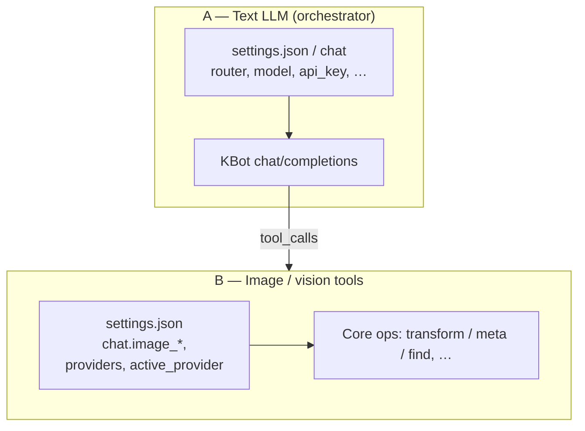
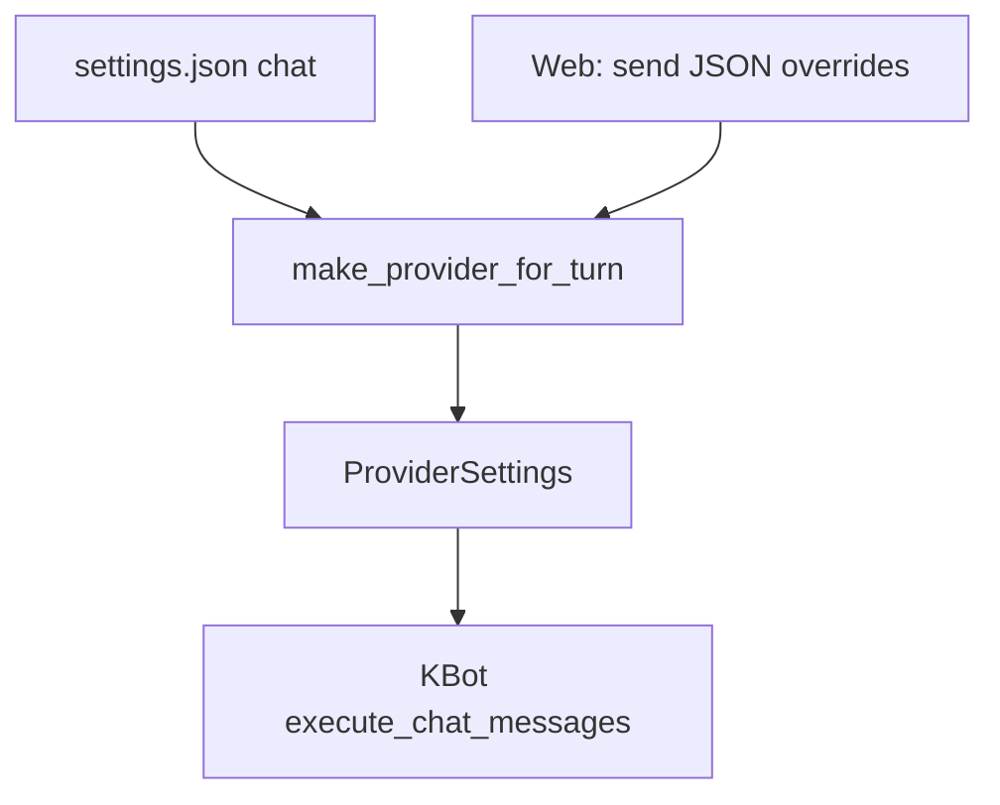
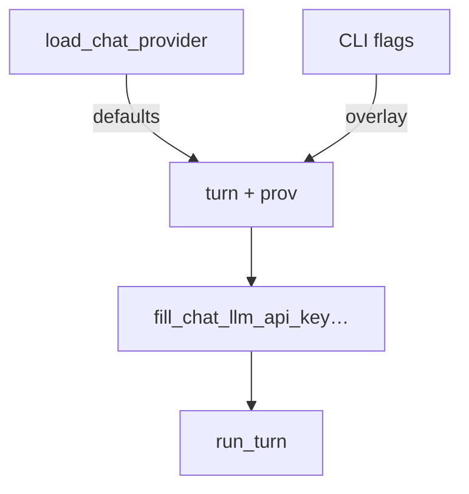
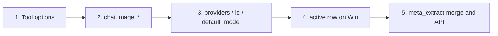
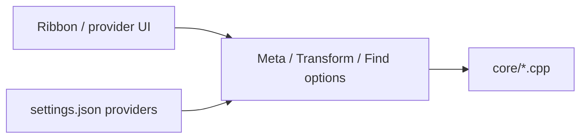

# LLM agent / chat: provider and model selection

This note describes how **conversational** (text) provider settings and **image/vision** tool provider settings are chosen in:

- `tanit llm agent` (CLI)
- In-app **web chat** (`FEATURE_CHAT_WEB`) and **native chat** (`CChatView`)
- Path tools (`image_transform`, `image_create`, `image_meta`, …) used by the same `media::llm::agent::run_turn` loop

**Related:** [llm-tools.md](llm-tools.md) (tool surface), [llm.md](llm.md) (add-op playbook). Implementation: `src/llm/agent.cpp`, `src/llm/path_tool_executor.cpp`, `src/cli/pm_image_cmd_llm_agent.cpp`, `src/cli/pm_image_cli_helpers.cpp`, `src/core/app_image_provider.cpp`, `src/win/ui_next/ChatWebPanel.cpp`, `src/win/ui_next/ChatPanel.cpp`, `src/win/settings_store.*`.

---

## 1. Two independent stacks

| Layer | What it drives | Settings source | In code (names may vary) |
|-------|------------------|-----------------|---------------------------|
| **A. Chat / text LLM** | `polymech::kbot::LLMClient` — the model that *calls* tools | `settings.json` → `chat` block (`router`, `model`, `api_key`, `base_url`, `timeout_ms`, `max_iterations`) | `ProviderSettings` in `src/llm/agent.hpp`; built by `make_provider_for_turn` (app) or `pm_image_cmd_llm_agent` (CLI) |
| **B. Image / vision tools** | `image_transform`, `image_create`, `image_meta`, `image_find` model backends (Google, Replicate, …) | Same `settings.json`, but **`chat.image_provider` / `chat.image_model`**, `providers[…].*`, and `active_provider` | `TransformOptions` / `MetaOptions`; defaults via `apply_image_ai_cli_defaults_from_app` (CLI) and `apply_chat_image_defaults_for_tool_options` (in-process agent) — **same resolution order** on Windows |

Layer **A** does **not** set layer **B**. A user can talk to Claude on OpenRouter (A) while `image_meta` uses Gemini or Replicate (B) from the image block.

---

## 2. Layer A — text LLM: chat, web, CLI

Behavior is **aligned** so the in-app experience matches `llm agent`.

### 2.1 In-app (native + WebView2)

1. **Load** `media::settings::load_chat_provider` → `settings.json` under `chat`.
2. **Build** `media::llm::agent::ProviderSettings`:
   - `router` — default `openrouter` if missing.
   - `model` — default `openai/gpt-4o-mini` if missing.
   - `timeout_ms` / `max_iterations` — sensible floor defaults.
3. **Web only:** the JSON from **Send** may override `router` / `model` for a single turn; changing `router` away from the saved one clears `base_url` so the kbot default for that router applies.
4. **API key** comes only from the saved `chat` block (no process-environment fallbacks in the in-app UIs).

### 2.2 CLI `tanit llm agent`

1. Start from **the same** `load_chat_provider` (via `media_cli_settings` bridge).
2. **Overlay** CLI flags (`--router`, `--model`, `--api-key`, …) when the user passed them; otherwise keep the saved `chat` values.
3. **Guards** empty router/model to `openrouter` / `openai/gpt-4o-mini` as in the app.
4. **Key fill:** `media_cli::fill_chat_llm_api_key_from_app_settings` if `--api-key` is empty (walks `providers` / active provider keys).

**Invariant:** with no CLI overrides, the CLI and the app read the same `settings.json` `chat` object.

---

## 3. Layer B — image/vision: CLI vs agent tools

The **`pm image` CLI** and the **in-process agent** (path tools in native/web chat) use the same rules to resolve **`provider` and `model` for image tools**, so both stay aligned after you edit `settings.json`.

### 3.1 Where it lives

| Function | File | Who calls it |
|----------|------|----------------|
| `apply_image_ai_cli_defaults_from_app` | `src/cli/pm_image_cli_helpers.cpp` | `pm image meta`, `transform`, `find` CLI, etc. |
| `apply_chat_image_defaults_for_tool_options` | `src/llm/path_tool_executor.cpp` | `do_meta`, `do_transform`, `do_image_create`, … for **path** tools in `run_turn` |
| `fill_image_provider_credentials_from_app` | `src/core/app_image_provider.cpp` | API key + base_url for a chosen image `provider` |
| `merge_image_provider_credentials` | `src/core/settings_portable.cpp` | Inside `meta_extract` / buffer meta — merges key + can switch to Replicate if Google has no key |

`load_chat_provider` **clears** `image_provider` / `image_model` in memory when those keys are **absent** from JSON, so a stale struct default (`replicate`) is not used as a fake “user pick”; the chain can fall through to `active_provider` / `get_active_image_provider` (see source comments in `path_tool_executor.cpp` and `settings_store.cpp`).

### 3.2 Resolution order (Windows, matches CLI)

For each path-tool call, look at the tool’s `options` JSON. Treat a present `provider` or `model` string as a **per-call override** (from the model or user), matching CLI “user set” flags.

1. **`options.provider` / `options.model`** in the tool call, if set.
2. **`settings.json` → `chat.image_provider` / `chat.image_model`**, if the corresponding key is still empty after (1) and the saved value is non-empty.
3. If **`model`** is still empty but **`provider`** is set: `providers[provider].default_model` from `settings.json`.
4. If **either** is still empty: **active image provider** row (same as `get_active_image_provider` / `try_load_active_image_provider_from_app` — the `providers[active_provider]` entry with `api_key` / `default_model` / `base_url`).

**Non-Windows (portable) agent:** steps 1–3, without the active-image row (CLI matches this split in `apply_image_ai_cli_defaults_from_app`).

`image_meta` has an extra **repair** step: if the resolved `provider` is `google` but the model string still looks like a **Replicate**-style `org/slug` without a Gemini id, the code can replace the model with `providers.google.default_model` so the direct **Gemini** endpoint is not given a Replicate model id (see `repair_meta_google_model_if_replicate_slug` in `path_tool_executor.cpp`).

Steps are applied in order: each step only fills fields that are **still** empty, except the tool always wins when it sets `provider` / `model` in `options` (see code).

### 3.3 Ribbon / batch “commands”

**Meta / transform / find** from the main window use **per-dialog** or **batch** state (provider, model, paths) and pass `MetaOptions` / `TransformOptions` built in UI code. They are **not** the same struct path as the agent’s JSON tools, but they use the same **core** workers (`media::meta_extract`, `transform_image`, …) and the same **credential** helpers from `app_image_provider` for keys when the UI leaves them empty.

---

## 4. Quick reference: what to edit in `settings.json`

| You want to change | Edit |
|--------------------|------|
| Default **chat** model (Claude, GPT, …) | `chat.model`, `chat.router`, `chat.api_key` |
| Default **image** tool **provider** (e.g. `google` vs `replicate`) | `chat.image_provider` (optional; if omitted, chain uses `providers` / `active_provider`) |
| Default **image** model id for that provider | `chat.image_model` **or** `providers.<id>.default_model` |
| Which `providers` row is “active” for generic API key / active-image fallback | `active_provider` |
| Keys and base URLs for each provider | `providers.<id>.{api_key, base_url, default_model}` |

---

## 5. Single sentence invariant

> **In-process agent path tools** use the same defaulting rules as **`pm image` CLI** (via `apply_chat_image_defaults_for_tool_options` mirroring `apply_image_ai_cli_defaults_from_app`); the **orchestrating** LLM is always configured from **`chat` only** and does not imply an image `provider` unless the **tool** arguments or `chat.image_*` + `providers` provide it.
