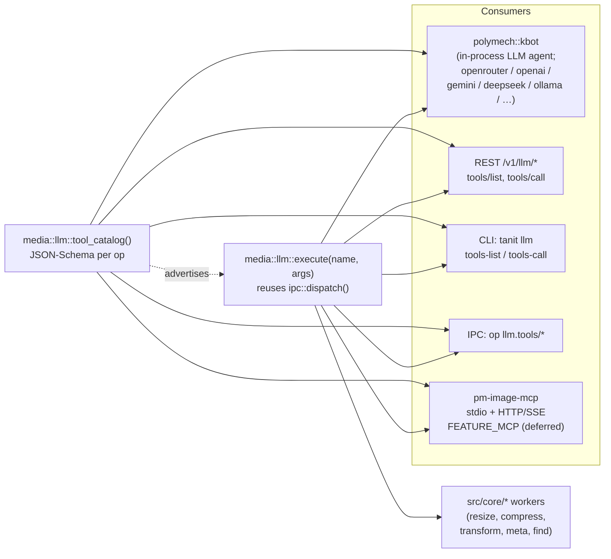

# LLM Tools — tanit ops as agent-callable functions

This document describes how the `tanit` core operations (`resize`,
`compress`, `transform`, `meta`, `find`) are exposed as **LLM tools** —
JSON-schema-described functions that an agent (OpenAI Responses, Gemini
function-calling, an MCP client, …) can invoke directly.

> Reading order if you are unfamiliar with the codebase:
> [api-dev.md](api-dev.md) (high-level), [api-rest.md](api-rest.md) (REST contract),
> [api-uds.md](api-uds.md) (IPC envelope), [llm.md](llm.md) (mechanical playbook for
> adding a new core op), [mcp.md](mcp.md) (MCP server, gated by `FEATURE_MCP`).

---

## 1. Why this layer exists

The tanit core is already tool-shaped. Every operation has:

| Property | Where | Why it matters for tools |
|---|---|---|
| Strongly-typed options struct | `media::<Op>Options` in `src/core/<op>.hpp` | The union of fields *is* the JSON Schema body |
| JSON option mapper | `apply_<op>_options_from_json(j, opts)` | One canonical name → field mapping reused by REST / IPC |
| Buffer (zero-fs) variant | `<op>_buffer(...)` | Bytes-in / bytes-out matches `tool_call` semantics |
| IPC dispatch | `media::ipc::dispatch(j)` in [src/ipc/ipc_serve.cpp](../src/ipc/ipc_serve.cpp) | A name-keyed router (`{"op": "..."}` → `{ok, ...}`) |

So: **no need to rebuild — wrap.** The new `media::llm` layer is two
files: a *tool catalog* (the schemas) and a *tool executor* (the
dispatcher). Everything else (REST endpoint, MCP server, optional
in-process agent) is a thin adapter on top.

---

## 2. Architecture



**Single source of truth rule:** the tool schemas are derived from the
same `apply_<op>_options_from_json` mappers that REST and IPC use.
Adding an option in [src/core/resize.hpp](../src/core/resize.hpp) (and
its mapper) automatically becomes part of the tool surface — there is
no second copy of the parameter list to keep in sync.

---

## 3. Initial tool catalog

| Tool name | Backed by | Inputs | Output | Notes |
|---|---|---|---|---|
| `image_resize`    | `media::resize_buffer`           | base64 PNG/JPEG/WebP/…                                          | base64 image | libvips; no API key. **Action verb** (resize / shrink / fit / crop). |
| `image_compress`  | `media::compress_buffer`         | base64 image                                                    | base64 image | MozJPEG / PNG; no API key. **Action verb** (compress / optimise / web-friendly). |
| `image_transform` | `media::transform_buffer`        | base64 image + optional `reference_images[]`                    | base64 PNG | Gemini; needs `IMAGE_TRANSFORM_GOOGLE_API_KEY`. **Action verb** (enhance / edit / fix / improve / clean up / restyle / colourise / remove X / add Y). |
| `image_meta`      | `media::meta_extract_buffer`     | base64 image                                                    | structured JSON (`alt`, `description`, `tags`, …) | Gemini; needs API key. **Content question** (what is this / describe / caption / tag). |
| `image_find`      | `media::find_images`             | array of paths / globs **+ optional `reference_images[]`**      | `{matches:[…]}` | LLM judge OR plain name-mode; AI mode needs API key. **Search verb**. |

> **Action verbs go straight to their tool — do not pre-call `image_meta`.**
> The `agent.cpp` system prompt (`build_system_prompt`) and the `image_meta`
> / `image_transform` descriptions in `path_tool_catalog.cpp` collectively
> tell the model: route action verbs (enhance / edit / resize / compress)
> directly, and reserve `image_meta` for content questions. A pre-action
> meta call wastes a paid Gemini round and adds 1–3 s of latency before the
> user sees anything happen. If you observe the agent meta-then-acting in a
> chat session, the regression is in one of those two places.

> **`image_find` and reference images.** `find` accepts an optional
> `reference_images: [path, …]` (alias `references` / `reference`, also
> a single string). When present in `--llm` mode the worker reads each
> reference once, attaches them to every judge call as multimodal parts,
> and asks the LLM "does this candidate look like the reference(s)?"
> Combine with `prompt: ""` for **pure visual search**. Schema for
> `image_find` therefore lists `prompt` *and* `reference_images` as
> independently optional, but at least one must be present (the lib
> returns `{ok:false, error: "find (llm): a prompt or at least one
> --reference image is required"}` otherwise).

Each tool's parameters JSON Schema is generated programmatically from
its `<Op>Options` struct — see §5. (`resize_buffer` shipped as part of T0,
so `image_resize` is a fully zero-fs tool today, same shape as
`compress` / `transform` / `meta`.)

---

## 4. Envelope conventions

A tool call always uses the IPC envelope shape so REST, MCP, and the
in-process agent all see the same payloads.

**Request** (arguments to `execute()`):

```json
{
  "image": { "mime": "image/png", "b64": "<base64>" },
  "options": { "max_width": 1024, "format": "webp", "quality": 85 }
}
```

For ops that already accept JSON-only inputs (`image_find`), `image`
is omitted and `options` is the full options blob.

**Response** (return of `execute()`):

```json
// JSON-out (meta, find)
{ "ok": true, "result": { ... } }

// Binary-out (resize, compress, transform)
{ "ok": true, "mime": "image/png", "bytes": 12345, "b64": "<base64>" }

// Failure
{ "ok": false, "error": "human-readable message" }
```

This is **the same envelope** the IPC dispatcher already returns
(see [api-uds.md](api-uds.md)) — `execute()` is essentially
`dispatch()` plus argument validation against the schema.

---

## 5. The abstraction layer

Two new files, both pure and dependency-light (only `nlohmann::json`
plus the existing `core/*.hpp`):

### 5.1 `src/llm/tool_catalog.{hpp,cpp}`

```cpp
namespace media::llm {

struct ToolDef {
    std::string  name;           // "image_resize"
    std::string  description;    // one-liner for the agent
    nlohmann::json input_schema; // JSON Schema (draft-07) object
};

/// All tools available in this build.
POLYMECH_API std::vector<ToolDef> tool_catalog();

/// Same data as JSON ({tools:[{name, description, input_schema}, …]}).
POLYMECH_API nlohmann::json tool_catalog_json();

} // namespace media::llm
```

Each schema is hand-authored *next to* its core header (so the
schema and the `apply_<op>_options_from_json` body stay together).
A single CI test (T8 below) re-derives the recognized keys from the
mapper and asserts the schema lists them.

### 5.2 `src/llm/tool_executor.{hpp,cpp}`

```cpp
namespace media::llm {

struct ExecuteResult {
    bool        ok = false;
    std::string error;
    nlohmann::json envelope;   // {ok, mime, b64, bytes} or {ok, result}
};

/// Run a tool by name. `arguments` follows the §4 envelope.
/// Validates required fields, then delegates to media::ipc::dispatch
/// (or a direct buffer call where dispatch is not yet wired).
POLYMECH_API ExecuteResult execute(const std::string& name,
                                   const nlohmann::json& arguments);

} // namespace media::llm
```

Implementation notes:

- **Reuses the IPC dispatcher.** Maps `image_resize` → `op:"resize"`,
  etc., before forwarding. No duplicate worker glue.
- **Decodes `image.b64` once** in the executor and passes the raw
  bytes to the buffer worker — keeps the per-op layer ignorant of
  base64.
- **Errors never throw across the C ABI** — a `try/catch` wraps every
  call and converts exceptions to `{ok:false, error}`, matching the
  rule in [llm.md](llm.md) §1.

---

## 6. REST surface

Add to [src/http/serve.cpp](../src/http/serve.cpp):

### `GET /v1/llm/tools/list`

```bash
curl -s http://127.0.0.1:8080/v1/llm/tools/list | jq .tools[0]
# → {"name":"image_resize","description":"...","input_schema":{...}}
```

Returns `media::llm::tool_catalog_json()` verbatim.

### `POST /v1/llm/tools/call`

Two intakes (mirrors the existing op endpoints):

| `Content-Type` | Body |
|---|---|
| `application/json` | `{"name":"image_resize","arguments":{"image":{"mime":"image/png","b64":"…"},"options":{...}}}` |
| `multipart/form-data` | text part `name=image_resize`, text part `options={...}`, image part `file=@in.png` (and `reference*=@…` parts for transform). The endpoint base64-encodes the upload internally before calling `execute()`. |

Response is `media::llm::execute(name, args).envelope` as
`application/json` (binary outputs come back base64-encoded inside the
envelope, the same shape the IPC and MCP surfaces emit).

> Unlike `/v1/compress` & friends, `/v1/llm/tools/call` **does** accept
> `application/json` — agent clients overwhelmingly speak JSON, and the
> envelope already carries the bytes. Multipart is offered as an
> ergonomics convenience for `curl`-driven testing.

---

## 7. IPC surface

Add to [src/ipc/ipc_serve.cpp](../src/ipc/ipc_serve.cpp) `dispatch()`:

```jsonc
// list
{ "op": "llm.tools/list" }
// call
{ "op": "llm.tools/call",
  "name": "image_meta",
  "arguments": { "image": { "mime": "image/jpeg", "b64": "…" },
                 "options": { "model": "gemini-2.5-pro" } } }
```

Both return the §4 envelope. `llm.tools/list` is just a thin pass-through
of `tool_catalog_json()`; `llm.tools/call` calls `execute()` and returns
its `envelope`.

---

## 8. CLI surface (manual testing)

```bash
tanit llm tools-list
tanit llm tools-call --name image_resize --args @args.json
tanit llm tools-call --name image_meta  --image-file photo.jpg
```

`--image-file` is a CLI ergonomics flag: it reads the file, base64-encodes
it, and stuffs it into `arguments.image` before calling `execute()`. The
CLI is the *only* surface that touches a path in `--image-file`; REST,
IPC, and MCP all stay zero-fs.

---

## 9. In-process agent — `polymech::kbot`

We **do not** build a parallel agent layer on top of liboai. The repo already
ships [`packages/kbot/`](../packages/kbot/) — a router-aware LLM client built
on top of liboai that natively supports **openrouter**, **openai**,
**deepseek**, **gemini**, **ollama**, **fireworks**, **xai**, and
**huggingface**. As of this iteration, kbot is **linked into `tanit`
in-process** (no more `KBOT_EXE` spawn):

```bash
tanit kbot ai --router openrouter --model "anthropic/claude-3.5-sonnet" --prompt "..."
tanit kbot ai --router gemini     --model "gemini-2.5-pro"               --prompt "..."
tanit kbot ai --router ollama     --model "llama3.2"                      --prompt "..."
tanit kbot ai --dry --prompt "ping"     # validate options without an API call
```

The relevant types live in
[`packages/kbot/kbot.h`](../packages/kbot/kbot.h) and
[`packages/kbot/llm_client.h`](../packages/kbot/llm_client.h):

```cpp
polymech::kbot::KBotOptions opts;
opts.router  = "openrouter";          // also: openai, gemini, deepseek, …
opts.model   = "anthropic/claude-3.5-sonnet";
opts.api_key = std::getenv("OPENROUTER_API_KEY");
polymech::kbot::LLMClient client(opts);
auto resp = client.execute_chat(prompt);
// resp.success / resp.text / resp.error / resp.provider_meta_json
```

CMake wiring (already done): `add_subdirectory(packages/{logger,json,liboai,kbot})`
plus `target_link_libraries(tanit PRIVATE kbot tomlplusplus_hdr)` plus
compiling `src/cmd_kbot.cpp` into the `tanit` target. Tests should set
`OPENROUTER_API_KEY` (or whichever provider env the chosen `--router` reads
from `config/postgres.toml`) — without it, kbot's network calls return an
error envelope but the dry-run path still validates the wiring.

### Tool-calling on top of kbot — concrete next step

`LLMClient::execute_chat` is text-only today, and `liboai::ChatCompletion`
**does not yet expose** the modern `tools` / `tool_choice` parameters
(`packages/liboai/liboai/components/chat.cpp` only carries the legacy
single `function_call` API; `rg "tools|tool_choice|tool_calls"` returns
zero hits there, while the new `responses.cpp` does have them). So
adding tool-calling for chat is **two layers**:

1. **liboai** ([`packages/liboai/ROADMAP.md`](../packages/liboai/ROADMAP.md) "Now") —
   add `tools` / `tool_choice` typed parameters to
   `ChatCompletion::create` / `create_async`, extend the response parser
   to capture `message.tool_calls[]`, and add
   `Conversation::AddAssistantToolCalls` / `AddToolResult` /
   `GetLastToolCalls`. Legacy `function_call` stays untouched.
2. **kbot** — add `LLMClient::execute_chat_messages(messages, tools,
   tool_choice)` returning `LLMResponse::tool_calls`. Routing (router
   / base_url / api_key) is unchanged; the new method just exposes the
   multi-turn / multi-tool surface.
3. **Agent loop** — lives in `src/llm/agent.{hpp,cpp}` (see
   [docs/chat.md](chat.md) §6). On each `tool_calls` item, invoke either
   `media::llm::execute(name, args)` (zero-fs) **or**
   `media::llm::path::execute(name, args)` (path-mode, used by the
   in-app chat — see [docs/chat.md §5](chat.md)) and feed the envelope
   back as a `tool` message until the model stops calling tools.

That work belongs to liboai + kbot, not to `media::llm` — the
abstraction layer documented above stays the same.

The TS reference for the agent loop / catalog-of-catalogs idea lives at
[ref/llm/tools.ts](../ref/llm/tools.ts) and the per-tool function shape at
[ref/llm/fs.ts](../ref/llm/fs.ts). When we port the loop, those are the
patterns to follow.

---

## 10. Testing

`orchestrator/test-media.mjs` gains a `suiteLlmTools(rep)`:

- **Catalog round-trip** — `GET /v1/llm/tools/list` → assert tool count,
  required fields (`name`, `description`, `input_schema.type=="object"`).
- **Schema sanity** — for each tool, assert every key listed in the schema
  is also accepted by the corresponding `apply_<op>_options_from_json`
  (drives the "no drift" rule). Run a tiny option through both paths and
  compare results.
- **Per-op invocation** — POST a fixture image and assert the response
  envelope (`ok===true`, expected `mime`, `bytes ≈ b64.length * 3/4`).
  Skip `image_transform` / `image_meta` / `image_find` cleanly when the
  Google API key is absent (existing pattern in `suiteApiRest`).
- **`image_find` with reference image** — gated by
  `IMAGE_TRANSFORM_GOOGLE_API_KEY` (existing `suiteFindCli` already
  exercises the `--reference` path; the LLM-tools wrapper needs the
  same case posted via `tools/call` once the catalog wires references
  through). Asserts the worker logs `Reference loaded:` and the
  envelope is well-formed.
- **IPC parity** — same suite via the `op:"llm.tools/call"` IPC path.

Add `--llm-only` flag mirroring `--meta-only`, plus
`"test:media:llm": "node orchestrator/test-media.mjs --llm-only"`
in `package.json` and append it to `test:all`.

---

## 11. Concrete task list

- [x] **T0** — `media::resize_buffer` in [src/core/resize.hpp](../src/core/resize.hpp) + impl, mirroring `compress_buffer`.
- [x] **T1** — `src/llm/tool_catalog.{hpp,cpp}` with one `ToolDef` per op (resize, compress, transform, meta, find).
- [x] **T2** — `src/llm/tool_executor.{hpp,cpp}` decoding `image.b64` and dispatching to the buffer workers (resize / compress / transform / meta) and to `media::find_images` (paths in / matches out).
- [x] **T3** — Wired `src/llm/tool_catalog.cpp` and `src/llm/tool_executor.cpp` into `_pm_media_sources` in [CMakeLists.txt](../CMakeLists.txt); both headers `install(FILES …)` to `include/polymech/llm/`.
- [x] **T4** — `GET /v1/llm/tools/list` + `POST /v1/llm/tools/call` (JSON intake) in [src/http/serve.cpp](../src/http/serve.cpp).
- [x] **T5** — `op:"llm.tools/list"` and `op:"llm.tools/call"` arms in [src/ipc/ipc_serve.cpp](../src/ipc/ipc_serve.cpp) `dispatch()`.
- [x] **T6** — CLI: `tanit llm tools-list` + `tanit llm tools-call --name … --args @file.json [--image-file path]` in [src/main.cpp](../src/main.cpp).
- [x] **T7** — Wired `polymech::kbot` in-process: `add_subdirectory(packages/{logger,json,liboai,kbot})` + compile `src/cmd_kbot.cpp` into `tanit`. `tanit kbot ai` now runs in-process via `polymech::kbot::run_kbot_ai_pipeline` (no more `KBOT_EXE` spawn). **Deferred:** plumbing `tools` / `tool_choice` through `polymech::kbot::LLMClient::execute_chat` (today text-only). See §9 "Tool-calling on top of kbot — open question".
- [x] **T8** — `suiteLlmTools` in [orchestrator/test-media.mjs](../orchestrator/test-media.mjs); `--llm-only`; `npm run test:media:llm` (also chained into `test:all`). Covers catalog round-trip + `image_compress` over CLI / REST / IPC. AI-backed tools (`image_transform` / `image_meta` / `image_find`) are exercised by the existing `--meta-only` / `--api-only` / `--find-only` suites with the same provider env vars.
- [x] **T9** — Docs:
    - [docs/api-rest.md](api-rest.md) — `## GET /v1/llm/tools/list` + `## POST /v1/llm/tools/call` sections.
    - [docs/api-uds.md](api-uds.md) — `## op: "llm.tools/list"` + `## op: "llm.tools/call"` sections.
    - [docs/api-dev.md](api-dev.md) — one-line mention of `src/llm/` under "Layout".
    - This file (§9) revised to use `polymech::kbot` instead of a parallel liboai agent.

---

## 12. Consumers inside `tanit --ui-next`

The Windows workbench surfaces the catalog in two places (today and
soon-to-come):

| Surface | How it uses the catalog |
|---|---|
| **Find Results dock** | Not a chat UI but conceptually the same shape: the user fills the Find Settings panel (prompt, `--llm` toggle, `+ Add reference…` for the LLM judge) and clicks Run. `OnFind()` builds a `media::FindOptions` and calls `media::find_images` directly. **When the in-app chat ships, the `image_find` tool will be the LLM-callable equivalent of this exact flow** — same options, same reference images, same envelope shape. |
| **In-app chat panel** *(planned, see [docs/chat.md](chat.md))* | Will use `polymech::kbot` as the LLM client (§9), the catalog from `media::llm::tool_catalog()` as the function list, and `media::llm::execute()` as the invocation point. The chat panel's "Reveal in Explorer panel" right-click (already implemented for Find Results) is the template for how tool results route the user back into the workbench. |

Two practical implications for adding a *new* tool:

1. **Mirror the UI mode if there is one.** If a tool has a Settings-panel
   mode (Resize / Compress / Transform / Meta / Find all do), the tool's
   schema and the panel's `Read<Op>Settings` should map 1:1 — the chat
   panel will eventually echo the same flow ("[Run with current panel
   settings] → tool call").
2. **Theme awareness is out of scope for the catalog.** Tools just
   process bytes; the App Settings dialog (theme + font) and
   `pmui::theme_palette()` belong to the UI layer (see
   [llm.md](llm.md) §3 step 7). The catalog never sees a `HWND`.

---

## 13. Non-goals

- **No new image op.** This layer wraps existing workers; adding a new op is still the [llm.md](llm.md) playbook.
- **No agent loop in `media::llm`.** The catalog + executor are stateless and provider-agnostic. The agent loop lives in [`packages/kbot/`](../packages/kbot/) — the kbot lib is the single place that talks to LLM providers (openrouter / openai / gemini / …). `pm-media` itself does not link liboai; only `tanit` does (transitively, via kbot).
- **No change to existing REST / IPC / CLI contracts.** The zero-fs invariant for `compress` / `transform` / `meta` is preserved (the new endpoints add to it, they don't relax it).
- **No MCP code in this layer.** MCP lives behind `FEATURE_MCP` in a separate binary — see [docs/mcp.md](mcp.md). Implementation deferred to a follow-up iteration.
