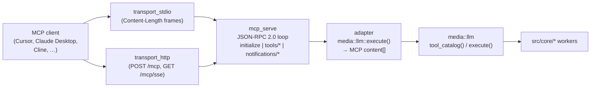

# MCP Server — `pm-image-mcp` (FEATURE_MCP)

This document describes the **Model Context Protocol** server shipped with
`tanit`. It is **opt-in** — gated behind `-DFEATURE_MCP=ON` at CMake
configure time — and lives in its own binary (`pm-image-mcp`), separate
from `tanit serve` (REST) and the IPC server.

> See first: [docs/llm-tools.md](llm-tools.md) — the `media::llm` tool
> catalog & executor that this server wraps. The MCP server is a thin
> protocol adapter; all the actual work happens in `media::llm::execute()`.

---

## 0. Shipped today vs this document

Two different surfaces share the **same tool catalog and executors**, but **not** the same wire protocol:

| Track | Wire protocol | Status | Pointers |
|-------|----------------|--------|----------|
| **Embedded MCP HTTP** | **REST:** `/v1/llm/…` + path-tools (plain JSON). **Cursor `"url"`:** MCP **Streamable HTTP** on **`/mcp`** (`POST` + `GET` SSE, session headers) backed by the agent path-tool catalog. | **Shipped** in the main `tanit` binary (default **on** at runtime; disable with `--no-mcp` or env) | `src/cli/pm_image_mcp_embed.{hpp,cpp}`, `src/cli/pm_image_mcp_streamable.{hpp,cpp}`, [End-user: embedded MCP](../public/mcp.md), `npm run test:mcp` |

**Embedded MCP env (`PM_IMAGE_MCP`):** set to `0`, `false`, `off`, or `no` to force-disable the in-process listener for that process (handy for CI and scripts that spawn `tanit` many times). Set to `1`, `true`, `on`, or `yes` to force-enable. If unset, the CLI flags `--mcp` / `--no-mcp` apply. The “listening on …” success line is printed to **stderr only when stderr is a TTY** so piping JSON is not polluted.

**LAN discovery.** When the bind address is not loopback (`--bind 0.0.0.0`, or any non-`127.0.0.1` host), the listener advertises `_tanit-mcp._tcp`. The instance name is the computer name. TXT is `txtvers=1`, `v=1`, `path=/mcp`. No secret. The phone Settings → MCP servers browse saves `http://host:port/mcp` into `mcp.json`. Loopback stays unpublished. The advertiser is the same Windows DNS-SD publisher as `_tanit._tcp` (`src/cli/lan/tanit_mdns_win.cpp`).
| **`pm-image-mcp` (below)** | **JSON-RPC 2.0** MCP (stdio `Content-Length:` framing + optional hosted HTTP/SSE) | **Not built** — requires `FEATURE_MCP=ON` and `src/mcp/*` | Sections 1–8, task **M1–M11** |

The **`/v1/llm/…`** surface is intentionally **not** JSON-RPC — it mirrors `tanit serve` for scripts. **`/mcp`** is the MCP-shaped entry point for hosts that configure **`"url"`**, and it exposes the same larger path-tool catalog used by the chat agent. The **M** tasks below still describe the **separate** `pm-image-mcp` binary (stdio + alternate HTTP layout) for a fully featured, removable MCP package.

The main binary also has a foreground `tanit mcp` command. Unlike the
background embedded listener that lives only as long as another command/session,
this command blocks until Ctrl+C and backs `/mcp` with the larger agent
path-tool catalog. `--preset` resolves the same saved chat preset/tool policy as
`llm agent`; omit it to use the default chat preset selection.

---

## 1. Scope & status

- **Opt-in.** Default `FEATURE_MCP=OFF`. When OFF, no `src/mcp/*` source
  is compiled and `pm-image-mcp` is not produced. The feature is fully
  removable.
- **Separate binary.** `pm-image-mcp` (Windows: `pm-image-mcp.exe`) —
  not a subcommand of `tanit`. This keeps the MCP protocol loop out
  of the existing `serve` / `ipc` plumbing where it would dilute the
  zero-fs contract.
- **v1 surface = `tools/*` only.** The server implements `initialize`,
  `tools/list`, `tools/call`, and `notifications/cancelled`. MCP
  *resources*, *prompts*, *sampling* and *roots* are **out of scope for
  v1** — they can be added later without changing the catalog shape.

> **Removability requirement:** if the MCP spec ever requires breaking
> the `media::llm` catalog shape (or imposes a runtime constraint that
> would force divergence from REST/IPC), we drop the feature rather than
> diverge. `git rm src/mcp/ src/mcp_main.cpp` plus deleting the
> `option(FEATURE_MCP …)` block must be a clean removal — no stragglers
> in `pm-media`, no hidden shared headers.

---

## 2. Why a dedicated server (not bolted onto REST/IPC)

| | REST `tanit serve` | IPC `tanit ipc` | MCP `pm-image-mcp` |
|---|---|---|---|
| Wire format | HTTP + multipart / JSON | line-JSON envelope | **JSON-RPC 2.0** (framed) |
| Lifecycle | stateless | stateless | **stateful** (`initialize` / capabilities / `shutdown`) |
| Notifications | none | none | **bidirectional** (`notifications/*`) |
| Transport | TCP only | TCP / Unix socket | **stdio** (canonical) + HTTP/SSE |
| Trust model | reverse-proxied microservice | parent-process IPC | one-MCP-client-per-process |

Trying to graft the MCP lifecycle onto cpp-httplib's `/v1/*` or onto the
line-JSON IPC would entangle three contracts. The cost of one extra
binary is one extra `add_executable` and ~600 LOC of self-contained
adapter code.

The **only** interface we share is `media::llm` from
[docs/llm-tools.md](llm-tools.md):



---

## 3. Transports

Both transports are built when `FEATURE_MCP=ON`; the launch mode is
chosen at CLI runtime.

### 3.1 stdio (canonical)

Used by Cursor, Claude Desktop, Cline, VS Code MCP extension, etc.
The host launches `pm-image-mcp stdio` as a child process and exchanges
JSON-RPC 2.0 messages framed LSP-style:

```
Content-Length: 137\r\n
\r\n
{"jsonrpc":"2.0","id":1,"method":"initialize", ...}
```

One process per client; the client owns the lifecycle.

Cursor / Claude Desktop **stdio** config (child process — not the same as `"url"` remote MCP):

```json
{
  "mcpServers": {
    "pm-image": {
      "command": "C:\\Program Files\\pm-image\\pm-image-mcp.exe",
      "args": ["stdio"]
    }
  }
}
```

Keys for Google-backed tools follow the **same rules as the desktop app** (saved provider settings in the user profile). Add an optional `"env": { … }` block **only** when the spawned child cannot load that profile (e.g. some CI boxes). You do **not** need a repo `.env` or `mcp.json` secrets for normal local use.

**Remote MCP via `"url"`** requires **MCP Streamable HTTP** on the configured path (e.g. another product at `http://localhost:3333/api/mcp`). PM-Image’s **embedded** listener serves **`http://127.0.0.1:<mcp-port>/mcp`** for that contract and **`/v1/llm/…`** for REST — see [Cursor mcp.json: remote url vs embedded PM-Image](../public/mcp.md#cursor-mcpjson-remote-url-vs-embedded-pm-image).

### 3.2 HTTP / SSE (hosted)

For deployments where the host language can't spawn child processes (or
where multiple clients share one server). Reuses cpp-httplib but on a
**different binary and a different port** than `tanit serve` —
`127.0.0.1:8081` by default.

```
POST /mcp           — request / response (single message)
GET  /mcp/sse       — long-lived SSE stream for server → client notifications
```

```bash
pm-image-mcp http --host 127.0.0.1 --port 8081
```

The two surfaces are interchangeable from the MCP client's perspective —
the `initialize` handshake is identical, only the framing changes.

---

## 4. Interface alignment with REST / IPC

| | MCP | REST `/v1/llm/*` | IPC `op:"llm.tools/*"` |
|---|---|---|---|
| `tools/list` data | `media::llm::tool_catalog_json()["tools"]` | `media::llm::tool_catalog_json()` | `media::llm::tool_catalog_json()` |
| `tools/call` request | `{ name, arguments }` | `{ name, arguments }` | `{ op:"llm.tools/call", name, arguments }` |
| `tools/call` result (text/JSON) | `{ content: [{ type:"text", text:"<JSON>" }], isError:false }` | the JSON envelope verbatim | the JSON envelope verbatim |
| `tools/call` result (binary) | `{ content: [{ type:"image", data:"<b64>", mimeType:"image/png" }], isError:false }` | envelope `{ok, mime, b64, bytes}` | envelope `{ok, mime, b64, bytes}` |
| Errors | `{ content: [{ type:"text", text:"<msg>" }], isError:true }` (or JSON-RPC `error` for protocol-level failures) | `{ ok:false, error:"…" }` (`200 OK` for tool errors, `4xx/5xx` for protocol) | `{ ok:false, error:"…" }` |

The translation lives in **one place** — `src/mcp/adapter.{hpp,cpp}` —
so any future change to either side is a single-file edit.

A contract test (M7 below) asserts the MCP `tools/list` payload
equals `media::llm::tool_catalog_json()["tools"]` byte-for-byte (after
sorting), so the two surfaces cannot drift silently.

---

## 5. Module layout

```
src/mcp/
  mcp_serve.hpp          # protocol loop entry points
  mcp_serve.cpp          # JSON-RPC 2.0 dispatcher: initialize, tools/*, notifications/*
  adapter.hpp
  adapter.cpp            # media::llm::ExecuteResult → MCP content[] mapping
  transport_stdio.cpp    # Content-Length framing on stdin/stdout
  transport_http.cpp     # POST /mcp + GET /mcp/sse via cpp-httplib
src/mcp_main.cpp         # entry point — selects transport from CLI
```

Nothing in `src/core/`, `src/http/`, `src/ipc/`, or `src/win/` includes
anything from `src/mcp/` (the dedicated MCP binary). The main `tanit`
binary **does** host unrelated **embedded MCP HTTP** in
`src/cli/pm_image_mcp_embed.*` (§0) — that code is not gated on
`FEATURE_MCP` and does not implement JSON-RPC MCP.

---

## 6. CMake gating

Single switch in [CMakeLists.txt](../CMakeLists.txt):

```cmake
option(FEATURE_MCP "Build the pm-image-mcp Model Context Protocol server" OFF)

if(FEATURE_MCP)
    message(STATUS "FEATURE_MCP: ON — building pm-image-mcp")
    add_executable(pm-image-mcp
        src/mcp_main.cpp
        src/mcp/mcp_serve.cpp
        src/mcp/adapter.cpp
        src/mcp/transport_stdio.cpp
        src/mcp/transport_http.cpp
    )
    target_link_libraries(pm-image-mcp PRIVATE
        pm-media
        httplib::httplib
        asio
        nlohmann_json::nlohmann_json
    )
    target_compile_definitions(pm-image-mcp PRIVATE FEATURE_MCP=1)
    target_include_directories(pm-image-mcp PRIVATE src)
    install(TARGETS pm-image-mcp RUNTIME DESTINATION bin)
else()
    message(STATUS "FEATURE_MCP: OFF — pm-image-mcp not built")
endif()
```

A guard at the top of `src/mcp/mcp_serve.cpp` rejects builds where
`media::llm` is missing (depends on T1/T2 from
[docs/llm-tools.md](llm-tools.md#11-concrete-task-list)):

```cpp
#if !__has_include("llm/tool_catalog.hpp")
#  error "FEATURE_MCP requires media::llm — see docs/llm-tools.md (T1, T2)"
#endif
```

---

## 7. Protocol coverage (v1)

| Method | Direction | Status |
|---|---|---|
| `initialize` | client → server | ✓ — replies with `{protocolVersion, capabilities:{tools:{listChanged:false}}, serverInfo:{name:"pm-image-mcp", version:…}}` |
| `notifications/initialized` | client → server | ✓ — accepted, no-op |
| `tools/list` | client → server | ✓ — returns `media::llm::tool_catalog_json()["tools"]` |
| `tools/call` | client → server | ✓ — `media::llm::execute()` + adapter |
| `notifications/cancelled` | client → server | ✓ — best-effort cancellation; long-running ops (transform/meta) ignored in v1 |
| `ping` | both | ✓ — trivial pong |
| `notifications/tools/list_changed` | server → client | ✗ — catalog is static, never emitted |
| `resources/*`, `prompts/*`, `sampling/*`, `roots/*` | — | ✗ — out of scope for v1 |

Any unknown method returns JSON-RPC error `-32601` ("method not found")
with a one-line `data.message` pointing at this doc.

---

## 8. Auth & secrets

- **stdio mode:** trusts the parent process (the host configures the
  child's environment, including `IMAGE_TRANSFORM_GOOGLE_API_KEY`). No
  in-band auth.
- **HTTP mode:** binds `127.0.0.1` by default. For LAN / hosted
  deployments, place the server behind a reverse proxy that handles auth
  (mirrors the [docs/integration.md](integration.md) recommendation for
  `tanit serve`). The MCP server itself does **not** implement
  bearer-token auth in v1 — explicitly documented as "loopback-only or
  reverse-proxy".

The Google API key follows the same env-var rule as the rest of the
codebase: `IMAGE_TRANSFORM_GOOGLE_API_KEY`. Tools that need it surface
the missing-key error through the standard envelope (`{isError:true,
content:[{type:"text", text:"…GOOGLE_API_KEY required…"}]}`).

---

## 9. Concrete task list

Split into **§9.1 Embedded HTTP** (already in tree) and **§9.2 Dedicated `pm-image-mcp`** (historical **M1–M11**).

### 9.1 Embedded MCP HTTP (`tanit`, not `FEATURE_MCP`)

- [x] **E0** — Side-car server in `src/cli/pm_image_mcp_embed.{hpp,cpp}`: cpp-httplib background thread; `GET/POST /v1/llm/tools/*` → `media::llm::{tool_catalog_json,execute}`; `GET/POST /v1/llm/path-tools/*` → `media::llm::path::{tool_catalog_json,execute}`.
- [x] **E1** — CLI flags: `--mcp` / `--no-mcp`, `--mcp-bind`, `--mcp-port`; bind defaults (Windows `0.0.0.0`, else `127.0.0.1`); port scan up to 64 ports; stderr line with effective URL (loopback hint when bound `0.0.0.0`).
- [x] **E2** — End-user documentation: [docs/public/mcp.md](../public/mcp.md).
- [x] **E3** — Smoke harness: `npm run test:mcp` → `orchestrator/test-mcp.mjs` (spawn `serve` + fixture `square-64.png` + optional `IMAGE_TRANSFORM_GOOGLE_API_KEY` for `image_create`).
- [ ] **E4** — **Drift guard:** assert embedded `GET /v1/llm/tools/list` JSON (sorted) **matches** `tanit llm tools-list` stdout (or one shared golden generator) so buffer catalog and CLI cannot diverge silently.
- [ ] **E5** — **REST parity:** either add `GET/POST /v1/llm/path-tools/*` to `tanit serve` ([serve.cpp](../../src/http/serve.cpp)) or keep path-tools **only** on embedded MCP and record the decision in [api-rest.md](../public/api-rest.md) (today: path-tools HTTP is **not** on REST).
- [ ] **E6** — **Auth:** when `--mcp-bind` is non-loopback (e.g. `0.0.0.0` on LAN), optional `--mcp-token` (bearer) or shared-secret file so the tool port is not anonymously writable.
- [ ] **E7** — **App commands bridge:** map selected `media::win::app_cmd` verbs (see `src/win/app_commands.hpp`) to documented HTTP actions or reserved pseudo-tools — only meaningful when a GUI instance owns WM_COPYDATA; spec + tests.
- [ ] **E8** — **Discoverability:** surface effective MCP base URL (bind + port from §0) in in-app Settings / About for support and power users.
- [ ] **E9** — **Rename / umbrella tests:** keep `test:mcp` for embedded; when `pm-image-mcp` exists, add `test:media:mcp` (or `test:mcp:protocol`) that runs JSON-RPC stdio + hosted suites and **skips** when binary missing (same spirit as **M8**).
- [ ] **E10** — **SSE / notifications:** long-lived progress for slow tools (`transform`, `meta`) over embedded HTTP (optional `GET …/events` or chunked) without blocking the simple POST contract.
- [ ] **E11** — **Adapter reuse:** when `src/mcp/adapter.cpp` exists (**M3**), factor shared “`ExecuteResult` → JSON for HTTP clients” helpers so embedded routes and MCP `content[]` stay aligned.
- [x] **E12** — **Settings parity for buffer LLM tools** ([tool_executor.cpp](../../src/llm/tool_executor.cpp); feeds embedded **`/v1/llm/tools/call`** and Streamable **`POST /mcp`** `tools/call`): mirror path tools + in-app agent — apply **`chat.image_provider` / `chat.image_model`** and per-row **`providers.*`** for api_key / base_url / model defaults; do **not** rely on **`ensure_google_api_key()`**-only (Google row) or **`fill_image_provider_base_url_from_app()`** driven by obsolete top-level **`active_provider`**. Factor a shared helper with [path_tool_executor.cpp](../../src/llm/path_tool_executor.cpp) so buffer and path tools cannot drift; optional follow-up: same **`chat`-over-`active_provider`** rule in [app_image_provider.cpp](../../src/core/app_image_provider.cpp) for remaining callers ([serve.cpp](../../src/http/serve.cpp), [ipc_serve.cpp](../../src/ipc/ipc_serve.cpp), CLI batch) and tighten path **`ensure_base_url_for_provider`** if it still falls back to **`active_provider`**.

### 9.2 Dedicated MCP protocol server (`pm-image-mcp`, `FEATURE_MCP`)

- [ ] **M1** — Add the `option(FEATURE_MCP …)` block (§6) to [CMakeLists.txt](../../CMakeLists.txt). Add the `__has_include` guard so the build fails fast when `media::llm` (T1/T2 from [llm-tools.md](llm-tools.md)) is missing.
- [ ] **M2** — `src/mcp/mcp_serve.{hpp,cpp}` — JSON-RPC 2.0 dispatcher with handlers for `initialize`, `notifications/initialized`, `tools/list`, `tools/call`, `notifications/cancelled`, `ping`. Plain `nlohmann::json`; ~300 LOC. No third-party MCP SDK.
- [ ] **M3** — `src/mcp/adapter.{hpp,cpp}` — `media::llm::ExecuteResult` → MCP `content[]` mapping per the §4 table.
- [ ] **M4** — `src/mcp/transport_stdio.cpp` — read/write `Content-Length:`-framed JSON-RPC on `stdin` / `stdout`. Mirror the LSP wire format. Errors go to `stderr` only (never to `stdout`, which is the protocol channel).
- [ ] **M5** — `src/mcp/transport_http.cpp` — `POST /mcp` + `GET /mcp/sse` on cpp-httplib. Default bind `127.0.0.1:8081`. Reject anything other than `127.0.0.1` unless `--allow-remote` is set (parallel to the docs above).
- [ ] **M6** — `src/mcp_main.cpp` — CLI11 wrapper:
    - `pm-image-mcp stdio`
    - `pm-image-mcp http --host 127.0.0.1 --port 8081 [--allow-remote]`
    - `pm-image-mcp --version` (used by M8 to detect availability)
- [ ] **M7** — **Protocol integration tests** for `pm-image-mcp` (distinct from embedded `test:mcp`):
    - Spawn `pm-image-mcp stdio`, send `initialize` → assert capabilities.
    - Send `tools/list` → assert payload **equals** `media::llm::tool_catalog_json()["tools"]` (sorted; compare to `tanit llm tools-list` from [llm-tools.md](llm-tools.md) T6).
    - Send `tools/call` `image_compress` with a fixture → assert `content[0].type === "image"` and `mimeType === "image/jpeg"`.
    - Repeat the suite against the **hosted** MCP HTTP/SSE transport on a chosen port.
- [ ] **M8** — `npm run test:media:mcp` (or agreed name; see **E9**). Detect availability via `pm-image-mcp --version` exit 0; **skip cleanly** when `FEATURE_MCP=OFF` (no failure — “skipped” line, same spirit as optional Google API key in media tests).
- [ ] **M9** — Docs (developer / integration):
    - Keep this file (`docs/llm/mcp.md`) as the **protocol** spec; cross-link [docs/public/mcp.md](../public/mcp.md) for embedded HTTP (§0).
    - One-line entry under “Layout” in [docs/public/api-dev.md](../public/api-dev.md) noting `src/mcp/` is `FEATURE_MCP`-gated.
    - New “MCP server” section in [docs/public/integration.md](../public/integration.md) — systemd unit + NSSM example for hosted HTTP mode; Cursor / Claude Desktop stdio snippet (§3.1).
- [ ] **M10** — Installer: in `installer.nsi`, add `pm-image-mcp.exe` to **both** `Section "Install"` and `Section "Uninstall"` — **only** when the build output contains it (CPack-style detection or NSIS define from build script when `FEATURE_MCP=ON`).
- [ ] **M11** — Decision: vendor a C++ MCP SDK vs roll our own. **Default = roll our own** — the v1 surface is small (`initialize` + `tools/*` ≈ 4 methods), the spec is stable enough, and a vendored SDK would dwarf the actual code. Revisit only if (a) `resources/*` or `sampling/*` enter v2 scope, or (b) we drift behind spec changes more than once.
- [ ] **M12** — **Path tools in MCP JSON-RPC:** decide whether `tools/call` for path-mode ops is in scope for v1 (second adapter from `path::ExecuteResult` → MCP content) or deferred to v2; if deferred, document “buffer tools only” for `pm-image-mcp` and keep path mode for embedded HTTP + in-app agent only.
- [ ] **M13** — **CI matrix row:** build at least one preset with `FEATURE_MCP=ON` in CI (Release or dev) so **M7** / **M8** are not permanently skipped on main.

---

## 10. Non-goals (v1)

- **No `resources/*`, `prompts/*`, `sampling/*`, `roots/*`.** Tools-only.
- **No bidirectional sampling.** The tanit MCP server never calls back
  into the client's LLM; if you want an agent loop, see
  `media::llm::run_agent` (`FEATURE_LIBOAI_AGENT`) in
  [docs/llm-tools.md](llm-tools.md#9-optional-in-process-agent--feature_liboai_agent).
- **No catalog hot-reload.** `notifications/tools/list_changed` is never
  emitted; the catalog is fixed at process start.
- **No bearer-token auth in HTTP mode.** Loopback-only or behind a
  reverse proxy — see [docs/integration.md](integration.md).
- **No streaming tool output.** A tool call is one request → one
  response, even for slow ops (`transform` / `meta`). Streaming may be
  added later via MCP `progress` notifications without breaking the
  current contract.

## References

https://webmachinelearning.github.io/webmcp/

https://modelcontextprotocol.io/specification/2025-11-25/server/resources