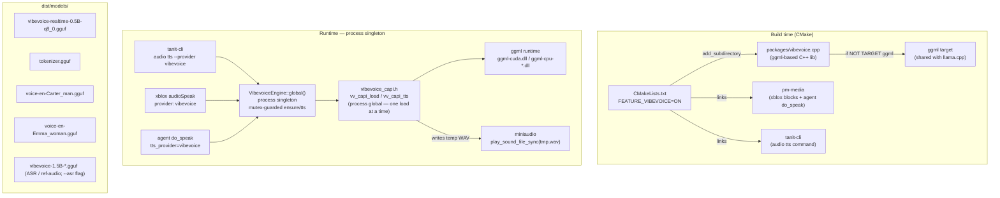
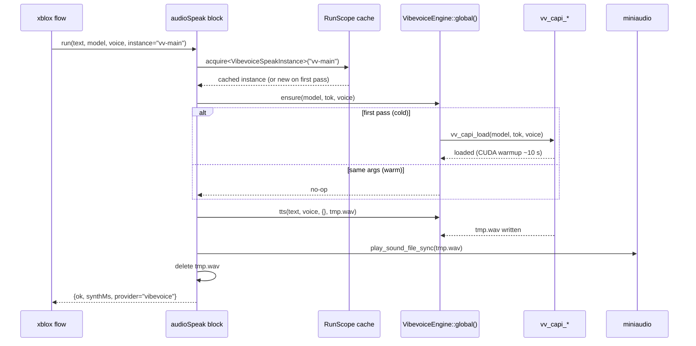

# VibeVoice — local TTS integration

VibeVoice is Microsoft's frontier text-to-speech model family, integrated as a pure C++ `ggml`-based package (`packages/vibevoice.cpp`). It shares the same `ggml` / CUDA backend already used by `llama.cpp` and `whisper.cpp` — no Python runtime, no Docker, no HTTP server.

---

## Feature flag

```
FEATURE_VIBEVOICE=ON   (default; requires FEATURE_LLAMA + FEATURE_STT)
```

Set in `CMakePresets.json` → `base` preset. Disabling either dependency auto-disables vibevoice with a CMake warning.

---

## Architecture



### Key design: `VibevoiceEngine::global()`

`vv_capi_*` is a **process global** — only one engine may be loaded at a time. `VibevoiceEngine` wraps it with a mutex and tracks which `(model, tokenizer, voice)` triple is hot. All callers (CLI, xblox blocks, agent `do_speak`) go through the singleton so they can never conflict.

The engine stays warm between calls (no unload/reload per utterance). VRAM is reclaimed by the OS on process exit (the static destructor does **not** call `vv_capi_unload` — doing so after CUDA teardown causes heap corruption).

### Audio output path

`vv_capi_tts` always writes a WAV file. All callers use **direct miniaudio playback**:

1. `ensure(model, tok, voice)` — load once, stay warm
2. Time `eng.tts(text, voice, {}, tmp_wav)` → `synth_ms`
3. Derive `audio_ms` from WAV header (sample_rate + data size, no full decode)
4. Print RTF: `synth_ms / audio_ms`
5. Copy `tmp_wav` → `--dst` if requested (file copy, no re-synthesis)
6. `play_sound_file_sync(tmp_wav)` — miniaudio decodes the WAV directly
7. Delete `tmp_wav`

This eliminates the old float32 PCM read-back, the float32 → int16 conversion, and the double-synthesis that was previously needed for RTF reporting + WAV saving.

---

## xblox call flow



---

## CLI usage

```sh
# Smoke test — play immediately
tanit-cli audio tts \
  --provider vibevoice \
  --model-id  dist/models/vibevoice-realtime-0.5B-q8_0.gguf \
  --tokenizer dist/models/tokenizer.gguf \
  --voice-id  dist/models/voice-en-Carter_man.gguf \
  --text "Hello from VibeVoice."

# Save WAV (no play)
tanit-cli audio tts \
  --provider vibevoice \
  --model-id  dist/models/vibevoice-realtime-0.5B-q8_0.gguf \
  --tokenizer dist/models/tokenizer.gguf \
  --voice-id  dist/models/voice-en-Carter_man.gguf \
  --text "Hello from VibeVoice." \
  --dst dist/tts-out/hello.wav --no-play
```

## xblox usage

```json
{
  "kind":       "audioSpeak",
  "provider":   "vibevoice",
  "model":      "dist/models/vibevoice-realtime-0.5B-q8_0.gguf",
  "tokenizer":  "dist/models/tokenizer.gguf",
  "voice":      "dist/models/voice-en-Carter_man.gguf",
  "instance":   "vv-main",
  "text":       "Hello from xblox.",
  "outputPath": "dist/tts-out/hello.wav"
}
```

### audioSpeak params (vibevoice-specific)

| param | required | description |
|---|---|---|
| `provider` | yes | `"vibevoice"` |
| `model` | yes | Path to `vibevoice-realtime-0.5B-q8_0.gguf` |
| `tokenizer` | yes | Path to `tokenizer.gguf` |
| `voice` | no | Path to `voice-*.gguf` (realtime-0.5B). Empty = model default |
| `instance` | no | Named cache key — reuses the loaded engine across loop passes. Empty = auto-keyed by model+tokenizer+voice paths |
| `outputPath` | no | Save synthesized WAV here. Empty = play only |
| `text` | no | Text to speak. Empty = PREVIOUS |

---

## Performance notes

| metric | observed (RTX 3060, realtime-0.5B q8) |
|---|---|
| First synthesis (cold — CUDA warmup) | ~10–25 s |
| Subsequent syntheses (warm engine, xblox loop) | ~2–5 s / sentence |
| RTF (warm) | < 0.5 (2× faster than real-time) |

The long cold start is **CUDA graph warmup** — a one-time cost per xblox run. Using the `instance` param ensures the warmup happens only on the first loop pass.

---

## Remaining todos

### Voice cloning (vibevoice-1.5B)

The 1.5B model does zero-shot speaker cloning from a ~5 s reference WAV. This is a different model from the realtime-0.5B already integrated:

| model | purpose | voice source |
|---|---|---|
| `vibevoice-realtime-0.5B-q8_0.gguf` | fast TTS | pre-baked `voice-*.gguf` |
| `vibevoice-1.5B-*.gguf` | quality TTS + voice cloning | reference WAV (`--ref-audio`) |

The plumbing is already wired (`--ref-audio` CLI flag, `refAudio` xblox param, `VibevoiceEngine::tts` passthrough). Remaining:

- [ ] Download the 1.5B model (`bash scripts/download-vibevoice.sh --1.5b` — to be added)
- [ ] Test `tanit-cli audio tts --provider vibevoice --model-id vibevoice-1.5B-*.gguf --ref-audio sample.wav`
- [ ] Add `vibevoice-clone` mode to `test-vibevoice.mjs` (gated on 1.5B model)

### ASR (speech-to-text — vibevoice-asr-7B)

`vv_capi_asr` requires a **separate 7B ASR model** (`vibevoice-asr-7b.gguf`), not the 1.5B TTS model. Given Whisper is already integrated and well-tested, **this is lower priority** — only worth pursuing if vibevoice-asr-7B quality is notably better on a target language.

- [ ] Benchmark vibevoice-asr-7B vs whisper-large-v3 on the test set before deciding
- [ ] If proceeding: wire `vv_capi_asr` into `tanit-cli audio record --provider vibevoice`

### Settings / app integration

- [ ] Add `vibevoice` to the TTS provider selector in App Settings (alongside `elevenlabs`, `pixlwiz`)
- [ ] Add a `--provider vibevoice` entry to the `audioSpeak` block palette defaults

### Streaming / chunked synthesis

- [ ] Investigate whether `vv_capi_*` supports streaming PCM output (sentence-at-a-time) to reduce first-audio latency for long texts
- [ ] If supported: route PCM chunks into `AudioRingBuffer` (already used by the agent's `do_speak` path) so the speaker starts playing before the full synthesis is complete

### Testing

- [ ] `tests/audio/test-vibevoice.sh --mode batch` → verify RTF < 1.0 consistently
- [ ] `test-vibevoice.mjs --mode clone` — 1.5B voice cloning (gated on 1.5B model)

---

## Completed

- [x] `--ref-audio` CLI flag + `refAudio` xblox param wired through `VibevoiceEngine::tts` (activates with 1.5B model)
- [x] `VibevoiceEngine::global()` — process singleton, mutex-guarded, shared by all callers (xblox, CLI, agent `do_speak`)
- [x] Destructor skips `vv_capi_unload` (static-destructor-after-CUDA-teardown safety)
- [x] `audio_blocks.cpp` — `VibevoiceSpeakInstance` uses the singleton; `g_vv_owner` removed
- [x] `AudioTools.cpp` — `do_speak` vibevoice path reads `vibevoice_model/tokenizer/voice` from `ChatProviderSettings`
- [x] `block_provider.hpp` — `resolve_tts` bypasses API key check for `provider=vibevoice`
- [x] `settings_types.hpp` + `chat_settings_schema.cpp` — `vibevoice_model`, `vibevoice_tokenizer`, `vibevoice_voice` fields serialised to/from JSON
- [x] CLI audio output: synthesize once → copy to `--dst` → `play_sound_file_sync(tmp)` (no double synthesis, no float32 conversion)
- [x] `tests/orchestrator/test-vibevoice.mjs` — Node harness: `--mode single` / `batch` / `loop`

---

## File map

| file | role |
|---|---|
| `packages/vibevoice.cpp/` | vendored C++ ggml TTS library |
| `packages/vibevoice.cpp/include/vibevoice_capi.h` | flat C ABI used by all integration points |
| `src/audio/tts/vibevoice_tts.hpp/.cpp` | `VibevoiceEngine` singleton + thin CLI helpers |
| `src/cli/pm_image_cmd_audio.cpp` | `audio tts --provider vibevoice` — single synthesis, direct miniaudio play |
| `src/xblox/blocks/audio_blocks.cpp` | `audioSpeak provider=vibevoice` xblox block + `VibevoiceSpeakInstance` scope cache |
| `src/llm/tools/audio/AudioTools.cpp` | `do_speak` vibevoice path (agent tool) |
| `src/xblox/blocks/block_provider.hpp` | `resolve_tts` — bypasses API key for vibevoice |
| `src/core/settings_types.hpp` | `ChatProviderSettings.vibevoice_model/tokenizer/voice` |
| `src/core/chat_settings_schema.cpp` | JSON serialisation of vibevoice settings fields |
| `CMakeLists.txt` | `FEATURE_VIBEVOICE` build wiring for `pm-media`, `tanit`, `tanit-cli` |
| `CMakePresets.json` | feature description + default ON |
| `scripts/download-vibevoice.sh` | HuggingFace model downloader → `dist/models/` (add `--1.5b` flag TODO) |
| `tests/audio/test-vibevoice.sh` | shell smoke / realtime TTS tests |
| `tests/xblox/tts-vibevoice.xblox` | sample xblox flow (one-shot + cached loop) |
| `tests/orchestrator/test-xblox-next.mjs` | `suiteAudio` — vibevoice single + loop × 2 assertions |
| `tests/orchestrator/test-vibevoice.mjs` | standalone Node harness: batch / loop / single modes |

---

## Related docs

- [`docs/audio-tts.md`](audio-tts.md) — agent TTS pipeline (ElevenLabs / pixlwiz proxy path)
- [`docs/xblox-architecture.md`](xblox-architecture.md) — xblox block runtime
- [`docs/xblox-detect-instances.md`](xblox-detect-instances.md) — cached instance pattern (videoDetect)
- [`docs/llama.md`](llama.md) — llama.cpp / ggml build and shared backend

## Examples

# Once you download vibevoice-1.5B-*.gguf:
tanit-cli audio tts \
  --provider vibevoice \
  --model-id  dist/models/vibevoice-1.5B-q4.gguf \
  --tokenizer dist/models/tokenizer.gguf \
  --ref-audio sample-speaker.wav \            # ← any voice, ~5s 24kHz mono
  --text "Hello in the cloned voice." \
  --dst out.wav

tanit-cli xblox run --log-level trace --src .\tests\xblox\tts-vibevoice.xblox
